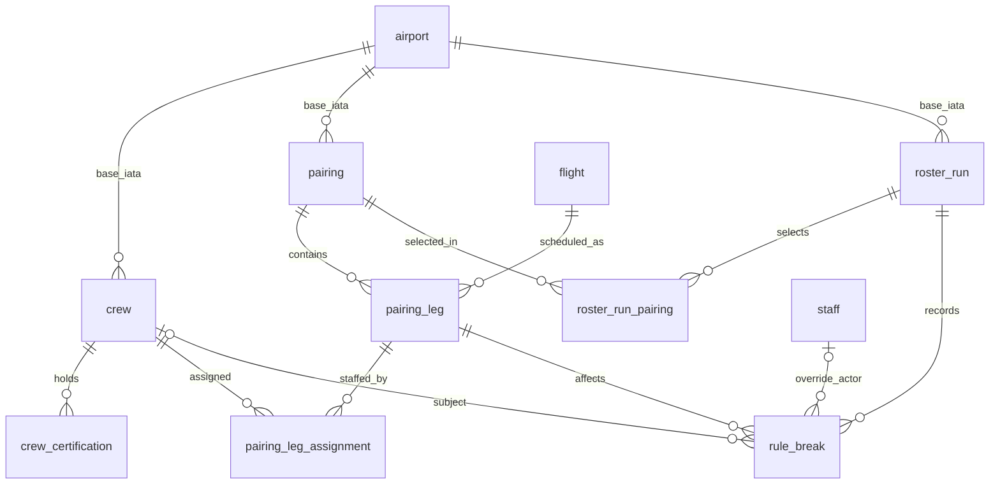

# F8 — Crew Management & Rostering (Iteration-02)

> **Status: PROPOSED DB DESIGN — NOT IN GITHUB `dev`.** Documented from Group 1’s Feature 8 Iteration-02 specification (**11 Oct 2026**) and compared with the merged Level 1 database at `dev` commit `752428e732da4e4179a5c4f7ea2c1a07bc3f6400` (checked **21 Oct 2026**). Feature 8 is **not** one of the 69 currently implemented tables; do not apply its draft SQL as an approved migration.

**Feature owner:** Group 1 — Choto and Xiang Xiang.  
**Module:** staff-web; Crew, Pairings, Roster and Fix rule breaks (mock/sample-data prototype).  
**Draft tables (10):** `crew`, `crew_certification`, `country_language`, `pairing`, `pairing_leg`, `pairing_leg_assignment`, `legality_rule`, `roster_run`, `roster_run_pairing`, `rule_break`.  
**Implemented database:** 69 tables / 640 columns (F1, F2, F4, F7, F9, F12, F15); **F8 tables implemented: 0**.

## 1. Scope and lifecycle

The feature converts Feature 2 flight schedules into up-to-three-day crew pairings starting/ending at a base, automatically assigns qualified crew, records coverage and violations, permits logged **project-defined company-rule** overrides, and publishes a roster only after open breaks are resolved. There is **no crew login, standby pool, leave/swap requests, or crew self-service in Iteration-02**. Police are represented in F8 as operational crew but travel as passengers and require integration with future F3/F6 seat and boarding logic. Feature 5 receives duty hours for future overtime calculations; Feature 13 distributes published rosters.

**Status vocabulary used throughout:** **Implemented** = found in current `dev` SQL/Prisma; **Proposed** = supplied by Group 1 but not committed; **Needs agreement** = conflicts with another feature/schema or omits a persistence requirement. Business-rule labels such as “law” and “company” below are classifications in the **project specification**, not independently verified aviation or jurisdictional rules.

### Database dependencies verified against `dev`

| Existing entity | Source feature | Actual schema / integration observation |
|---|---|---|
| `airport` | F2 | PK is **`iata_code TEXT`**, not `code`; `country TEXT` is not guaranteed ISO-3166-alpha-2 |
| `route` | F2 | `origin` and `destination` are TEXT FKs to `airport(iata_code)` |
| `flight` | F2 | `id UUID`, `flight_number`, `service_date`, `route_id`, `dep_at`, `arr_at`, `scheduled_dep_at`, `scheduled_arr_at`, `aircraft_id`, `status`; use dated flight rows, not free-form flight codes |
| `flight_event` | F2 | Events include delay, reschedule, aircraft change, diversion and cancellation; F8 listeners/handlers are **not yet implemented** |
| `aircraft` | F9 | `id UUID`, `aircraft_type_id UUID` (FK to `aircraft_type`) |
| `aircraft_type` | F9 | `id UUID`; `code TEXT` has a **partial** unique index for non-deleted rows; no dedicated cabin-crew minimum column in current SQL |
| `staff` / `user` / `role` | F1 | Ops sign-in uses existing staff identity. F8 `crew` need not be an authenticated `staff` account |
| `audit_log` | F15 | Implemented append-only log; `actor_id` is `user.id` (per SQL comment), `source_feature` may be `'8'`; action constrained to existing enum |
| F3 booking and police seat allocation | F3 | **Not present in current Level 1 SQL** — integration contract needed |
| F5 overtime, F13 notifications, F14 BI | Later waves | No corresponding F8-bound tables/contracts in current Level 1 schema; report outputs must be agreed |

## 2. Proposed entity relationships



The diagram expresses the intended logical relationships; the three `airport` FKs are **invalid in Group 1’s literal SQL until their targets are corrected**. `country_language` and `legality_rule.country_code` currently have no SQL FK to a canonical country table; the country dictionary is not implemented.

## 3. Proposed SQL data dictionary

All column names and types in the following tables come directly from the **supplied Feature 8 SQL**, not from current GitHub tables. “FK →” records the draft SQL reference even when invalid. Recommendations are identified separately below.


<a id="table-crew"></a>
### 3.1 `crew`

Crew master profile, role, home base, fleet, contact data, spoken languages and licence. Allowed roles: `captain`, `first_officer`, `cabin_crew`, `police`. This table describes operational crew, not a new Clerk login or a replacement for shared `staff`.

| Column | SQL type | Draft constraints / linkage | Meaning |
|---|---|---|---|
| `id` | `UUID` | PK; required; default `gen_random_uuid()` | Crew UUID. |
| `first_name` | `TEXT` | required | Given name. |
| `last_name` | `TEXT` | required | Family name. |
| `employee_number` | `TEXT` | required; unique | Operational employee identifier; distinct from shared `staff.staff_code`. |
| `role` | `TEXT` | required; CHECK | Captain, first officer, cabin crew or police (air marshal). |
| `date_of_birth` | `DATE` | nullable | Date of birth, if available. |
| `email` | `TEXT` | nullable | Crew contact email. |
| `phone` | `TEXT` | nullable | Crew contact phone. |
| `base_airport` | `TEXT` | required; FK → `airport(code)` | Home base airport IATA code; **proposed `airport(code)` reference is invalid against `dev`**. |
| `fleet_aircraft_type` | `TEXT` | required | Aircraft type code assigned for fleet eligibility; linkage to F9 still unresolved. |
| `languages` | `CHAR(2)[]` | required; default `'{}'` | ISO 639-1 language codes crew can speak, used for destination-local coverage. |
| `licence_number` | `TEXT` | required; unique | Licence/credential identifier; mandatory in the supplied draft even for police. |
| `licence_expires_on` | `DATE` | required | Credential expiry used by legality checks. |
| `created_at` | `TIMESTAMPTZ` | required; default `now()` | SQL default uses wall-clock `now()`; distinguish from simulated business time. |
| `updated_at` | `TIMESTAMPTZ` | required; default `now()` | SQL default set on insertion; application must maintain updates. |
| `deleted_at` | `TIMESTAMPTZ` | nullable | Soft deletion marker. |

<a id="table-crew_certification"></a>
### 3.2 `crew_certification`

Dated type ratings and other qualifications for a crew profile. For pilots, the aircraft type rating must match the operating aircraft type.

| Column | SQL type | Draft constraints / linkage | Meaning |
|---|---|---|---|
| `id` | `UUID` | PK; required; default `gen_random_uuid()` | Certification UUID. |
| `crew_id` | `UUID` | required; FK → `crew(id)` | Crew member with this qualification. |
| `name` | `TEXT` | required | Qualification type/name. |
| `aircraft_type` | `TEXT` | nullable | Type rating code where relevant; NULL for non-type certifications. |
| `expires_on` | `DATE` | required | Last date qualification remains valid. |

<a id="table-country_language"></a>
### 3.3 `country_language`

Reference mapping from a destination country to languages accepted by the project’s local-crew rule.

| Column | SQL type | Draft constraints / linkage | Meaning |
|---|---|---|---|
| `country_code` | `CHAR(2)` | required | ISO 3166-1 alpha-2 code, e.g. `JP`; requires normalized `airport.country` mapping. |
| `language_code` | `CHAR(2)` | required | ISO 639-1 language, e.g. `ja`. |

**Composite PK:** `(country_code, language_code)`.

<a id="table-pairing"></a>
### 3.4 `pairing`

Ordered trip starting and ending at a crew base; contains totals and a validation result. Overnight trips may last at most three days.

| Column | SQL type | Draft constraints / linkage | Meaning |
|---|---|---|---|
| `id` | `UUID` | PK; required; default `gen_random_uuid()` | Pairing UUID. |
| `base_airport` | `TEXT` | required; FK → `airport(code)` | Start and end airport for pairing; source draft targets nonexistent `airport.code`. |
| `day_count` | `INT` | required | Number of duty/overnight days, up to three by project rules. |
| `duty_hours` | `NUMERIC(5,1)` | required | Total measured duty hours across all duty days; not a replacement for per-duty windows. |
| `is_valid` | `BOOLEAN` | required | Pairing validity flag. |
| `invalid_reason` | `TEXT` | nullable | Human-readable pairing validation error; NULL when valid. |
| `created_at` | `TIMESTAMPTZ` | required; default `now()` | SQL insertion timestamp. |
| `updated_at` | `TIMESTAMPTZ` | required; default `now()` | SQL insertion default; application-maintained thereafter. |
| `deleted_at` | `TIMESTAMPTZ` | nullable | Soft-deletion timestamp. Avoid hard-deleting published history. |

<a id="table-pairing_leg"></a>
### 3.5 `pairing_leg`

One dated Feature 2 `flight` used as a leg of a pairing, with order and duty-day grouping.

| Column | SQL type | Draft constraints / linkage | Meaning |
|---|---|---|---|
| `id` | `UUID` | PK; required; default `gen_random_uuid()` | Pairing-leg UUID. |
| `pairing_id` | `UUID` | required; FK → `pairing(id)` | Owning pairing. |
| `flight_id` | `UUID` | required; FK → `flight(id)` | Dated scheduled flight from Feature 2. |
| `sequence_number` | `INT` | required | Order of this leg in the pairing. |
| `duty_day` | `INT` | required | Duty-day grouping within the pairing (1–3). |
| `status` | `TEXT` | required; default `'scheduled'` | Leg lifecycle; synchronization with `flight.status` needed. |

**Allowed `status`:** `scheduled`, `completed`, `cancelled`. **Declared table-level uniqueness:** `(pairing_id, sequence_number)`; no explicit uniqueness on `(pairing_id, flight_id)` in the draft.

<a id="table-pairing_leg_assignment"></a>
### 3.6 `pairing_leg_assignment`

Crew member assigned to one leg, including its assignment/removal history and source (automatic or Ops).

| Column | SQL type | Draft constraints / linkage | Meaning |
|---|---|---|---|
| `id` | `UUID` | PK; required; default `gen_random_uuid()` | Assignment UUID. |
| `pairing_leg_id` | `UUID` | required; FK → `pairing_leg(id)` | Flight leg that the crew member serves. |
| `crew_id` | `UUID` | required; FK → `crew(id)` | Assigned operational crew. |
| `assigned_by` | `TEXT` | required; CHECK | Source of assignment: automatic allocator or Ops. |
| `assigned_at` | `TIMESTAMPTZ` | required; default `now()` | Time assignment was made; simulated-time policy must be decided. |
| `unassigned_at` | `TIMESTAMPTZ` | nullable | NULL for currently active; non-NULL for removed/replaced. |
| `reason` | `TEXT` | nullable | Free-text removal or reassignment explanation. |

**Allowed `assigned_by`:** `auto`, `ops`. **Active assignment convention:** `unassigned_at IS NULL`; this does **not** by itself prohibit duplicate active assignments or relate an assignment to a specific `roster_run`.

<a id="table-legality_rule"></a>
### 3.7 `legality_rule`

Default and optional destination-country thresholds for duty, rest, coverage and operating rules.

| Column | SQL type | Draft constraints / linkage | Meaning |
|---|---|---|---|
| `id` | `UUID` | PK; required; default `gen_random_uuid()` | Legality-rule record UUID. |
| `country_code` | `CHAR(2)` | nullable; unique | NULL for project default; otherwise destination country. UNIQUE alone permits multiple NULL defaults. |
| `max_flights_per_duty` | `INT` | required; default `4` | Maximum flight legs in one duty. |
| `max_duty_hours` | `NUMERIC(4,1)` | required; default `13` | Maximum hours in one duty period. |
| `max_pairing_days` | `INT` | required; default `3` | Maximum total pairing days. |
| `min_rest_hours` | `NUMERIC(4,1)` | required; default `10` | Minimum rest between duties. |
| `max_flight_hours_28d` | `NUMERIC(5,1)` | required; default `100` | Maximum block/flight hours in rolling 28 days. |
| `min_local_crew` | `INT` | required; default `1` | Language-eligible minimum crew for destination. |
| `min_police` | `INT` | required; default `2` | Police minimum for international services only. |

<a id="table-roster_run"></a>
### 3.8 `roster_run`

A draft or published automatic assignment run for a date range and base. Allowed statuses: `draft`, `published`.

| Column | SQL type | Draft constraints / linkage | Meaning |
|---|---|---|---|
| `id` | `UUID` | PK; required; default `gen_random_uuid()` | Roster-run UUID. |
| `base_airport` | `TEXT` | required; FK → `airport(code)` | Airport base; proposed FK target is invalid on current schema. |
| `date_from` | `DATE` | required | Roster starting service date. |
| `date_to` | `DATE` | required | Roster ending service date; should be >= start. |
| `status` | `TEXT` | required; default `'draft'`; CHECK | Draft versus published state. |
| `published_at` | `TIMESTAMPTZ` | nullable | Publication time; should align with `status` and simulation clock. |
| `created_at` | `TIMESTAMPTZ` | required; default `now()` | SQL default insertion timestamp. |

<a id="table-roster_run_pairing"></a>
### 3.9 `roster_run_pairing`

Join table containing the pairings selected for a particular roster run.

| Column | SQL type | Draft constraints / linkage | Meaning |
|---|---|---|---|
| `roster_run_id` | `UUID` | required; FK → `roster_run(id)` | Chosen roster run. |
| `pairing_id` | `UUID` | required; FK → `pairing(id)` | Pairing selected for this roster. |

**Composite PK:** `(roster_run_id, pairing_id)`.

<a id="table-rule_break"></a>
### 3.10 `rule_break`

Recorded legality/coverage exception for a leg and roster run, with resolution/override metadata.

| Column | SQL type | Draft constraints / linkage | Meaning |
|---|---|---|---|
| `id` | `UUID` | PK; required; default `gen_random_uuid()` | Rule-break UUID. |
| `roster_run_id` | `UUID` | required; FK → `roster_run(id)` | Roster run for this validation result. |
| `pairing_leg_id` | `UUID` | required; FK → `pairing_leg(id)` | Affected flight leg. |
| `crew_id` | `UUID` | nullable; FK → `crew(id)` | Affected crew member, if person-specific; NULL for coverage/seat breaks. |
| `rule` | `TEXT` | required; CHECK | Standardized error code naming the broken rule. |
| `detail` | `TEXT` | required | Human-readable explanation and evidence of the break. |
| `created_at` | `TIMESTAMPTZ` | required; default `now()` | Insertion timestamp. |
| `resolved_at` | `TIMESTAMPTZ` | nullable | When fixed or overridden. |
| `resolution` | `TEXT` | nullable; CHECK | NULL open; fixed or overridden when closed. |
| `overridden_by` | `UUID` | nullable; FK → `staff(id)` | Shared `staff.id` of Ops staff approving permitted override. |
| `override_reason` | `TEXT` | nullable | Required descriptive rationale for company-rule override. |

**Allowed `rule` values:** `OVERLAP`, `REST_SHORT`, `HOURS_28D`, `DUTY_LIMIT`, `NO_LOCAL_CREW`, `POLICE_MIN`, `POLICE_NO_SEAT`, `NO_LEGAL_CREW`, `LICENCE_EXPIRED`, `NO_TYPE_RATING`. **Declared checks:** permitted `rule` enum; `resolution` is `fixed`/`overridden`; draft attempts to require an override reason and restrict overrides to `NO_LOCAL_CREW`, `POLICE_MIN`, `POLICE_NO_SEAT`. The NULL-handling of its reason check requires revision; see §5.

## 4. Feature 8 rules: data needed and enforcement boundary

| Group 1 rule (11 Oct 2026) | Planned source/storage | Enforced today in merged SQL? |
|---|---|---|
| Pairing returns to home base; at most 3 days | `pairing`, ordered `pairing_leg`, `route`, `flight`; compare initial origin/final destination | **No.** F8 tables are not merged; validation in F8 backend required |
| Max 4 legs **and** 13 hours per duty | `pairing_leg.duty_day`, F2 flight times, `legality_rule` | **No.** `pairing.duty_hours` is an aggregate, not full per-duty timestamps |
| 1 captain, 1 first officer, F9 cabin count | `pairing_leg_assignment`, `crew.role`, F9 aircraft type | **No.** F9 has no dedicated cabin-crew-count value |
| 1 destination-language-capable crew | `crew.languages`, `country_language`, destination from F2 route | **No.** Need normalized airport country identifiers |
| 2 police on each international flight; booked seats | `crew.role=police`, assignment plus proposed F3 booking/seat API | **No.** F3 reservation tables and F6 boarding integration are not merged |
| Valid licence, rating, fleet and availability | `crew`, `crew_certification`, F9 aircraft type, rest and duty records | **No.** Must evaluate against service date and aircraft type |
| At least 10 hours rest; max 100 flight hours in rolling 28 days | Flight/duty histories and country rule | **No.** Need exact duty boundaries and published/revised history |
| No overlapping crew flight assignments | Crew assignments joined to flight time windows | **No.** Must handle atomic concurrent allocation and event changes |
| Stricter destination-country limits win | `legality_rule.country_code`; planned country mapping | **No.** No regulatory dataset approved or seeded |
| Company override only, with Ops identity and reason | `rule_break`, F15 `audit_log` | **No.** Draft CHECK not fully NULL-safe; real legal approval separate |
| Publish only with no open breaks | `roster_run.status`, `rule_break.resolution`, coverage query | **No.** Backend transaction and concurrent recheck required |
| Republish and notify crew after changes | `roster_run` / assignments + F13 event | **No.** Assignment revision/history contract incomplete |
| Crew duty hours to F5 overtime | Derived duty intervals; publication/version identifiers | **No.** Duty start/end and rate logic need interface definitions |
| Simulation clock from F1 | Application clock service; future `assigned_at`, `published_at`, `resolved_at` | **No F8 implementation.** Draft `DEFAULT now()` is real wall-clock time, not automatically simulated time |

**Important interpretation:** A violation marked “company” in the feature spec is **not necessarily legally waivable in real airline operations**. The implementation should not treat specification labels as external legal authorization; DB/feature leads must approve jurisdiction-specific policies before a production claim.

## 5. Integration issues to resolve before an F8 migration

| Priority | Issue in supplied SQL or neighboring features | Recommended DB-team action |
|---|---|---|
| **Blocker** | `crew.base_airport`, `pairing.base_airport`, `roster_run.base_airport` reference `airport(code)`, but **the real PK is `airport(iata_code)`** | Replace the three FK targets with `airport(iata_code)`; preserve source draft in version history |
| **Blocker** | `pairing_leg_assignment` has **no `roster_run_id`**; multiple runs for the same leg share one global active assignment list | Agree if the assignment is an immutable published operational fact or a draft/run-specific allocation. Add a run FK or an explicit assignment snapshot/version mapping and distinguish draft from published |
| **High** | `fleet_aircraft_type` and `crew_certification.aircraft_type` are unvalidated TEXT; F9 `aircraft_type.code` is only **partially** unique for non-deleted rows | Prefer referencing `aircraft_type.id` (UUID) or approve a stable lookup/interface keyed on active code; account for F9 layout versions (`A320-V2`) |
| **High** | Existing `aircraft_type` SQL does **not** store `min_cabin_crew` / required cabin crew count | Obtain approved F9 parameter or derived rule, with version-safe source and business rule |
| **High** | `airport.country` is unnormalized `TEXT`; F8 country codes require `CHAR(2)` ISO values | Define authoritative country-code mapping; avoid assuming free-text country names are ISO-3166-alpha-2 |
| **High** | `legality_rule.country_code CHAR(2) UNIQUE` permits **multiple NULL rows** in PostgreSQL | Enforce a single default rule (e.g., partial unique index for `country_code IS NULL`) and document effective stricter-country rule merging |
| **High** | The `rule_break` check `((resolution = 'overridden') = (override_reason IS NOT NULL))` can evaluate to `NULL` when resolution is NULL; PostgreSQL CHECK accepts UNKNOWN | Define a NULL-safe check tying together `resolution`, `override_reason`, `overridden_by`, and `resolved_at`; maintain allowed override rule whitelist |
| **High** | A pairing has total `duty_hours` and `duty_day` per leg, but no duty/report/release interval | Agree report/debrief buffers and per-duty boundary source (derived or materialized); necessary for 13-hour duty, 10-hour rest and F5 overtime |
| **High** | `ON DELETE CASCADE` from pairing → leg → assignment could destroy auditability; published-run pairings cannot be deleted | Use soft-delete and protect published history; agree FK/delete policy and immutable snapshots/versioning |
| **High** | Roster run has only `draft` or `published`; post-publication modifications and crew re-notifications need version/order | Add a revision/publication history or defined immutable run strategy and idempotent event contract |
| **High** | `pairing_leg_assignment` lacks a DB guard against duplicate active crew/leg assignments; simple uniqueness will not detect **overlap across different legs** | At minimum, partial unique `(pairing_leg_id, crew_id)` for active rows; enforce schedule conflicts transactionally using indexed time queries and appropriate locking |
| **High** | F3 booking/seat inventory and F6 boarding rules are not yet integrated | Decide whether police receive passenger bookings/tickets or separate protected occupancy rows; define aisle/front/Economy-first availability and override permissions |
| **Medium** | Draft `crew.licence_number NOT NULL UNIQUE` requires a licence for every police officer; licence expiry warning threshold unspecified | Confirm whether police have an equivalent credential and whether unique numbers are soft-delete aware; agree expiring-soon days |
| **Medium** | `pairing.is_valid=false` and `invalid_reason` are stored, but the API says invalid pairings **cannot be committed** | Decide whether invalid pairings exist only in preview, or can persist as unpublished drafts; update status semantics |
| **Medium** | `pairing_leg.status` duplicates `flight.status` and may diverge after Feature 2 events | Set synchronization/derivation policy and use stable `flight.id` on all updates |
| **Medium** | Draft `roster_run` lacks `date_to >= date_from`; `pairing_leg.duty_day` lacks 1–3 bound; `legality_rule` lacks threshold positivity checks | Add FK/index/check constraints and enum validation before DB Leads approve migration |
| **Medium** | `audit_log.actor_id` is `user.id` per merged SQL comments; `rule_break.overridden_by` is `staff.id` | Resolve actor ID through `staff.user_id` and write F15 allowed action codes (not arbitrary unapproved `override` action) |
| **Medium** | Simulated business timestamps conflict with SQL `DEFAULT now()` values | Keep `created_at`/`updated_at` as actual DB clock according to shared docs; explicitly supply simulation clock for event times where required |
| **Medium** | No F8 reference seeds or production-appropriate crew sample data exist in `dev` | Prepare approved country languages, defaults and test fixtures; never seed fabricated real crew/licence data into production |

### Sample review-only PostgreSQL corrections

The following are **illustrative changes, not an executable migration**; create/approve migration through DB Leads after resolving table design:

```sql
-- In the three proposed F8 tables, use actual existing airport PK:
-- base_airport TEXT NOT NULL REFERENCES airport (iata_code)

-- A UNIQUE nullable country code alone does not ensure one default row:
CREATE UNIQUE INDEX legality_rule_one_default_uq
  ON legality_rule ((1)) WHERE country_code IS NULL;

-- A crew member should not have two active rows on the *same* leg:
CREATE UNIQUE INDEX pairing_leg_assignment_active_uq
  ON pairing_leg_assignment (pairing_leg_id, crew_id)
  WHERE unassigned_at IS NULL;

-- Still requires application/transactional cross-leg overlap checks.
-- Required checks tying override reason/actor/resolution must be designed
-- jointly with F8 and F15 before implementation.
```

These snippets assume the F8 tables have already been created and are **not** safe to execute alone.

## 6. Proposed seeds and verification scenarios

**Reference/data dictionaries to approve:** one default `legality_rule` using the project’s 4 flights / 13 duty hours / 3 pairing days / 10 rest hours / 100 hours per 28 days / 1 local / 2 international police limits; optionally stricter per-country records; country-to-language ISO mapping; F9 aircraft type definitions and cabin crew counts. These are **requirements-derived defaults**, not verified rules from aviation authorities.

**Fixtures for test/staging only:** crews with all four roles, valid/expired and near-expiry licences, multiple languages, certified/uncertified pilots, multiple same-day and overnight F2 flights and bases, two draft runs sharing pairings, publication/republication, sick-call removals, concurrent overlapping crew assignment attempts, international/domestic police requirements, missing police seats, cancelled/diverted flights and company-only override history.

**Publish tests:** rejected while an open law or company break exists; accepted after valid fixes or permitted company override with actor/reason; blocked for override of a law-tagged rule; blocked on attempted deletion of published pairing; rechecks after flight events; audit log contains action, who, when, before/after details and safe reason; assignment history is recoverable.

## 7. Interfaces and data ownership

| Producer → consumer | Required contract / ownership |
|---|---|
| F2 → F8 | Flight `id`, dep/arr instants, airports, aircraft ID, cancellation/reschedule/aircraft change event and stable event identifier |
| F9 → F8 | `aircraft_type.id`, active type/code, approved cabin staffing count, type-rating matching policy |
| F8 ↔ F3 / F6 | Air marshal seat assignment and board-first workflow. Booking/seat inventory schema not yet available in Level 1 |
| F8 → F2 | Crew coverage by flight; pairing-impact counts for schedule change preview |
| F8 → F5 | Duty-hour and roster version/period totals for overtime payroll; payment calculation belongs to F5 |
| F8 → F13 | Published/revised roster notification event, crew recipient mapping, event ID for deduplication |
| F8 → F14 | Crew utilisation, legality exceptions, coverage and published roster metrics |
| F8 → F15 | Append-only action audit record with F15’s actual action enum, actor `user.id`, `source_feature='8'` and sensitive-field masking |
| F1 → F8 | Ops staff authorization and an application-supplied simulation clock; no new F8 self-service identity |

## 8. Source references and review checklist

- **Feature source:** Group 1, “Feature 8: Crew Management & Rostering (Iteration-02)”, updated **11 Oct 2026**, supplied directly for this review. The original SQL was treated as **proposed**, not merged.
- **Current database:** [`schema.sql`](https://github.com/CSC290-2026-AIRLINE/airline-management-system/blob/dev/apps/backend/src/db/schema.sql) / [`schema.prisma`](https://github.com/CSC290-2026-AIRLINE/airline-management-system/blob/dev/apps/backend/src/db/prisma/schema.prisma), `dev` SHA `752428e732` checked **21 Oct 2026**.
- **Other documentation:** [F1 baseline](./f1-baseline.md), [F2 scheduling](./f2-flight-scheduling.md), [F9 aircraft](./f9-aircraft-management.md), [F15 audit](./f15-admin-audit.md), [Relationships & migrations](./relationships-and-migrations.md), [Seeds](./seed-data.md), [Decisions & maintenance](./decisions-and-maintenance.md).

**Before DB implementation:** [ ] F8 and DB Leads approve corrected airport FKs; [ ] F9 resolves fleet/cabin limits; [ ] F8 defines roster assignment revision and duty boundaries; [ ] F3/F6 seat integrations agreed; [ ] F15 audit contract approved; [ ] legality country/default and NULL-safe override constraints approved; [ ] migration review/tests; [ ] update this dictionary with approved SQL and applied migration SHA; [ ] verify running database independently.

---

[← Database documentation home](../docs.md) · [Relationships & migrations](./relationships-and-migrations.md) · [Seed data](./seed-data.md) · [Decisions & maintenance](./decisions-and-maintenance.md)
