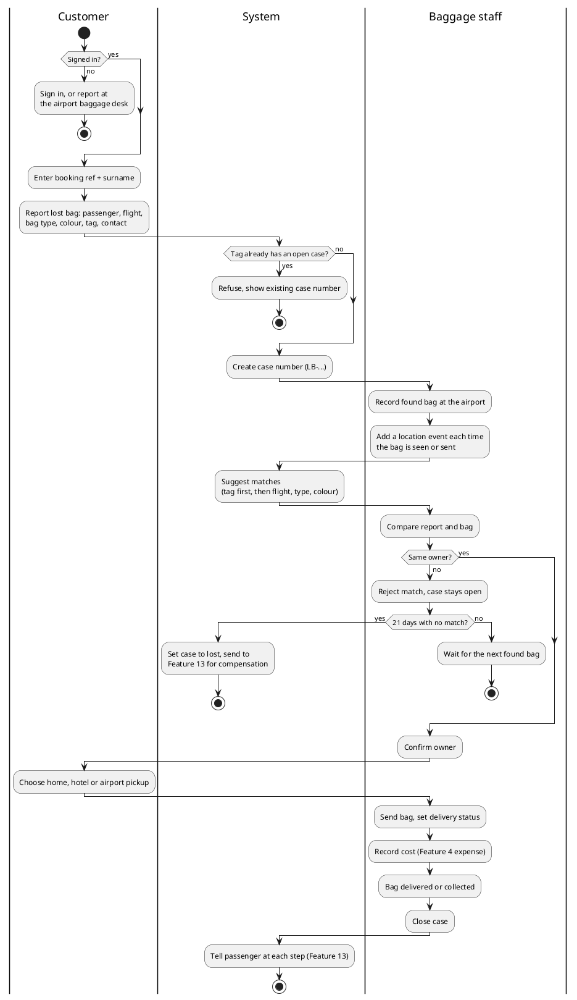
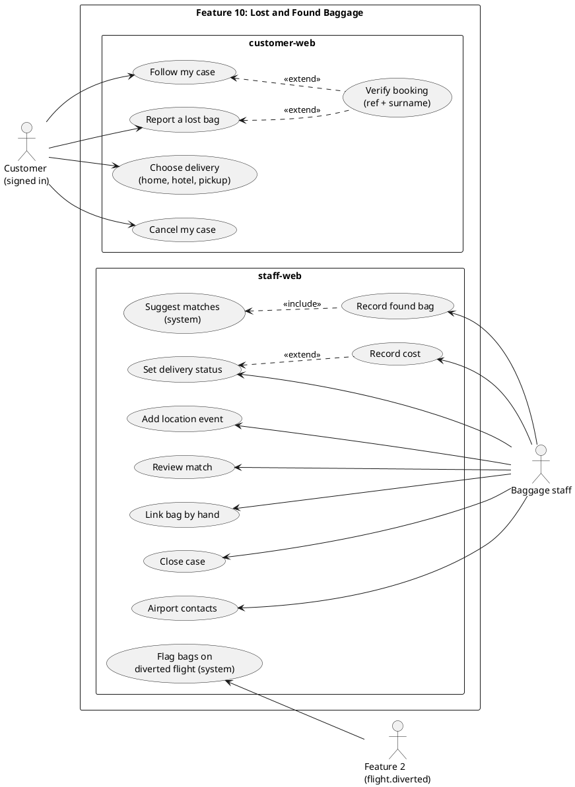

# Feature 10: Lost and Found Baggage (Iteration-03)

latest update: Nov 23, 2026

CSC290 Integrated Project

Built from the Iteration-01 spec, the group requirement doc, and Ajarn's feedback. Where they disagree, we pick the more reasonable option and say why.

**Changed 23 Nov:** reporting a lost bag online needs a customer account. A passenger without an account reports at the airport baggage desk, where staff file the case for them. The booking reference + surname is still asked for, but only to prove a signed-in customer's booking, never as a way in on its own.

Live prototype: [customer-web: Report a lost bag and My bag case, and staff-web: Lost bag cases, Found bags, Match review and Deliveries](https://claude.ai/artifact/52gxdYuLgqq8VpevPYHEg9) (sample data)

Note: **What Ajarn said**

- Track bags and keep contact with staff at each airport, so a bag sent to the wrong place (e.g. Thailand instead of Japan) can be traced.
- A lost or misrouted bag report, plus matching found bags to the right passenger and report.
- For delivery, the passenger chooses where: home, or their current destination or hotel.
- Decide who pays the recovery or delivery cost when a bag is lost or misrouted.

# Part A: Requirements

## 1. Purpose

Get lost and misrouted bags back to their owners: passengers report a lost bag, staff record found bags and trace where they go, the system suggests matches, staff confirm the owner, and the bag is delivered or picked up at no cost to the passenger. Weighing bags, excess fees and tag numbers belong to Feature 6.

## 2. Main Users

| User | App | What they do |
| --- | --- | --- |
| Customer (signed in) | customer-web | Reports a lost bag for anyone on their booking (proving the booking with booking reference + surname), follows the case, chooses where the bag goes |
| Baggage staff (F1 role `baggage`) | staff-web | Files reports at the airport desk (including for passengers without an account), records found bags, traces bag locations, reviews matches, arranges delivery, records costs, closes cases |
| System | backend | Suggests matches, adds a found bag for each bag on a diverted flight, sets cases to lost after 21 days and held bags to unclaimed after 90 days, sends status changes to Feature 13 |

## 3. Main Functions

- Lost bag report (Ajarn): passenger, flight, bag type, colour, brand, tag number, description, photo and contact; the passenger gets a case number (for example LB-2026-000121)
- Account required: only a signed-in customer can report online, and they prove the booking with booking reference + surname, the same check as Feature 13 complaints. A passenger without an account reports at the airport desk, where staff file it; staff can also open one for the owner of a tagged found bag
- Found bags: any bag the airline holds that is not with its owner. Staff record every bag nobody collected, at any airport, with the flight it came off when known; the system looks up its Feature 6 bag by tag
- Bag tracking (Ajarn): every place a bag is seen or sent is saved as a location event, so a bag sent to the wrong country can be traced
- Airport contacts (Ajarn): desk name, phone and email for each airport, so staff can call the station holding a bag
- Matching (Ajarn): the system suggests matches (same tag or same owner first, then flight, type and colour) when a found bag is recorded and when a report is made; staff confirm or reject, or link a bag by hand
- Delivery choice (Ajarn): home, hotel or current destination, or pickup at an airport
- Costs (Ajarn): the airline pays every recovery and delivery cost; each cost is its own row, saved as a Feature 4 expense
- Diverted flights: when Feature 2 sends `flight.diverted`, the system adds a found bag for each checked bag on that flight, marked "at diverted airport"; staff check them and close the ones that go on with the flight
- Never found: after 21 days with no confirmed match, the case is set to lost and sent to Feature 13 for compensation; it can still be matched if the bag turns up later. A held found bag with no confirmed match after 90 days is set to unclaimed
- Notifications: every status change goes to Feature 13, which messages the passenger
- Audit: every staff change is sent to the Feature 15 audit log

## 4. Main Flow

See `F10_Flow` under Diagram Sources (PlantUML) at the end.

A match the system suggests never moves a bag on its own; staff confirm the owner first.

## 5. Information Needed

Columns are in the SQL (Part B).

- **Lost bag report:** case number, passenger and booking, flight, who reported it (signed-in customer or staff), tag number, bag type, colour, brand, description, photo, contact, status, when it was set to lost
- **Found bag:** tag number, Feature 6 bag, flight it came off, bag type, colour, brand, description, airport and time found, source (staff or diverted flight), status, staff who recorded it
- **Match:** report, found bag, level (strong, possible, manual), status, staff who linked it (manual only), staff who reviewed it and when, note
- **Location event:** bag, airport, what happened (found, held, sent, arrived, at diverted airport, out for delivery, delivered), where it was sent and on which flight, note, staff, time
- **Delivery:** home, hotel, other address or airport pickup, address or pickup airport, status, time delivered
- **Cost:** case, kind (forwarding, delivery, storage, other), the Feature 4 expense that holds the amount
- **Airport contact:** airport, desk name, phone, email
- **Setting:** days until a case is lost (21) and until a held bag is unclaimed (90)

| Thing | Statuses |
| --- | --- |
| Lost bag report | open, matched, delivering, closed, lost, cancelled |
| Found bag | held, matched, sent, delivered, unclaimed, continued\_with\_flight |
| Match | suggested, under\_review, confirmed, rejected |
| Delivery | waiting\_choice, preparing, in\_transit, ready\_for\_pickup, delivered |

## 6. Business Rules

| Area | Rule |
| --- | --- |
| Who can report | Only a signed-in customer can report online, for anyone on their own booking. They prove the booking with booking reference + surname; a case number alone is never enough. A passenger without an account cannot report or follow a case online: they report at the airport desk, where baggage staff file it, and Feature 13 keeps them informed |
| One case per tag | One live report per bag tag, lost cases included. The tag must belong to the reporting passenger on the booking (checked with Feature 6). A second report for the same tag is refused; the case number is shown only to the same booking |
| Case number | LB-, the simulated year, -, then a 6-digit running number from one sequence that never restarts, so numbers never repeat (LB-2026-000124). It is shown to the passenger but never opens the case on its own |
| Report fields | Booking and flight, bag type, colour and one contact (email or phone) are required. Tag number, brand and photo are optional. Bag type and colour come from one fixed list for reports and found bags. Types: suitcase, backpack, duffel, box, garment\_bag, sports\_equipment, stroller, other. Colours: black, white, grey, blue, red, green, yellow, orange, pink, purple, brown, beige, multi |
| Tag number | 10 digits starting with 0, IATA style, made by Feature 6: 0, the airline's 3-digit code, then a 6-digit running number |
| Matching | Strong: the found bag's tag equals the report's tag, or the found bag's Feature 6 bag belongs to the report's passenger. Possible: same flight, bag type and colour (a found bag with no known flight gets no suggestion). Anything less is not suggested; staff can still link by hand. Matching runs when a found bag is recorded and when a report is made |
| Confirming | The system only suggests. Staff confirm the owner (bag details, tag and booking) with a note before a bag moves. A report and a found bag can each have only one confirmed match. Who reviewed it and when are saved; a hand link saves who made it |
| Rejecting | A rejected match frees both the report and the bag, so each can be matched again |
| Tracking | Staff add a location event every time they see, send or receive a bag. A bag's current place is its latest event. Events are never edited. A sent event names where the bag went and, if it flew, the flight, so a misrouted bag can be traced. Only the diversion job writes an event without staff |
| Diverted flight | When Feature 2 sends `flight.diverted`, F10 reads the bags on that flight from Feature 6 and adds a found bag for each (source diverted flight), marked "at diverted airport". Staff add the type and colour when they check each bag, and set the ones that go on with the flight to continued\_with\_flight |
| Never found | A report with no confirmed match 21 days (setting lost\_after\_days) after it was made is set to lost. F10 sends it to Feature 13, which opens a flight case (issue `lost_bag`) for compensation paid by Feature 5B. A lost case can still be matched: if the bag turns up, staff confirm it and it is delivered; what that means for compensation already paid is Feature 13 and 5B's rule |
| Unclaimed | A held found bag with no confirmed match 90 days (setting unclaimed\_after\_days) after it was found is set to unclaimed. It stays in the system, so staff can still look it up, but it can no longer be matched or delivered |
| Delivery | After the owner is confirmed, the passenger picks home, hotel, another address (their current destination), or airport pickup (Ajarn). They can change it until the bag is sent. Every change goes to the audit log and to Feature 13, so the passenger hears about it |
| Delivery status | Staff set it (preparing, in transit, ready for pickup, delivered). The passenger sees each change and Feature 13 notifies them |
| Costs | The airline pays every recovery and delivery cost; the passenger is never charged (Ajarn asked who pays). Each cost is its own row linked to a Feature 4 expense (category other, description with the case number), so it shows in the finance summary. The amount lives only in the expense; a step that costs nothing has no row |
| Privacy | The passenger sees the report status and the delivery status. Match details and staff notes stay staff-only |
| Time | All times use the Feature 1 simulation clock |
| Audit | Every staff change is sent to the Feature 15 audit log |

## 7. Data from Other Features

Other features are called through their shared services inside the one backend.

| Feature | We need |
| --- | --- |
| 1 Platform Core | Login, the `baggage` role, simulation clock, event bus; staff-only and role guards on staff routes; a file upload route for the report photo |
| 2 Flight Scheduling | Airports and flights; the `flight.diverted` event |
| 3b Booking | Check booking reference + surname for a signed-in customer; passengers on a booking |
| 4 Pricing & Finance | Base currency; the expense table for recovery costs |
| 6 Check-in | Checked bag by tag number (passenger, booking, flight), to link a found bag and to check a reported tag belongs to the booking; bags on a flight |
| 7 Profiles | The passenger's profile (name, contact), so no names are copied into F10 |

## 8. Data Provided to Other Features

| Feature | We send |
| --- | --- |
| 4 Pricing & Finance | Each recovery or delivery cost as an expense row |
| 13 Customer Service | Case and delivery status changes (for notifications); each report set to lost after 21 days (opens a compensation case); a lost case matched later; a case staff open for the owner of a tagged found bag |
| 15 Admin Console | Audit entry for every staff action |

## 9. Edge Cases

| Case | What happens | Error code |
| --- | --- | --- |
| Not signed in | Asked to sign in; a passenger without an account reports at the airport desk | 401 |
| Booking reference and surname don't match the customer's booking | Report not accepted | BOOKING\_NOT\_FOUND |
| Duplicate report for the same tag | Refused; the case number is shown only to the same booking | REPORT\_EXISTS |
| Reported tag is not on the reporter's booking | Report not accepted | TAG\_NOT\_ON\_BOOKING |
| No found bag matches | Case stays open; every new found bag runs matching again |  |
| Bag found before it is reported | Matching runs when the report is made, against held bags |  |
| Several possible matches | All are listed; staff confirm one, the rest are rejected |  |
| Bag has no tag | Only possible matches by details; staff confirm by hand |  |
| Report has no tag (receipt lost) | If the found bag is tagged, Feature 6 names its owner, so it is still a strong match |  |
| Tagged found bag, owner has not reported | Staff open a case for the owner; Feature 13 tells the passenger |  |
| Bag found in another country | Location event at that airport; staff call its station contact and send it on |  |
| Delivery choice changed after the bag is sent | Refused | ALREADY\_SENT |
| Passenger finds the bag themselves | Passenger cancels the case (only before the bag is sent) |  |
| Flight diverted | One found bag per checked bag, marked "at diverted airport"; staff close the ones that go on with the flight |  |
| No confirmed match after 21 days | Set to lost and sent to Feature 13 for compensation; the case can still be matched later |  |
| Bag turns up after the case is lost | Staff confirm the match and the bag is delivered; Feature 13 is told |  |
| Held bag not matched for 90 days | Set to unclaimed; it stays in the system but can no longer be matched or delivered |  |

## 10. Open Questions

Labels follow the build order (wave 1: F1 · wave 2: F2, 4, 7, 8, 9, 12, 15 · wave 3: F3a, 3b, 6, 10, 11, 13, 17 · wave 4: F5a, 5b, 14, 16). Earlier groups set the base; later groups follow.

**We decide (later groups follow us)**

- [x] A bag never found: after how many days does the case close as lost and go to Feature 13 for compensation? (done: 21 days, the airline industry norm; setting lost\_after\_days)
- [x] A found bag nobody claims: when does it become unclaimed, and what happens? (done: 90 days, then it is set to unclaimed and can no longer be matched or delivered; setting unclaimed\_after\_days)

**Follow an earlier group**

- [x] Where recovery costs go (done: Feature 4's expense table, category other, so they show in the finance summary; Feature 5 not needed)
- [ ] Platform: staff-only and role guards on staff routes. Today a customer token passes them, so F10's staff routes wait for this (Feature 6 needs it too)
- [ ] Platform: a file upload route for the report photo; photo\_url stores what it returns (Feature 6's passport photo needs the same)

**Same wave, agree together**

- [x] Tag number format with Feature 6 (done: 10 digits starting with 0, IATA style, the same check in both)
- [x] Feature 6: the two reads F10 needs (done: checked bag by tag and bags on a flight, both added to Feature 6's API routes)
- [ ] Feature 3b: route to check booking reference + surname, and to list passengers on a booking (Feature 13 needs the same route). Until then, staff can still file reports at the desk

**Changed from the Iteration-01 spec:** delivery follows Ajarn (home, hotel or current destination), with airport pickup kept as a third choice; Feature 6 now weighs bags and makes tag numbers, and F10 only uses them; bag tracking added, with location events and diverted-flight flags (Ajarn); the airline pays every recovery cost, saved as a Feature 4 expense (Ajarn); who can report and the matching rules are written out. 25 Oct: the DB team's review is applied (bags on diverted flights, fixed bag types and colours, links to Feature 6 bags, staff reports, booking reference on every passenger call, lost cases stay matchable, one row per cost, unclaimed after 90 days). 23 Nov: reporting online needs a customer account; passengers without one report at the airport desk.

# Part B: Technical

Same stack and conventions as the rest of Flython: NestJS, Postgres, Clerk for sign-in, singular table names, PUT for updates, errors as `{ error: { code, message, details? } }`.

## Use Case Diagram

See `F10_UseCase` under Diagram Sources (PlantUML) at the end.

## API Routes

Guards: C = signed-in customer, who also proves the booking with booking reference + surname (a case number alone is never enough), B = baggage staff (or admin). There is no guest access: every customer route needs an account. Feature 2's `flight.diverted` arrives on the shared in-process event bus, not through a route. Every B write also sends an entry to the Feature 15 audit log. B routes need the platform's staff-only and role guards first (see Open Questions).

All routes sit under the `/api` prefix. Customer routes are `customer/...` and staff routes are `staff/...`. C routes also take `bookingReference` and `surname` (the query string, or the body on writes) to prove the booking.

| Route | Method | Guard | Purpose |
| --- | --- | --- | --- |
| /customer/lost-report-travellers | GET | C | Travellers on the customer's booking, to pick whose bag it is |
| /customer/lost-report-flights | GET | C | Confirmed flights on the booking, to pick the flight |
| /customer/lost-reports | POST | C | Report a lost bag (with optional photo); returns the case number. 409 REPORT\_EXISTS if the tag already has a live case (case number shown only to the same booking); 422 TAG\_NOT\_ON\_BOOKING if the tag is not on the booking. Runs matching against held bags |
| /customer/lost-reports | GET | C | My cases |
| /customer/lost-reports/:caseNumber | GET | C | One case: status and delivery status |
| /customer/lost-reports/:caseNumber/summary | GET | C | Case timeline for the My bag case page |
| /customer/lost-reports/:caseNumber/photo | GET | C | The photo attached to the report |
| /customer/lost-reports/:caseNumber/delivery-choice | GET, PATCH | C | See or choose home, hotel, other address or airport pickup. 409 ALREADY\_SENT once the bag is sent |
| /customer/lost-reports/:caseNumber/cancel | PATCH | C | Close my case (bag turned up), only before the bag is sent |
| /staff/baggage-desk | GET | B | Simulation time and the signed-in staff member's role, for the desk header |
| /staff/lost-reports | GET | B | List and filter cases by status, airport, flight |
| /staff/lost-reports | POST | B | File a report at the airport desk; runs matching |
| /staff/lost-reports/bookings/:bookingReference | GET | B | Passengers and flights on a booking, to fill the desk form (logged as a sensitive view) |
| /staff/lost-reports/from-found-bag | POST | B | Open a case for the owner of a tagged found bag who has not reported it |
| /staff/lost-reports/:id | GET | B | One case with its matches and delivery |
| /staff/lost-reports/:id/photo | GET | B | The passenger's bag photo, to compare with found bags |
| /staff/lost-reports/:id/cancel | POST | B | Cancel a case with no confirmed bag yet, with a reason |
| /staff/lost-reports/:id/costs | GET, POST | B | List costs, or record one (forwarding, delivery, storage, other), saved as a Feature 4 expense |
| /staff/lost-reports/:id/costs/:costId | DELETE | B | Remove a cost entered by mistake |
| /staff/found-bags | POST | B | Record a found bag; looks up its Feature 6 bag by tag; runs matching |
| /staff/found-bags | GET | B | List found bags; search by tag number, filter by status, airport and flight |
| /staff/found-bags/:id | GET | B | One found bag |
| /staff/found-bags/:id | PATCH | B | Add type and colour to a diverted-flight bag |
| /staff/found-bags/:id/continue-with-flight | POST | B | Mark a diverted-flight bag continued\_with\_flight |
| /staff/found-bags/:id/locations | POST | B | Add a location event (held, sent, arrived) |
| /staff/found-bags/:id/locations | GET | B | Trace: every place the bag has been, and where it is now |
| /staff/found-bags/diversions/:flightId | POST | B | Add a found bag for each tagged bag on a diverted flight (safe to repeat; the `flight.diverted` listener does the same) |
| /staff/found-bags/unclaimed-sweep | POST | B | Run the unclaimed check now (held bags past unclaimed\_after\_days) |
| /staff/bag-matches | GET | B | Open matches first, strong on top |
| /staff/bag-matches | POST | B | Link a report and a found bag by hand |
| /staff/bag-matches/:id | GET | B | One match, report and bag side by side |
| /staff/bag-matches/:id/confirm | POST | B | Confirm the owner with a note; the other open matches of both are rejected. A hand link is confirmed by someone other than the staff member who linked it |
| /staff/bag-matches/:id/reject | POST | B | Reject, with a note |
| /staff/bag-deliveries | GET | B | Deliveries, bags to send first |
| /staff/bag-deliveries/:id | GET | B | One delivery with its ownership checks |
| /staff/bag-deliveries/:id/choice | PUT | B | Record the passenger's choice for them (409 ALREADY\_SENT once in transit) |
| /staff/bag-deliveries/:id/status | POST | B | Set in transit or ready for pickup |
| /staff/bag-deliveries/:id/hand-over | POST | B | Check the person collecting against the case, then hand over; sets delivered and closes the case. 409 OWNERSHIP\_NOT\_VERIFIED if the check fails |
| /staff/baggage-flights | GET | B | Flights that landed at or are due at an airport (`?airport=`) |
| /staff/baggage-flights/departures | GET | B | Flights a found bag can be sent on (`?from=&to=`) |
| /staff/baggage-flights/diverted | GET | B | Diverted flights with bags still to add |
| /staff/baggage-flights/airports | GET | B | Active airports for the "Found at" and "Sent to" lists |
| /staff/baggage-flights/:id | GET | B | One flight |
| /staff/station-contacts | GET | B | Airport contact list |
| /staff/station-contacts/:airportCode | GET, PUT | B | See or edit one airport's contact |
| /staff/baggage-settings | GET, PUT | B (admin) | Days until a case is lost (21) and a held bag is unclaimed (90) |

There is no separate close route: the hand-over that delivers the bag closes the case.

## SQL Schema

Requested tables for the DB team; they write the final schema. Updated 21 Oct to match the Level 1 schema in the repo: the passenger comes from Feature 7's `passenger`, airports and flights from Feature 2, and recovery costs are saved as Feature 4's `expense` rows. `booking_passenger` (Feature 3b) doesn't exist yet, so that id has no foreign key. Updated 25 Oct to the DB team's reviewed SQL (tested in Postgres), plus three additions: unclaimed\_after\_days (90), the found bag status continued\_with\_flight, and tag numbers starting with 0.

**Backend notes** (no schema change):

- The backend sets updated\_at on every update (the repo has no trigger and no @updatedAt).
- The report and found bag statuses follow the confirmed match and the delivery, in the same transaction.
- The migration holds the two setting defaults; seed.ts holds the station contacts for the demo airports and the Feature 10 screens.

```sql
-- Feature 10 (Lost and Found Baggage) - requested schema, updated 25 Oct with the DB team's review.
-- Matching, the lost and unclaimed jobs, tag ownership, delivery choice rules and the status changes that follow a
-- match or a delivery are the backend's job (see Backend notes above).
-- Applies on top of the repo's migrations and feature 6's proposed schema (feature-6.sql). Uses staff (feature 1),
-- passenger and customer (feature 7) and expense (feature 4). The airport and flight foreign keys (feature 2) and the
-- checked_bag foreign key (feature 6) are in the cross-module section at the end.
-- booking_passenger (feature 3b) does not exist yet, so that id has no foreign key.
-- Business timestamps (reported_at, lost_at, closed_at, found_at, suggested_at, reviewed_at, occurred_at,
-- delivered_at) have no default and come from the simulation clock. created_at and updated_at are real time, and the
-- backend sets updated_at on every update (no trigger, no @updatedAt).
-- Tag numbers are feature 6's checked_bag.tag_number: 10 digits starting with 0, IATA style.
-- bag_type and colour use one closed list for reports and found bags, so "same type and colour" is an exact match.

-- Settings and reference data ---------------------------------------------------------------------------

-- lost_after_days: a report with no confirmed match this many days after reported_at becomes lost.
-- unclaimed_after_days: a held found bag with no confirmed match this many days after found_at becomes unclaimed and
-- can no longer be matched or delivered. Values are validated by the backend.
CREATE TABLE baggage_setting (
  key        TEXT PRIMARY KEY CHECK (key IN ('lost_after_days', 'unclaimed_after_days')),
  value      TEXT NOT NULL,
  updated_at TIMESTAMPTZ NOT NULL DEFAULT now(),
  updated_by UUID REFERENCES staff (id)
);

INSERT INTO baggage_setting (key, value) VALUES ('lost_after_days', '21'), ('unclaimed_after_days', '90');

-- The baggage desk at each airport, so staff can call the station holding a bag.
CREATE TABLE station_contact (
  airport_code TEXT PRIMARY KEY,                           -- feature 2's airport (cross-module FK)
  desk_name    TEXT NOT NULL,
  phone        TEXT NOT NULL,
  email        TEXT,
  updated_at   TIMESTAMPTZ NOT NULL DEFAULT now(),
  updated_by   UUID REFERENCES staff (id)
);

-- Reports ------------------------------------------------------------------------------------------------

CREATE SEQUENCE lost_bag_case_seq MAXVALUE 999999;

-- The passenger's case. Who and which booking come from features 3b and 7, so no names are copied here.
-- case_number is 'LB-', the simulated year, '-' and lost_bag_case_seq padded to 6 digits, built by the backend. It is
-- shown to the passenger but is never a credential: customer routes need the booking reference and surname every time.
-- A report is filed by a signed-in customer or by baggage staff (at an airport desk, for a passenger without an account,
-- or for the owner of a tagged on-hand bag). Online reporting needs an account, so the backend always sets one reporter
-- column; the CHECK below still allows both NULL (tightening it is a DB team change).
-- lost: no confirmed match lost_after_days after reported_at; feature 13 opens the compensation case. A lost case stays
-- matchable, so a bag that turns up later can still be confirmed and delivered (lost_at keeps when it was declared).
CREATE TABLE lost_bag_report (
  id                      UUID PRIMARY KEY DEFAULT gen_random_uuid(),
  case_number             TEXT NOT NULL UNIQUE CHECK (case_number ~ '^LB-[0-9]{4}-[0-9]{6}$'),
  booking_passenger_id    UUID NOT NULL,                   -- feature 3b (no FK yet)
  passenger_id            UUID NOT NULL REFERENCES passenger (id),
  flight_id               UUID NOT NULL,                   -- feature 2's flight (cross-module FK)
  reported_by_customer_id UUID REFERENCES customer (id),
  reported_by_staff_id    UUID REFERENCES staff (id),
  tag_number              TEXT CHECK (tag_number ~ '^0[0-9]{9}$'),
  bag_type                TEXT NOT NULL CHECK (bag_type IN (
                            'suitcase', 'backpack', 'duffel', 'box', 'garment_bag', 'sports_equipment', 'stroller', 'other')),
  colour                  TEXT NOT NULL CHECK (colour IN (
                            'black', 'white', 'grey', 'blue', 'red', 'green', 'yellow', 'orange', 'pink', 'purple', 'brown',
                            'beige', 'multi')),
  brand                   TEXT,
  description             TEXT,
  photo_url               TEXT,
  contact_email           TEXT,
  contact_phone           TEXT,
  status                  TEXT NOT NULL DEFAULT 'open'
                            CHECK (status IN ('open', 'matched', 'delivering', 'lost', 'closed', 'cancelled')),
  reported_at             TIMESTAMPTZ NOT NULL,            -- simulation clock
  lost_at                 TIMESTAMPTZ,                     -- simulation clock
  closed_at               TIMESTAMPTZ,                     -- simulation clock
  created_at              TIMESTAMPTZ NOT NULL DEFAULT now(),
  updated_at              TIMESTAMPTZ NOT NULL DEFAULT now(),
  CHECK (contact_email IS NOT NULL OR contact_phone IS NOT NULL),
  CHECK (reported_by_customer_id IS NULL OR reported_by_staff_id IS NULL),
  CHECK (status <> 'lost' OR lost_at IS NOT NULL),
  CHECK ((status IN ('closed', 'cancelled')) = (closed_at IS NOT NULL))
);

-- One live case per tag, lost ones included.
CREATE UNIQUE INDEX lost_bag_report_open_tag_uq ON lost_bag_report (tag_number)
  WHERE tag_number IS NOT NULL AND status IN ('open', 'matched', 'delivering', 'lost');
CREATE INDEX lost_bag_report_flight_idx ON lost_bag_report (flight_id);
CREATE INDEX lost_bag_report_booking_passenger_idx ON lost_bag_report (booking_passenger_id);
CREATE INDEX lost_bag_report_customer_idx ON lost_bag_report (reported_by_customer_id) WHERE reported_by_customer_id IS NOT NULL;
CREATE INDEX lost_bag_report_open_idx ON lost_bag_report (reported_at) WHERE status = 'open';

-- Found bags ---------------------------------------------------------------------------------------------

-- An on-hand bag: one the airline holds that is not with its owner. Staff record every bag nobody collected; when
-- feature 2 reports a diversion, the system adds one row per checked bag on the flight (source diverted_flight), and
-- staff add the type and colour when they check it. A bag that goes on with the flight is continued_with_flight.
-- unclaimed: held unclaimed_after_days with no confirmed match; the row stays, but it can no longer be matched or delivered.
-- checked_bag_id is feature 6's bag with the same tag, looked up when the bag is recorded. It names the owner, so a
-- tagged bag gets a strong match even when the report has no tag, and staff can open a case for an owner who has not
-- reported yet. flight_id is the flight the bag came off, when known; possible matches need it.
CREATE TABLE found_bag (
  id             UUID PRIMARY KEY DEFAULT gen_random_uuid(),
  checked_bag_id UUID UNIQUE,                              -- feature 6 (cross-module FK)
  tag_number     TEXT CHECK (tag_number ~ '^0[0-9]{9}$'),
  flight_id      UUID,                                     -- feature 2's flight (cross-module FK)
  bag_type       TEXT CHECK (bag_type IN (
                   'suitcase', 'backpack', 'duffel', 'box', 'garment_bag', 'sports_equipment', 'stroller', 'other')),
  colour         TEXT CHECK (colour IN (
                   'black', 'white', 'grey', 'blue', 'red', 'green', 'yellow', 'orange', 'pink', 'purple', 'brown',
                   'beige', 'multi')),
  brand          TEXT,
  description    TEXT,
  found_airport  TEXT NOT NULL,                            -- feature 2's airport (cross-module FK)
  found_at       TIMESTAMPTZ NOT NULL,                     -- simulation clock
  source         TEXT NOT NULL DEFAULT 'staff' CHECK (source IN ('staff', 'diverted_flight')),
  status         TEXT NOT NULL DEFAULT 'held' CHECK (status IN (
                   'held', 'matched', 'sent', 'delivered', 'unclaimed', 'continued_with_flight')),
  recorded_by    UUID REFERENCES staff (id),               -- NULL for a diverted-flight row
  created_at     TIMESTAMPTZ NOT NULL DEFAULT now(),
  updated_at     TIMESTAMPTZ NOT NULL DEFAULT now(),
  CHECK ((source = 'staff') = (recorded_by IS NOT NULL)),
  CHECK (source = 'diverted_flight' OR (bag_type IS NOT NULL AND colour IS NOT NULL)),
  CHECK (source = 'staff' OR (checked_bag_id IS NOT NULL AND flight_id IS NOT NULL)),
  CHECK (checked_bag_id IS NULL OR tag_number IS NOT NULL)
);

CREATE INDEX found_bag_tag_idx ON found_bag (tag_number) WHERE tag_number IS NOT NULL;
CREATE INDEX found_bag_flight_idx ON found_bag (flight_id) WHERE flight_id IS NOT NULL;
CREATE INDEX found_bag_held_idx ON found_bag (found_airport) WHERE status = 'held';

-- Matches ------------------------------------------------------------------------------------------------

-- strong: same tag, or the found bag's feature 6 bag belongs to the report's booking passenger.
-- possible: same flight, bag type and colour. manual: linked by staff (linked_by).
-- The system only suggests; staff confirm the owner with a note before a bag moves, and a report and a found bag each
-- have one confirmed match at most.
CREATE TABLE bag_match (
  id           UUID PRIMARY KEY DEFAULT gen_random_uuid(),
  report_id    UUID NOT NULL REFERENCES lost_bag_report (id),
  found_bag_id UUID NOT NULL REFERENCES found_bag (id),
  match_level  TEXT NOT NULL CHECK (match_level IN ('strong', 'possible', 'manual')),
  status       TEXT NOT NULL DEFAULT 'suggested' CHECK (status IN ('suggested', 'under_review', 'confirmed', 'rejected')),
  linked_by    UUID REFERENCES staff (id),
  reviewed_by  UUID REFERENCES staff (id),
  review_note  TEXT,
  suggested_at TIMESTAMPTZ NOT NULL,                       -- simulation clock
  reviewed_at  TIMESTAMPTZ,                                -- simulation clock
  created_at   TIMESTAMPTZ NOT NULL DEFAULT now(),
  updated_at   TIMESTAMPTZ NOT NULL DEFAULT now(),
  UNIQUE (report_id, found_bag_id),
  CHECK ((match_level = 'manual') = (linked_by IS NOT NULL)),
  CHECK ((status IN ('confirmed', 'rejected')) = (reviewed_by IS NOT NULL)),
  CHECK ((reviewed_by IS NULL) = (reviewed_at IS NULL)),
  CHECK (status <> 'confirmed' OR review_note IS NOT NULL)
);

CREATE UNIQUE INDEX bag_match_report_confirmed_uq ON bag_match (report_id) WHERE status = 'confirmed';
CREATE UNIQUE INDEX bag_match_bag_confirmed_uq ON bag_match (found_bag_id) WHERE status = 'confirmed';
CREATE INDEX bag_match_found_bag_idx ON bag_match (found_bag_id);

-- Tracking -----------------------------------------------------------------------------------------------

-- Where a bag has been; its current place is its latest event. Append-only through the shared forbid_mutation()
-- trigger. airport_code is where the bag is, or the station that dispatched it for out_for_delivery and delivered.
-- A sent event names where the bag went (to_airport) and, if it flew, the flight, so a misrouted bag can be traced.
-- Only the diversion job writes without staff.
CREATE TABLE bag_location_event (
  id                UUID PRIMARY KEY DEFAULT gen_random_uuid(),
  found_bag_id      UUID NOT NULL REFERENCES found_bag (id),
  airport_code      TEXT NOT NULL,                         -- feature 2's airport (cross-module FK)
  action            TEXT NOT NULL CHECK (action IN (
                      'found', 'held', 'sent', 'arrived', 'at_diverted_airport', 'out_for_delivery', 'delivered')),
  to_airport        TEXT,                                  -- feature 2's airport (cross-module FK)
  sent_on_flight_id UUID,                                  -- feature 2's flight (cross-module FK)
  note              TEXT,
  staff_id          UUID REFERENCES staff (id),            -- NULL = system (diverted flight)
  occurred_at       TIMESTAMPTZ NOT NULL,                  -- simulation clock
  created_at        TIMESTAMPTZ NOT NULL DEFAULT now(),
  CHECK ((action = 'sent') = (to_airport IS NOT NULL)),
  CHECK (to_airport IS DISTINCT FROM airport_code),
  CHECK (action = 'sent' OR sent_on_flight_id IS NULL),
  CHECK (staff_id IS NOT NULL OR action = 'at_diverted_airport')
);

CREATE INDEX bag_location_event_bag_idx ON bag_location_event (found_bag_id, occurred_at);

CREATE TRIGGER bag_location_event_append_only
  BEFORE UPDATE OR DELETE ON bag_location_event
  FOR EACH ROW EXECUTE FUNCTION forbid_mutation();

-- Delivery and costs -------------------------------------------------------------------------------------

-- One per confirmed case. other_address is the passenger's current destination when it is not a home or a hotel.
-- The passenger can change the choice until the bag is in transit (ALREADY_SENT, backend).
CREATE TABLE bag_delivery (
  id             UUID PRIMARY KEY DEFAULT gen_random_uuid(),
  report_id      UUID NOT NULL UNIQUE REFERENCES lost_bag_report (id),
  delivery_type  TEXT CHECK (delivery_type IN ('home', 'hotel', 'other_address', 'airport_pickup')), -- NULL until chosen
  address        TEXT,
  pickup_airport TEXT,                                     -- feature 2's airport (cross-module FK)
  status         TEXT NOT NULL DEFAULT 'waiting_choice'
                   CHECK (status IN ('waiting_choice', 'preparing', 'in_transit', 'ready_for_pickup', 'delivered')),
  delivered_at   TIMESTAMPTZ,                              -- simulation clock
  created_at     TIMESTAMPTZ NOT NULL DEFAULT now(),
  updated_at     TIMESTAMPTZ NOT NULL DEFAULT now(),
  CHECK ((status = 'waiting_choice') = (delivery_type IS NULL)),
  CHECK (delivery_type IS NOT NULL OR (address IS NULL AND pickup_airport IS NULL)),
  CHECK (delivery_type IS DISTINCT FROM 'airport_pickup' OR (pickup_airport IS NOT NULL AND address IS NULL)),
  CHECK (delivery_type IS NULL OR delivery_type = 'airport_pickup' OR (address IS NOT NULL AND pickup_airport IS NULL)),
  CHECK (status <> 'ready_for_pickup' OR delivery_type = 'airport_pickup'),
  CHECK ((status = 'delivered') = (delivered_at IS NOT NULL))
);

-- Every recovery and delivery cost of a case. The amount lives only in feature 4's expense row (category 'other'), which
-- this row ties to the case, so the two cannot disagree. A step that costs nothing, such as an airport pickup, has no row.
CREATE TABLE bag_cost (
  id         UUID PRIMARY KEY DEFAULT gen_random_uuid(),
  report_id  UUID NOT NULL REFERENCES lost_bag_report (id),
  expense_id UUID NOT NULL UNIQUE REFERENCES expense (id),
  kind       TEXT NOT NULL CHECK (kind IN ('forwarding', 'delivery', 'storage', 'other')),
  created_at TIMESTAMPTZ NOT NULL DEFAULT now()
);

CREATE INDEX bag_cost_report_idx ON bag_cost (report_id);

-- Cross-module foreign keys (feature 10 -> features 2 and 6) ----------------------------------------------

-- Airports and flights are never hard-deleted, and feature 6 never deletes a tagged bag, so these are safe. In
-- schema.sql they go in the cross-module part. Later, once feature 3b exists:
-- lost_bag_report.booking_passenger_id -> booking_passenger.
ALTER TABLE station_contact    ADD CONSTRAINT station_contact_airport_fk        FOREIGN KEY (airport_code)      REFERENCES airport (iata_code);
ALTER TABLE lost_bag_report    ADD CONSTRAINT lost_bag_report_flight_fk         FOREIGN KEY (flight_id)         REFERENCES flight (id);
ALTER TABLE found_bag          ADD CONSTRAINT found_bag_checked_bag_fk          FOREIGN KEY (checked_bag_id)    REFERENCES checked_bag (id);
ALTER TABLE found_bag          ADD CONSTRAINT found_bag_flight_fk               FOREIGN KEY (flight_id)         REFERENCES flight (id);
ALTER TABLE found_bag          ADD CONSTRAINT found_bag_airport_fk              FOREIGN KEY (found_airport)     REFERENCES airport (iata_code);
ALTER TABLE bag_location_event ADD CONSTRAINT bag_location_event_airport_fk     FOREIGN KEY (airport_code)      REFERENCES airport (iata_code);
ALTER TABLE bag_location_event ADD CONSTRAINT bag_location_event_to_airport_fk  FOREIGN KEY (to_airport)        REFERENCES airport (iata_code);
ALTER TABLE bag_location_event ADD CONSTRAINT bag_location_event_flight_fk      FOREIGN KEY (sent_on_flight_id) REFERENCES flight (id);
ALTER TABLE bag_delivery       ADD CONSTRAINT bag_delivery_airport_fk           FOREIGN KEY (pickup_airport)    REFERENCES airport (iata_code);
```

## UI Mockups

The mockup is only there to help people picture the pages. It doesn't show every function, and it may show things that aren't part of the feature.

- [customer-web: Report a lost bag and My bag case, and staff-web: Lost bag cases, Found bags, Match review and Deliveries](https://claude.ai/artifact/52gxdYuLgqq8VpevPYHEg9)

Six pages: two in customer-web, four in staff-web.

| App | Page | Contains |
| --- | --- | --- |
| customer-web | Report a lost bag | Signed-in customers only; booking reference + surname to prove the booking; pick the passenger and flight; bag type, colour, brand, tag number, photo, contact |
| customer-web | My bag case | Case status and timeline; choose or change delivery (home, hotel, airport pickup) once the owner is confirmed |
| staff-web | Lost bag cases | List with filters (status, airport, flight); case detail with matches and delivery |
| staff-web | Found bags | Record a found bag; search by tag; location trace with an Add location action |
| staff-web | Match review | Report and found bag side by side, field by field; Confirm or Reject with a note |
| staff-web | Deliveries | Cases waiting to be sent; set status, record a cost; airport contacts list |

## Diagram Sources (PlantUML)




