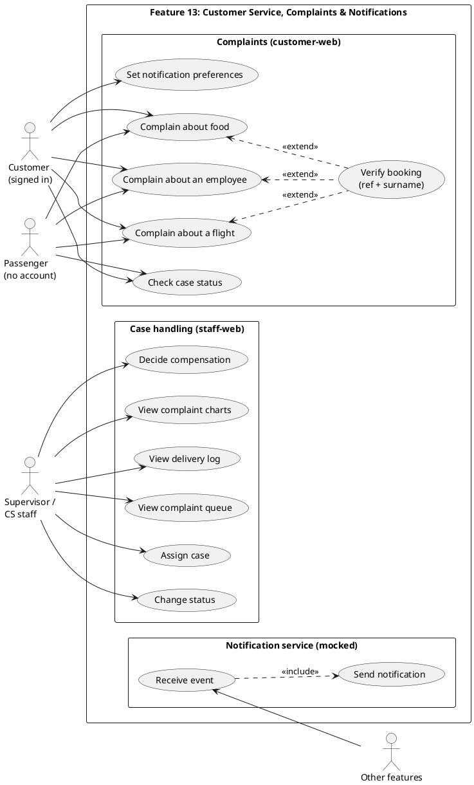
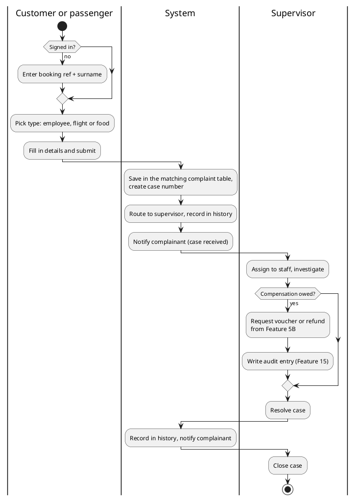

# Feature 13 — Customer Service, Complaints & Notifications (Iteration-03)

Nov 16, 2026 · Group 16 · In, Ball

**Prototype:** [Flython Complaints Mockups](https://claude.ai/artifact/TXGUGWVpMZYah3eNUHPuyG): customer-web Make a complaint, staff-web Supervisor queue and Complaint charts (sample data).

Built from the Iteration-01 spec, the group requirement doc, and Ajarn's feedback. Where they disagree, we pick the more reasonable option and say why.

## Overview

Feature 13 lets customers and passengers complain about an employee, a flight or food, sends every complaint to a supervisor with a full record of what happens to it, and sends every message the system needs. All message providers are mocked: nothing real is sent.

**What Ajarn said.**

- Both customers and passengers (even without an account) can complain about the flight.
- Make 3 tables for complaints: about employees, about the flight, and about food.
- No inbox needed.
- Complaints go to the supervisor, so the system must keep a record of them.

What this feature owns:

- The 3 complaint types (Employee, Flight, Food), each in its own table, plus one shared case row for the queue and history
- Complaints without an account: the passenger proves booking reference + surname on every call
- Case numbers (`CS-2026-000124`), status, and an append-only history of every step
- The supervisor queue, case handling (assign, notes, resolve, close, duplicates) and compensation decisions (paid by Feature 5B)
- Complaint charts: by type, per week, top flights
- The notification service: turns events (other features' and our own case events) into email, SMS or push messages from templates, through mocked providers, with a delivery log
- Customer notification preferences

**Users.**

| User | App | What they do |
| --- | --- | --- |
| Customer (signed in) | customer-web | Makes a complaint, checks case status, reopens a closed case, sets notification preferences |
| Passenger (no account) | customer-web | Makes a complaint with booking reference + surname, checks case status |
| CS supervisor (`cs-supervisor`) | staff-web | Assigns cases, decides compensation, edits templates, works any case, views charts and the delivery log |
| CS agent (`cs-agent`) | staff-web | Works the cases assigned to them: adds notes, marks duplicates, resolves and closes |
| Other features | system | Send events (flight delayed, gate changed, ...) for the notification service to turn into messages |

A staff role with `is_admin` counts as a supervisor.

**Revision of 21 Oct 2026.** Complaints point at Feature 2's flight and Feature 12's product by id, and a lost-bag case links to Feature 10's report, to match the Level 1 schema in the repo.

**Revision of 25 Oct 2026.** The DB team's review (23 fixes, tested on PostgreSQL 16) is folded into the schema.

**Revision of 16 Nov 2026 (implementation status).** The complaint half is built and follows the roles and status rules below. The notification half is not built: templates exist and can be edited, but no event is turned into a message yet, preferences live in the browser, and the delivery log shows only rows that are already in the database. What the code does and does not do is in the section "Implementation status"; where the code differs from this design, the section "Differences from the design" says so. This revision also fixed, on branch `feat-13-customer-service`:

- Staff-web no longer shows sample data when a call fails; the error shows on the page.
- Roles and status now follow the rules: only the supervisor assigns, an agent works only their own cases, only the complainant reopens, and only a closed case within 7 days of `closed_at`.
- Signed-in flight and food complaints always check that the flight is on one of the customer's bookings (`FLIGHT_NOT_ON_BOOKING`).
- Charts and the delivery log return real values only (no fallback numbers, weeks or routes).
- Every staff write is audited in the same transaction as the change.
- A second compensation decision at the same time returns `COMPENSATION_EXISTS` instead of a 500.
- The staff queue lists open cases first, unassigned first.
- The seed sets `confirmed_at` on its demo bookings, which `booking_check1` requires.

Cross-module contracts:

- **Feature 1 (Platform Core):** sign-in, roles (`cs-agent`, `cs-supervisor`), the simulation clock. Every business timestamp comes from the simulation clock.
- **Feature 2 (Flight Scheduling):** we read `flight` by `(flight_number, service_date)` and subscribe to its status events (delay, reschedule, diversion, cancellation) for notifications.
- **Feature 3 (Booking):** we check booking reference + surname against `booking_passenger`, and that the flight is a `booking_segment` of that booking. Bookings carry a contact email and phone.
- **Feature 5B (Refunds):** pays compensation; each decision's id is the idempotency key. *Not connected yet.*
- **Feature 6 (Check-in):** gate changes and boarding events for notifications.
- **Feature 7 (Profiles):** who complained (`passenger`); name on passenger, email on user, phone on customer; security events for the police alert.
- **Feature 10 (Lost and Found):** opens a lost-bag case through our in-process service (no route) when a report is set to lost. *Not built yet.*
- **Feature 12 (Onboard Products):** the passenger's meal line, or the flight's default meal, for food complaints. *Not read yet.*
- **Feature 14 (BI):** complaint counts by type, week and flight (no duplicates), resolution times.
- **Feature 15 (Admin Console):** an audit entry for every staff action, through its in-process `AuditService`, in the same transaction as the change; the staff screen registers as `f13.service_compensation`.

## Data model

Ten tables. Singular names, UUID primary keys (`notification_type` uses its code), business timestamps from the simulation clock, `created_at` and `updated_at` in real time. PK = primary key, FK = foreign key.

| Table | Key columns | Notes |
| --- | --- | --- |
| `complaint_case` | `id` (PK), `case_number`, `type`, `passenger_id` (FK), `customer_id` (FK, nullable), `booking_passenger_id` (FK, nullable), `contact_email`, `contact_phone`, `status`, `owner_staff_id` (FK), `source`, `lost_bag_report_id` (FK, unique), `duplicate_of_case_id` (FK), `opened_at`, `resolved_at`, `closed_at` | What every complaint has, so one queue and one history cover all 3 types |
| `employee_complaint` | `case_id` + `case_type` (PK, FK), `location`, `staff_name`, `linked_staff_id` (FK), `description` | `staff_name` is free text; the agent links the staff record later |
| `flight_complaint` | `case_id` + `case_type` (PK, FK), `flight_id` (FK), `issue`, `details` | `lost_bag` is only for Feature 10 cases |
| `food_complaint` | `case_id` + `case_type` (PK, FK), `flight_id` (FK), `product_id` + `product_category` (FK), `issue`, `details` | The meal, snack or drink from Feature 12, if known |
| `case_event` | `id` (PK), `case_id` (FK), `event_type`, `actor_type`, `actor_staff_id` (FK), `from_value`, `to_value`, `note`, `is_internal`, `occurred_at` | Append-only (trigger). Staff notes are always internal |
| `case_compensation` | `id` (PK), `case_id` (FK), `decided_by_staff_id` (FK), `type`, `amount`, `reason`, `status`, `payout_ref`, `failure_reason`, `decided_at`, `result_at` | One live decision per case (`case_compensation_live_uq`, ignores `failed`) |
| `notification_type` | `code` (PK), `source_feature`, `name`, `is_mandatory` | Reference data in the migrations; Features 5 and 11 add their own types |
| `notification_template` | `id` (PK), `type_code` (FK), `channel`, `subject_template`, `body_template`, `is_active`, `updated_by` (FK) | One per type and channel; email needs a subject, SMS has none |
| `notification_preference` | `customer_id` + `type_code` + `channel` (PK), `is_enabled` | No row = email on, SMS and push off |
| `inbound_event` | `id` (PK), `source`, `source_event_id`, `event_type`, `payload`, `received_at`, `processed_at` | Unique on `(source, source_event_id)`, so a repeated event is a no-op |
| `notification` | `id` (PK), `inbound_event_id` (FK), `type_code` (FK), `channel`, `recipient`, `customer_id` (FK), `case_id` (FK), `subject`, `body`, `status`, `attempts`, `error`, `queued_at`, `sent_at` | One per event, recipient and channel. Content never changes after it is set; rows are never deleted |

**Deliberate choices.**

- **Three detail tables, one case table.** Each detail table pins its type through a composite key to `complaint_case (id, type)`, so a case has details only in its own type's table, and the queue and history stay in one place.
- **A case number is never a credential.** A passenger without an account sends booking reference + surname on every call.
- **No names are copied** onto the case: the passenger row (Feature 7) holds them.
- **Every message comes from an event.** Our own case events go through `inbound_event` with source `'13'`, the same path as other features' events.

## Complaint status

```text
with_supervisor (no owner) ──assign (supervisor)──▶ assigned ──resolve──▶ resolved ──close──▶ closed
        ▲                                                                                      │
        └──────────────── reopen (complainant only, within 7 days of closed_at) ───────────────┘
```

| Step | Who | Route | Notes |
| --- | --- | --- | --- |
| Assign or reassign | Supervisor | `PATCH /staff/complaints/:id/assign` | Not allowed on a resolved or closed case |
| Resolve | Case owner or supervisor | `PATCH /staff/complaints/:id/status` (`resolved`) | Only from `assigned` |
| Close | Case owner or supervisor | `PATCH /staff/complaints/:id/status` (`closed`) | Only from `resolved` |
| Reopen | Complainant | `POST /complaints/:caseNumber/reopen` | Only from `closed`, within 7 days of `closed_at`; clears owner and resolution |

Any other step returns `409`. A staff member who is neither the owner nor a supervisor gets `403 NOT_CASE_OWNER`. Every step writes a `case_event` row and a Feature 15 audit entry in one transaction; a concurrent change returns `409`.

## API routes

All paths sit under the global prefix `/api`. Writes use `POST` to create and `PATCH` to change (see "Differences from the design"). Ids in staff paths are UUIDs. Guards: C = signed-in customer, P = passenger proving booking reference + surname, S = staff with role `cs-agent` or `cs-supervisor` (`CustomerServiceStaffGuard`), Sup = supervisor only (`@SupervisorOnly()`).

Customer (`CustomerComplaintsController`):

| Method & path | Guard | Purpose | Main errors |
| --- | --- | --- | --- |
| `POST /complaints` | C | Submit a complaint; returns the case | `400 FLIGHT_NOT_ON_BOOKING`, `400` bad issue, `404` no such flight |
| `POST /complaints/guest` | P (public) | Submit without an account | `404 BOOKING_NOT_FOUND`, `400 FLIGHT_NOT_ON_BOOKING`, `400` no contact |
| `GET /complaints` | C | List own complaints | none |
| `GET /complaints/:caseNumber` | C | Status and history (internal events hidden) | `404` |
| `GET /complaints/guest/:caseNumber?booking_reference=&surname=` | P (public) | Status and history without an account | `400` missing proof, `404` |
| `POST /complaints/:caseNumber/reopen` | C | Reopen a closed case within 7 days | `409 INVALID_STATUS`, `409 CANNOT_REOPEN_AFTER_7_DAYS` |

Staff (`StaffComplaintsController`, prefix `/staff/complaints`):

| Method & path | Guard | Purpose | Main errors |
| --- | --- | --- | --- |
| `GET /me` | S | The caller's name, role and `isSupervisor` | `403` |
| `GET /staff-members` | S | CS agents and supervisors, for the assign picker | none |
| `GET /` | S | Queue: unassigned, then assigned, then resolved and closed; newest first in each group; up to 500 open and 500 finished | none |
| `GET /:id` | S | Detail with internal notes and history | `404` |
| `PATCH /:id/assign` | Sup | Assign to a staff member | `404`, `409 INVALID_STATUS` |
| `PATCH /:id/status` | S | Resolve or close (allowed steps only) | `403 NOT_CASE_OWNER`, `409` |
| `POST /:id/notes` | S | Add an internal note | `404` |
| `POST /:id/compensation` | Sup | Decide compensation (status `pending`) | `409 COMPENSATION_EXISTS` |
| `GET /charts` | S | Numbers for the charts | none |
| `GET /delivery-log` | S | The latest 200 messages with counters | none |
| `GET /templates` | S | Templates per type and channel | none |
| `PATCH /templates/:code` | Sup | Edit a template's text or switch a channel on or off | `404` unknown type |

Not built yet: `GET` and `PUT /customers/me/notification-preferences`, guest reopen.

## Notification service (mocked)

Nothing real is sent on any channel: the repo has no email, SMS or push provider and no settings for one. The service is planned as a mock that does everything except call a provider, so the delivery log shows exactly what would have gone out. *Not built yet.*

1. **Event arrives.** Another feature publishes on the shared in-process bus, or a case event happens here. The event is saved in `inbound_event`; a repeat of `(source, source_event_id)` is ignored.
2. **Find recipients.** Passengers on the flight (through Feature 3), the complainant of the case, or the fixed authority address for `security_alert`.
3. **Check preferences.** No preference row = email on, SMS and push off. Mandatory types (`is_mandatory`) always go out on at least one channel, email if the customer switched every channel off.
4. **Fill the template.** The active template for the type and channel; a switched-off template means that channel is skipped. Placeholders the backend fills: `{{passenger_name}}`, `{{flight_number}}`, `{{service_date}}`, `{{new_departure}}`, `{{diverted_to}}`, `{{seat}}`, `{{gate}}`, `{{boarding_time}}`, `{{case_number}}`, `{{status}}`, `{{delivery_status}}`, `{{reference}}`.
5. **Send (mocked).** The mock sender marks the message `sent`, or `failed` with an error so retries can be shown. No phone number = SMS skipped, other channels sent.
6. **Save a delivery record.** One `notification` row per event, recipient and channel, linked to the case when there is one. Its content never changes; only status, attempts, `sent_at` and error do.

Our own events: **complaint received** (case created) and **complaint updated** (assigned, resolved, closed, reopened).

## Templates

The database holds 21 message types and 59 templates: every type has email, SMS and push except `security_alert` and `security_alert_withdrawn` (email only). All are switched on.

| Feature | Message types |
| --- | --- |
| 2 | `flight_delayed`, `flight_rescheduled`, `flight_diverted`, `flight_cancelled` |
| 5 | `payment_received`, `refund_issued`, `refund_failed`, `voucher_issued` |
| 6 | `check_in_completed`, `boarding_pass_issued`, `gate_changed`, `boarding_call` |
| 7 | `security_alert`, `security_alert_withdrawn` |
| 10 | `bag_case_updated`, `bag_delivery_updated` |
| 11 | `cabin_upgraded`, `miles_expiring`, `tier_changed` |
| 13 | `complaint_received`, `complaint_updated` |

The Templates page loads and saves real data: a supervisor can edit the text of a template and switch SMS or push on and off, and every save is audited. Known problems, to fix before the notification work:

- [ ] Every type is labelled "Feature 13": the backend ignores `notification_type.source_feature`, so the Source feature filter only works for Feature 13. The filter list is fixed and misses Feature 5.
- [ ] The marks are swapped: the backend sends `!` for a switched-off template and `–` for a missing one; the page's legend says the opposite.
- [ ] A missing channel shows made-up flight-delay text with placeholders the backend does not fill, and Save writes it to the database.
- [ ] Agents see Edit buttons and switches and get `403` on save; the page should be read-only for them.
- [ ] The backend lets mandatory email be switched off, and switching on a missing SMS or push template creates an empty one.
- [ ] `updated_by` and `updated_at` are never set on save.
- [ ] The page text says messages are "skipped in the delivery log"; it should say messages are simulated and recorded in the Delivery log.

## Use case diagram





## Frontend pages

Customer-web (`src/features/customer-service/`, routes under `/complaints`):

| Page | Route | What it does |
| --- | --- | --- |
| Make a complaint | `/complaints` | Pick a type, fill in details; signed in or with booking reference + surname |
| Complaint sent | `/complaints/sent` | Shows the case number |
| Check a case | `/complaints/check` | Status and history (non-internal events) |
| Notification preferences | `/complaints/preferences` | Type × channel switches. *Saved in the browser's localStorage, not the database yet* |

Staff-web (`src/features/customer-service/`, routes under `/_authenticated/complaints`, sidebar group "Service & Compensation"). A page whose load fails shows `PageError` with Try again.

| Sidebar entry | Route | Actions |
| --- | --- | --- |
| Complaint queue | `/complaints` | Read: queue with type, status and owner filters, refreshed on a timer. Assign (supervisor), resolve and close (owner or supervisor), add a note, decide compensation (supervisor) |
| Complaint charts | `/complaints/charts` | Read: totals, open now, average days to close, compensation, by type, top flights, last 8 weeks. *The month label is fixed text and its buttons do not reload* |
| Delivery log | `/complaints/delivery-log` | Read: messages with event, channel, status and linked case; filters and paging |
| Templates | `/complaints/templates` | Read for all CS staff; edit text and switch SMS or push (supervisor). See "Templates" for known problems |

`ComplaintDetailPanel.tsx` is not rendered by any page and can be deleted.

## Rules the backend enforces (not database constraints)

- **Status steps:** the transitions in "Complaint status"; owner or supervisor for resolve and close; supervisor for assign, compensation and template edits.
- **Reopen:** complainant only, from `closed` only, within 7 days of `closed_at` on the simulation clock.
- **Booking checks:** booking reference + surname must match a `booking_passenger` (case-insensitive surname); a flight or food complaint's flight must be a segment of the complainant's booking. For a signed-in customer, a booking counts as theirs when they made it or travel on it.
- **Issues:** flight issues `delay`, `cancellation`, `seat`, `cleanliness`, `other`; food issues `wrong_meal`, `quality`, `allergy`, `missing`, `other`. `lost_bag` is refused from the form.
- **Contact:** a guest complaint needs a contact email or phone, from the form or the booking.
- **Compensation:** one live decision per case; a concurrent second decision hits `case_compensation_live_uq` and returns `COMPENSATION_EXISTS`.
- **Audit:** every staff write sends a Feature 15 audit entry in the same transaction.
- **Privacy:** complainants see only their own cases; internal notes and staff names are never shown to them.
- **Concurrency:** status writes are conditional on the status (and owner) read; a change in between returns `409`.

## Edge cases

| Case | What happens | Error code | Built |
| --- | --- | --- | --- |
| Booking reference and surname don't match | Complaint not accepted | `BOOKING_NOT_FOUND` | Yes |
| Flight complaint for a flight not on the booking | Not accepted | `FLIGHT_NOT_ON_BOOKING` | Yes |
| Food complaint but no meal on the booking | Accepted, meal left blank | | Yes (meal is never filled yet) |
| Staff member not named in an employee complaint | Accepted with a description | | Yes |
| Same problem sent twice | Staff resolve one as a duplicate; the charts leave it out | | No |
| Close before Resolved | Blocked | `INVALID_STATUS` (`409`) | Yes |
| Reopen after 7 days, or a case that is not closed | Blocked | `CANNOT_REOPEN_AFTER_7_DAYS`, `INVALID_STATUS` | Yes |
| Agent works a case they don't own | Blocked | `NOT_CASE_OWNER` (`403`) | Yes |
| Compensation asked while one is pending or paid | Blocked | `COMPENSATION_EXISTS` | Yes |
| Feature 5B rejects the payout | Marked failed with the reason; supervisor can decide again | | No |
| Lost bag report, bag found later | Case from Feature 10; supervisor decides | | No |
| Complainant picks issue `lost_bag` | Not accepted | | Yes |
| Same event received twice | Ignored | | No |
| No phone number for SMS | SMS skipped, other channels sent | | No |
| Customer turned off every channel | Mandatory types still go by email | | No |
| Template missing, or mocked provider fails | Saved as failed, retried | | No |

## Implementation status

| Main function | Status | Notes |
| --- | --- | --- |
| 3 complaint types in their own tables | Built | |
| Complain without an account | Built | Create and check; guest reopen is not built |
| Case number, status and history | Built | `routed_to_supervisor` events are not written |
| Send to supervisor, roles and status | Built | |
| Case handling: assign, notes, resolve, close | Built | |
| Duplicates (`duplicate_of_case_id`) | Not built | "Duplicate case" is only stored as resolution note text |
| Employee complaint: link staff record (`linked_staff_id`) | Not built | |
| Food complaint: fill `product_id` from Feature 12 | Not built | |
| Compensation decision | Partly built | Saved as `pending`; never sent to Feature 5B |
| Lost-bag cases from Feature 10 | Not built | Depends on Feature 10 |
| Complaint charts | Built | Duplicates are not left out yet (no duplicates exist) |
| Notification service and event bus | Not built | |
| Notification preferences in the database | Not built | Browser localStorage only |
| Templates | Built, with problems | See "Templates" |
| Delivery log | Built | Empty until the notification service writes rows |
| Audit to Feature 15 | Built | Every staff write, same transaction |

## Differences from the design

| Design | Code | Plan |
| --- | --- | --- |
| `PUT` for updates | `PATCH` | Keep `PATCH` |
| `PUT /staff/complaints/:id/owner` | `PATCH /:id/assign` | Rename the route or update this document |
| `GET /staff/complaints/stats` | `GET /charts` | Same |
| `/staff/notification-templates`, edit by template id | `/staff/complaints/templates`, edit by type code + channel | Same |
| `GET /staff/notifications` | `GET /staff/complaints/delivery-log` | Same |
| `GET /customers/me/complaints` | `GET /complaints` | Same |
| One `POST /complaints` for C and P | `POST /complaints` (C) and `POST /complaints/guest` (P) | Keep: the guards differ |
| Errors as `{ error: { code, message, details? } }` | NestJS default `{ statusCode, message, error }` | Check what the other features do first |

## Follow-up work

In order. Each item stays inside the customer-service folders unless it says otherwise.

1. **Templates fixes** (section "Templates"): backend service and DTO, `TemplatesPage.tsx`.
2. **Duplicates:** `duplicateOfCaseId` on `UpdateCaseStatusDto` when resolving, a case picker in the queue, a `marked_duplicate` event, and `duplicate_of_case_id: null` in the charts query.
3. **Notification preferences:** `GET` and `PUT /customers/me/notification-preferences` on `notification_preference`; customer-web reads them instead of localStorage.
4. **Notification service:** the mock sender and the event bus subscription (section "Notification service"); `complaint_received` and `complaint_updated` from our own case events.
5. **Guest reopen:** a public route that takes booking reference + surname, and a button on the Check a case page.
6. **Employee and food links:** `linked_staff_id` picker for agents; `product_id` from Feature 12's read.
7. **Route names and error format** (section "Differences from the design"), after agreeing with the other groups.
8. **Sidebar screen codes:** give the "Service & Compensation" items a screen `code` and add the group to the Role access preview. These files belong to Feature 15 (`features/admin-console/`), so ask them first.
9. **Charts month picker:** load the chosen month instead of the fixed "October 2026" label.
10. **Customer-web restyle:** move inline styles to theme tokens and shadcn/ui in the frontend pass.

Waiting on other groups: paying compensation through Feature 5B, and lost-bag cases from Feature 10.

## SQL (Structured Query Language)

The schema as applied is the migration `apps/backend/src/db/prisma/migrations/20261106120200_feature13_customer_service/migration.sql`; read it there rather than a copy here. Differences from the schema requested on 25 Oct:

- `security_alert_withdrawn` was added as a mandatory Feature 7 type.
- `complaint_case.booking_passenger_id` now has its foreign key (`complaint_case_booking_passenger_fk`, added by the Feature 3 migration).
- Features 5 and 11 add their own `notification_type` rows and templates in their migrations.

Required rows: the notification types and a default template per type and channel are in the migration; the `cs-agent` and `cs-supervisor` roles, the Feature 13 screen and the demo complaints are in `seed.ts`.

## Open questions

**We decide (later groups follow us):**

- [x] **Compensation request shape:** each decision's id is the idempotency key, so a new decision is a new request to Feature 5B.
- [ ] **"Don't have to do inbox":** this document drops the case message thread and the customer inbox page. Is that what Ajarn meant?
- [x] **Employee complaints:** free text only; the agent links the staff member later.
- [ ] **Compensation guideline values** (for example a delay over 3 h = 1,000 THB voucher).
- [x] **Reopen a closed case:** yes, by the complainant, within 7 days of closing; after that they open a new case.
- [ ] **Queue order within a group:** newest first (as built) or oldest first?
- [ ] **Signed-in "own booking":** as built, a booking counts when the customer made it or travels on it. Is "made it" alone intended?

**Follow an earlier group:**

- [x] **Feature 12:** the passenger's meal line in `product_order_line`, or the flight's default meal in `product_offering`; Feature 12 exposes the read.
- [x] **Feature 15:** their in-process audit service, in the same transaction as the change.
- [x] **Feature 7:** name on passenger, email on user, phone on customer.
- [ ] **Feature 7:** they send a security event, and we send the police alert to the authority.

**Same wave, agree together:**

- [ ] **Feature 3:** a route to list passengers on a flight (for notifications). Booking reference + surname is checked directly against `booking_passenger`.
- [ ] **Error format:** the design says `{ error: { code, message, details? } }`; the code uses the NestJS default. What do the other features return?

Changed from the Iteration-01 spec: one case table became 3 complaint tables (Ajarn); message thread and customer inbox removed (Ajarn); escalation levels replaced by "everything goes to the supervisor" (Ajarn). SLA timers stay a stretch goal.

## Glossary

Acronyms used in this document, in alphabetical order.

| Acronym | Meaning | Where it appears |
| --- | --- | --- |
| API | Application Programming Interface | The routes the frontends call |
| BI | Business intelligence (Feature 14) | Data provided to other features |
| CS | Customer service | Role codes `cs-agent`, `cs-supervisor` |
| FK | Foreign key: a column that points at the primary key of another table | Data model |
| PK | Primary key: the column that uniquely identifies a row | Data model |
| SLA | Service-level agreement: a time limit for handling a case | Open questions |
| SMS | Short Message Service: a text message to a phone | Notifications |
| SQL | Structured Query Language | SQL section |
| THB | Thai baht | Compensation amounts |
| UUID | Universally unique identifier, used as the id of most tables | Data model |
