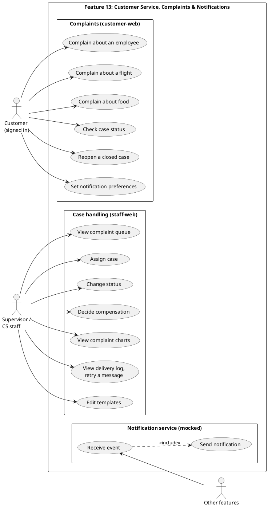
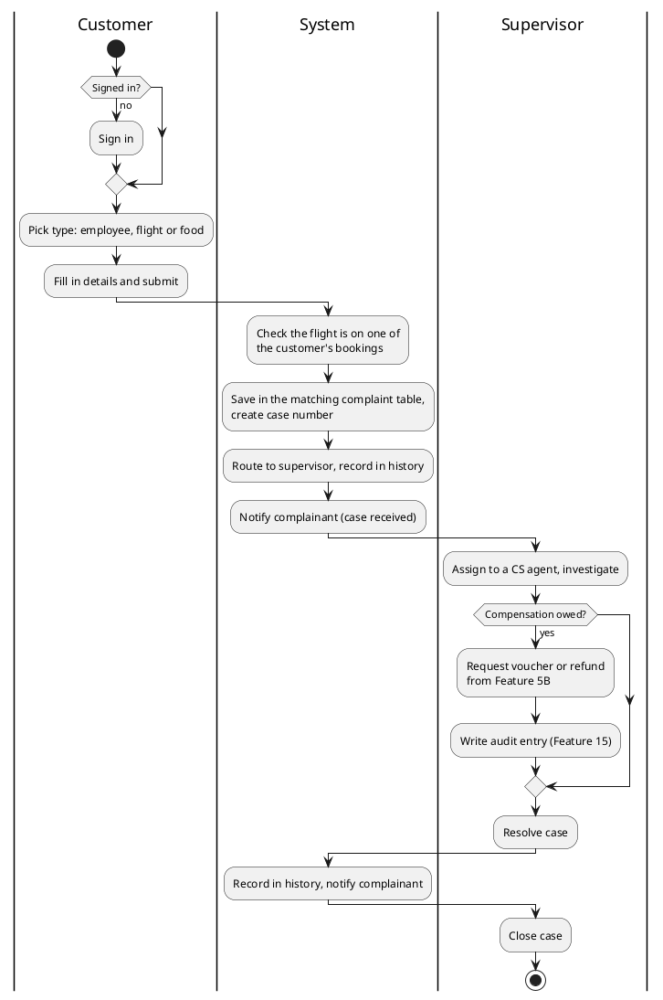

# Feature 13 — Customer Service, Complaints & Notifications (Iteration-03)

Nov 20, 2026 · Group 16 · In, Ball

**Prototype:** [Flython Complaints Mockups](https://claude.ai/artifact/TXGUGWVpMZYah3eNUHPuyG): customer-web Make a complaint, staff-web Supervisor queue and Complaint charts (sample data).

This document describes Feature 13 as it should be when it is finished. What the code still lacks is listed in "Remaining work" at the end. It is built from the Iteration-01 spec, the group requirement doc and Ajarn's feedback; where they disagree, we pick the more reasonable option and say why.

## Overview

Feature 13 lets signed-in customers complain about an employee, a flight or food, sends every complaint to a supervisor with a full record of what happens to it, and sends every message the system needs. All message providers are mocked: nothing real is sent.

**What Ajarn said.**

- Both customers and passengers (even without an account) can complain about the flight.
- Make 3 tables for complaints: about employees, about the flight, and about food.
- No inbox needed.
- Complaints go to the supervisor, so the system must keep a record of them.

**Scope decision (20 Nov 2026): complaints need an account.** Only a signed-in customer can make, check or reopen a complaint. This narrows Ajarn's first point (see "Open questions"). Passengers without an account are still covered by the notification service: they get flight and other messages at the booking's contact address.

What this feature owns:

- The 3 complaint types (Employee, Flight, Food), each in its own table, plus one shared case row for the queue and history
- Case numbers (`CS-2026-000124`), status, and an append-only history of every step
- The supervisor queue, case handling (assign, notes, resolve, close, duplicates) and compensation decisions (paid by Feature 5B)
- Lost-bag cases opened by Feature 10
- Complaint charts: by type, per week, top flights
- The notification service: turns events (other features' and our own case events) into email, SMS or push messages from templates, through mocked providers, with a delivery log and retry
- Customer notification preferences

**Users.**

| User | App | What they do |
| --- | --- | --- |
| Customer (signed in) | customer-web | Makes a complaint, checks case status, reopens a closed case, sets notification preferences |
| CS supervisor (`cs-supervisor`) | staff-web | Assigns cases, decides compensation, edits templates, works any case, views charts and the delivery log |
| CS agent (`cs-agent`) | staff-web | Works the cases assigned to them: adds notes, marks duplicates, resolves and closes; reads templates, charts and the delivery log |
| Other features | system | Send events (flight delayed, gate changed, ...) for the notification service to turn into messages |

A staff role with `is_admin` counts as a supervisor.

**Revisions.**

- 21 Oct 2026: complaints point at Feature 2's flight and Feature 12's product by id, and a lost-bag case links to Feature 10's report, to match the Level 1 schema in the repo.
- 25 Oct 2026: the DB team's review (23 fixes, tested on PostgreSQL 16) is folded into the schema.
- 16 Nov 2026: implementation status of the complaint half.
- 20 Nov 2026: complaints need an account; the no-account flow is removed. The document now describes the finished feature, with the notification service, preferences and retry as built, and the open work in "Remaining work".
- 23 Nov 2026: the no-account flow, the agent rules and the recipient's name on retry are done, so they are off "Remaining work".

Cross-module contracts:

- **Feature 1 (Platform Core):** sign-in, roles (`cs-agent`, `cs-supervisor`), the simulation clock. Every business timestamp comes from the simulation clock.
- **Feature 2 (Flight Scheduling):** we read `flight` by `(flight_number, service_date)` and subscribe to its in-process `FlightEventBus` (`flight.delayed`, `flight.rescheduled`, `flight.diverted`, `flight.cancelled`) for notifications.
- **Feature 3 (Booking):** a complaint's flight must be a `booking_segment` of one of the customer's bookings. Bookings carry a contact email and phone. We need a route that lists the passengers on a flight; until then we read confirmed bookings directly. We subscribe to its booking event bus (`booking.confirmed`, `booking.cancelled`, `booking.partner_rebooked`, `booking.seat_changed`, `service_request.updated`) and message the booking's customer; a booking cancelled with its flight sends nothing, since `flight_cancelled` already covers it.
- **Feature 5B (Refunds):** pays compensation; each decision's id is the idempotency key. The result comes back as `paid` or `failed` with a reason.
- **Feature 5 (Payments):** writes `payment_received`, `refund_issued`, `refund_failed` and `voucher_issued` straight into `inbound_event` (source `'5'`, `payload.customer_id`) in the same transaction as the money movement; our stored-event sender picks them up.
- **Feature 6 (Check-in):** publishes gate change, boarding call, check-in and boarding pass events through `NotificationService.publish`.
- **Feature 7 (Profiles):** who complained (`passenger`); name on passenger, email on user, phone on customer; publishes the security alert events.
- **Feature 10 (Lost and Found):** its `BaggageCaseNotices` hook calls `CustomerServiceService.openLostBagCase(reportId)` when a report is set to lost (a `lost_bag` flight case, source `feature_10`), and sends bag case and delivery events through `NotificationService.handleEvent`.
- **Feature 12 (Onboard Products):** the passenger's meal line, or the flight's default meal, for food complaints.
- **Feature 14 (BI):** complaint counts by type, week and flight (no duplicates), resolution times.
- **Feature 15 (Admin Console):** an audit entry for every staff action, through its in-process `AuditService`, in the same transaction as the change; the staff screen registers as `f13.service_compensation`.

## Data model

Ten tables. Singular names, UUID primary keys (`notification_type` uses its code), business timestamps from the simulation clock, `created_at` and `updated_at` in real time. PK = primary key, FK = foreign key.

| Table | Key columns | Notes |
| --- | --- | --- |
| `complaint_case` | `id` (PK), `case_number`, `type`, `passenger_id` (FK), `customer_id` (FK, nullable), `booking_passenger_id` (FK, nullable), `contact_email`, `contact_phone`, `status`, `owner_staff_id` (FK), `source`, `lost_bag_report_id` (FK, unique), `duplicate_of_case_id` (FK), `opened_at`, `resolved_at`, `closed_at` | What every complaint has, so one queue and one history cover all 3 types. `customer_id` is empty only for a Feature 10 case whose passenger has no account |
| `employee_complaint` | `case_id` + `case_type` (PK, FK), `location`, `staff_name`, `linked_staff_id` (FK), `description` | `staff_name` is free text; the agent links the staff record later |
| `flight_complaint` | `case_id` + `case_type` (PK, FK), `flight_id` (FK), `issue`, `details` | `lost_bag` is only for Feature 10 cases |
| `food_complaint` | `case_id` + `case_type` (PK, FK), `flight_id` (FK), `product_id` + `product_category` (FK), `issue`, `details` | The meal, snack or drink from Feature 12, if known |
| `case_event` | `id` (PK), `case_id` (FK), `event_type`, `actor_type`, `actor_staff_id` (FK), `from_value`, `to_value`, `note`, `is_internal`, `occurred_at` | Append-only (trigger). Staff notes are always internal |
| `case_compensation` | `id` (PK), `case_id` (FK), `decided_by_staff_id` (FK), `type`, `amount`, `reason`, `status`, `payout_ref`, `failure_reason`, `decided_at`, `result_at` | One live decision per case (`case_compensation_live_uq`, ignores `failed`) |
| `notification_type` | `code` (PK), `source_feature`, `name`, `is_mandatory` | Reference data in the migrations; Features 5 and 11 add their own types |
| `notification_template` | `id` (PK), `type_code` (FK), `channel`, `subject_template`, `body_template`, `is_active`, `updated_by` (FK) | One per type and channel; email needs a subject, SMS has none |
| `notification_preference` | `customer_id` + `type_code` + `channel` (PK), `is_enabled` | No row = email on, SMS and push off |
| `inbound_event` | `id` (PK), `source`, `source_event_id`, `event_type`, `payload`, `received_at`, `processed_at` | Unique on `(source, source_event_id)`, so a repeated event is a no-op |
| `notification` | `id` (PK), `inbound_event_id` (FK), `type_code` (FK), `channel`, `recipient`, `customer_id` (FK), `case_id` (FK), `subject`, `body`, `status`, `attempts`, `error`, `queued_at`, `sent_at` | One per event, recipient and channel. Content never changes after it is set; rows are never deleted |

The schema is unchanged by the account-only decision: `customer_id` stays nullable for Feature 10 cases.

**Deliberate choices.**

- **Three detail tables, one case table.** Each detail table pins its type through a composite key to `complaint_case (id, type)`, so a case has details only in its own type's table, and the queue and history stay in one place.
- **A case belongs to an account.** A customer sees only cases filed from their own account; a case number alone never opens a case.
- **No names are copied** onto the case: the passenger row (Feature 7) holds them.
- **Every message comes from an event.** Our own case events go through `inbound_event` with source `'13'`, the same path as other features' events.

## Complaint status

```text
with_supervisor (no owner) ──assign (supervisor)──▶ assigned ──resolve──▶ resolved ──close──▶ closed
        ▲                                                                                      │
        └──────────────── reopen (complainant only, within 7 days of closed_at) ───────────────┘
```

| Step | Who | Route | Notes |
| --- | --- | --- | --- |
| Assign or reassign | Supervisor | `PATCH /staff/complaints/:id/assign` | Only to a `cs-agent` or `cs-supervisor`; not on a resolved or closed case |
| Add a note | Case owner or supervisor | `POST /staff/complaints/:id/notes` | Always internal |
| Resolve | Case owner or supervisor | `PATCH /staff/complaints/:id/status` (`resolved`) | Only from `assigned`; may name the case it duplicates |
| Close | Case owner or supervisor | `PATCH /staff/complaints/:id/status` (`closed`) | Only from `resolved` |
| Reopen | Complainant | `POST /complaints/:caseNumber/reopen` | Only from `closed`, within 7 days of `closed_at`; clears owner and resolution |

Any other step returns `409`. A staff member who is neither the owner nor a supervisor gets `403 NOT_CASE_OWNER`. Every step writes a `case_event` row and a Feature 15 audit entry in one transaction; a concurrent change returns `409`. A new or reopened case writes a `routed_to_supervisor` event.

## API routes

All paths sit under the global prefix `/api`. Writes use `POST` to create and `PATCH` to change. Ids in staff paths are UUIDs. Every route needs a signed-in user (the global `JwtAuthGuard`); there are no public routes. Guards: C = signed-in customer, S = staff with role `cs-agent` or `cs-supervisor` (`CustomerServiceStaffGuard`), Sup = supervisor only (`@SupervisorOnly()`). Request bodies are validated with `whitelist` and `forbidNonWhitelisted`: unknown fields are refused with `400`.

Customer (`CustomerComplaintsController`, `CustomerNotificationPreferencesController`):

| Method & path | Guard | Purpose | Main errors |
| --- | --- | --- | --- |
| `POST /complaints` | C | Submit a complaint; returns the case | `400 FLIGHT_NOT_ON_BOOKING`, `400` bad issue or missing date, `404` no such flight |
| `GET /complaints` | C | List own complaints, in the same customer view as the detail | none |
| `GET /complaints/:caseNumber` | C | Status and history (internal events and staff names hidden) | `404` |
| `POST /complaints/:caseNumber/reopen` | C | Reopen a closed case within 7 days | `409 INVALID_STATUS`, `409 CANNOT_REOPEN_AFTER_7_DAYS` |
| `GET /customers/me/notification-preferences` | C | Type × channel switches; the security types are not listed | none |
| `PUT /customers/me/notification-preferences` | C | Save switches: `{ preferences: [{ typeCode, email, sms, push }] }` | `400` unknown or security type |

Staff (`StaffComplaintsController`, prefix `/staff/complaints`):

| Method & path | Guard | Purpose | Main errors |
| --- | --- | --- | --- |
| `GET /me` | S | The caller's name, role and `isSupervisor` | `403` |
| `GET /staff-members` | S | CS agents and supervisors, for the assign picker | none |
| `GET /` | S | Queue: unassigned, then assigned, then resolved and closed; newest first in each group; up to 500 open and 500 finished | none |
| `GET /:id` | S | Detail with internal notes and history | `404` |
| `PATCH /:id/assign` | Sup | Assign to a CS staff member | `400` target not CS staff, `404`, `409 INVALID_STATUS` |
| `PATCH /:id/status` | S | Resolve (optionally as a duplicate) or close | `403 NOT_CASE_OWNER`, `409` |
| `POST /:id/notes` | S | Add an internal note | `403 NOT_CASE_OWNER`, `404` |
| `POST /:id/compensation` | Sup | Decide compensation: `voucher` or `refund`, amount in THB, reason (status `pending`) | `400` bad type or amount, `409 COMPENSATION_EXISTS` |
| `GET /charts` | S | Numbers for the charts, for a chosen month | none |
| `GET /delivery-log` | S | The latest 200 messages with counters | none |
| `POST /delivery-log/:id/retry` | S | Retry a failed message (audited) | `404` |
| `GET /templates` | S | Templates per type and channel | none |
| `PATCH /templates/:code` | Sup | Edit a template's text or switch a channel on or off | `400 INVALID_PLACEHOLDER`, `400 MANDATORY_EMAIL_REQUIRED`, `404` unknown type |

## Notification service (mocked)

Nothing real is sent on any channel: the repo has no email, SMS or push provider and no settings for one. The service does everything except call a provider, so the delivery log shows exactly what would have gone out.

1. **Event arrives.** Feature 2 publishes on its `FlightEventBus`, another feature calls `NotificationService.publish`, or a case event happens here. The event is saved in `inbound_event`; a repeat of `(source, source_event_id)` is ignored.
2. **Find recipients.** Passengers on the flight (through Feature 3), the person named in the event, the complainant of the case, or the fixed authority address for the security types. Each passenger is linked to their own account only; a co-traveller without an account gets messages at the booking's contact address, with default preferences and no push.
3. **Check preferences.** No preference row = email on, SMS and push off. Mandatory types (`is_mandatory`) always go out by email if the customer switched every channel off.
4. **Fill the template.** The active template for the type and channel, with the placeholders listed in `notification-placeholders.ts`. Each recipient's name fills `{{passenger_name}}` and is saved with the event, so a retry uses the same name.
5. **Send (mocked).** The mock sender marks the message `sent`, or `failed` with an error. No phone number = SMS skipped; no account = push skipped; a switched-off template = that channel skipped. A skipped channel writes no message.
6. **Save a delivery record.** One `notification` row per event, recipient and channel, linked to the case when there is one. Its content never changes once set; only status, attempts, `sent_at` and error do. A missing template saves the row as `failed` with no subject or body.
7. **Retry.** Staff retry a failed message from the delivery log. A message with no body is rendered again from the current template, keeping any subject already saved; others are sent again as they are.

A notification is sent after the case change has been saved. If it fails, the error is logged and the request still returns the saved case.

Our own events: **complaint received** (case created) and **complaint updated** (assigned, resolved, closed, reopened). The status in a message is readable text ("Resolved"), not the code.

## Templates

The database holds 21 message types and 59 templates: every type has email, SMS and push except `security_alert` and `security_alert_withdrawn` (email only). All are switched on.

| Feature | Message types |
| --- | --- |
| 2 | `flight_delayed`, `flight_rescheduled`, `flight_diverted`, `flight_cancelled` |
| 5 | `payment_received`, `refund_issued`, `refund_failed`, `voucher_issued` |
| 6 | `check_in_completed`, `boarding_pass_issued`, `gate_changed`, `boarding_call` |
| 7 | `security_alert`, `security_alert_withdrawn` |
| 10 | `bag_case_updated`, `bag_delivery_updated` |
| 11 | `cabin_upgraded`, `miles_expiring`, `tier_changed` |
| 13 | `complaint_received`, `complaint_updated` |

Rules:

- Every CS staff member can read templates; only the supervisor edits them. For agents the Templates page is read-only.
- A template may use only its type's placeholders (`INVALID_PLACEHOLDER`).
- The email template of a mandatory type cannot be switched off (`MANDATORY_EMAIL_REQUIRED`). SMS and push can.
- A missing SMS or push template needs its text before it can be switched on.
- Every save sets `updated_by` and `updated_at` and writes an audit entry.
- The page says that messages are simulated and recorded in the Delivery log, and that a switched-off channel is not sent.

## How other features send us an event

Feature 2's flight events arrive through its `FlightEventBus`; nothing else is needed from them. Features 6, 7 and 10 import `CustomerServiceModule` and call `NotificationService.publish(event)`. The event shapes are the `ExternalNotificationEvent` types in `apps/backend/src/modules/customer-service/notification-events.ts`, exported from `@backend/modules/customer-service`.

| Feature | `eventType` | Fields besides `source`, `sourceEventId`, `eventType` | Sent to |
| --- | --- | --- | --- |
| 6 | `gate_changed` | `flightNumber`, `serviceDate`, `gate`, `flightId?`, `passengerName?`, `email?`, `phone?`, `customerId?` | The named passenger, or everyone on `flightId` |
| 6 | `boarding_call` | `flightNumber`, `gate`, `flightId?`, `passengerName?`, `email?`, `phone?`, `customerId?` | The named passenger, or everyone on `flightId` |
| 6 | `check_in_completed` | `flightNumber`, `serviceDate`, `passengerName`, `email?`, `phone?`, `customerId?` | The passenger |
| 6 | `boarding_pass_issued` | `flightNumber`, `serviceDate`, `seat`, `boardingTime`, `passengerName`, `email?`, `phone?`, `customerId?` | The passenger |
| 7 | `security_alert`, `security_alert_withdrawn` | `passengerName`, `flightNumber`, `serviceDate`, `reference` | The authority (`security-authority@example.invalid`) |
| 10 | `bag_case_updated` | `caseNumber`, `status`, `passengerName`, `email?`, `phone?`, `customerId?` | The passenger |
| 10 | `bag_delivery_updated` | `caseNumber`, `deliveryStatus`, `passengerName`, `email?`, `phone?`, `customerId?` | The passenger |

`sourceEventId` must be unique per event within the feature: the same `(source, sourceEventId)` sent twice is ignored.

```typescript
@Injectable()
export class GateService {
  constructor(private readonly notifications: NotificationService) {}

  async onGateChanged(flight: { id: string; number: string; serviceDate: string }, gate: string, changeId: string) {
    await this.notifications.publish({
      source: '6',
      sourceEventId: `gate-change-${changeId}`,
      eventType: 'gate_changed',
      flightId: flight.id, // everyone on the flight
      flightNumber: flight.number,
      serviceDate: flight.serviceDate,
      gate,
    })
  }
}
```

## Use case diagram





## Frontend pages

Customer-web (`src/features/customer-service/`, routes under `/complaints`). Every page needs a signed-in customer; a signed-out visitor is asked to sign in. The pages sit under the app's shared header.

| Page | Route | What it does |
| --- | --- | --- |
| Make a complaint | `/complaints` | Pick a type and fill in details. Flight and food complaints need a flight number and date; the form starts empty |
| Complaint sent | `/complaints/sent` | Shows the case number |
| Check a case | `/complaints/check` | The customer's cases, and a case's status and history (non-internal events) in the browser's time zone. A Reopen button for a closed case within 7 days |
| Notification preferences | `/complaints/preferences` | Type × channel switches saved to the database; shows a loading state, never made-up values |

Staff-web (`src/features/customer-service/`, routes under `/_authenticated/complaints`, sidebar group "Service & Compensation"). A page whose load fails shows `PageError` with Try again; an action that fails shows its error inline.

| Sidebar entry | Route | Actions |
| --- | --- | --- |
| Complaint queue | `/complaints` | Read: queue with type, status and owner filters, refreshed on a timer. Assign (supervisor), resolve, mark duplicate and close (owner or supervisor), add a note (owner or supervisor), decide compensation (supervisor), link the staff member of an employee complaint |
| Complaint charts | `/complaints/charts` | Read: totals, open now, average days to close, compensation, by type, top flights, last 8 weeks; a month picker that reloads the numbers |
| Delivery log | `/complaints/delivery-log` | Read: messages with event, channel, status and linked case; filters and paging; Retry on a failed message |
| Templates | `/complaints/templates` | Read for all CS staff; edit text and switch channels (supervisor) |

Missing values show `—`; no page shows sample data.

## Rules the backend enforces (not database constraints)

- **Account only:** every complaint route needs a signed-in customer; a customer sees and reopens only their own cases.
- **Status steps:** the transitions in "Complaint status"; owner or supervisor for notes, resolve and close; supervisor for assign, compensation and template edits.
- **Assign:** the new owner must be a CS agent or supervisor.
- **Reopen:** complainant only, from `closed` only, within 7 days of `closed_at` on the simulation clock.
- **Booking checks:** a flight or food complaint needs a flight number and date, and the flight must be a segment of one of the customer's bookings (they made it or travel on it); a booking reference, if sent, narrows the check to that booking. The case shows the booking that holds the flight.
- **Issues:** flight issues `delay`, `cancellation`, `seat`, `cleanliness`, `other`; food issues `wrong_meal`, `quality`, `allergy`, `missing`, `other`. `lost_bag` is refused from the form.
- **Contact:** the case's contact email is the account's email.
- **Compensation:** type `voucher` or `refund`, amount above 0; one live decision per case; a concurrent second decision hits `case_compensation_live_uq` and returns `COMPENSATION_EXISTS`.
- **Preferences:** only the types the GET lists can be saved; the security types go to the authority, not the customer.
- **Audit:** every staff write, including a message retry, sends a Feature 15 audit entry in the same transaction.
- **Privacy:** customers never receive internal notes, staff names or staff ids, in the list or the detail.
- **Concurrency:** status writes are conditional on the status (and owner) read; a change in between returns `409`.

## Edge cases

| Case | What happens | Error code |
| --- | --- | --- |
| Not signed in | Asked to sign in; the API refuses | `401` |
| Flight complaint for a flight not on the customer's bookings | Not accepted | `FLIGHT_NOT_ON_BOOKING` |
| Food complaint but no meal on the booking | Accepted, meal left blank | |
| Staff member not named in an employee complaint | Accepted with a description | |
| Same problem sent twice | Staff resolve one as a duplicate; the charts leave it out | |
| Close before Resolved | Blocked | `INVALID_STATUS` (`409`) |
| Reopen after 7 days, or a case that is not closed | Blocked | `CANNOT_REOPEN_AFTER_7_DAYS`, `INVALID_STATUS` |
| Agent works or notes a case they don't own | Blocked | `NOT_CASE_OWNER` (`403`) |
| Compensation asked while one is pending or paid | Blocked | `COMPENSATION_EXISTS` |
| Feature 5B rejects the payout | Marked failed with the reason; supervisor can decide again | |
| Lost bag report, bag found later | Case from Feature 10; supervisor decides | |
| Complainant picks issue `lost_bag` | Not accepted | |
| Same event received twice | Ignored | |
| No phone number for SMS | SMS skipped, other channels sent | |
| Customer turned off every channel | Mandatory types still go by email | |
| Template missing, or mocked provider fails | Saved as failed; staff retry it | |
| Notification fails after a case change | Logged; the change is kept and returned | |

## SQL (Structured Query Language)

The schema as applied is the migration `apps/backend/src/db/prisma/migrations/20261106120200_feature13_customer_service/migration.sql`; read it there rather than a copy here. Differences from the schema requested on 25 Oct:

- `security_alert_withdrawn` was added as a mandatory Feature 7 type.
- `complaint_case.booking_passenger_id` now has its foreign key (`complaint_case_booking_passenger_fk`, added by the Feature 3 migration).
- Features 5 and 11 add their own `notification_type` rows and templates in their migrations.

Required rows: the notification types and a default template per type and channel are in the migration; the `cs-agent` and `cs-supervisor` roles, the Feature 13 screen and the demo complaints are in `seedCustomerService()` in `seed.ts`.

## Open questions

**We decide (later groups follow us):**

- [x] **Compensation request shape:** each decision's id is the idempotency key, so a new decision is a new request to Feature 5B.
- [x] **Employee complaints:** free text only; the agent links the staff member later.
- [x] **Reopen a closed case:** yes, by the complainant, within 7 days of closing; after that they open a new case.
- [x] **Complaints without an account:** dropped on 20 Nov 2026. Confirm with Ajarn, who said passengers without an account can complain about the flight.
- [ ] **"Don't have to do inbox":** this document drops the case message thread and the customer inbox page. Is that what Ajarn meant?
- [ ] **Compensation guideline values** (for example a delay over 3 h = 1,000 THB voucher).
- [ ] **Queue order within a group:** newest first or oldest first?
- [ ] **Signed-in "own booking":** a booking counts when the customer made it or travels on it. Is "made it" alone intended?

**Follow an earlier group:**

- [x] **Feature 12:** the passenger's meal line in `product_order_line`, or the flight's default meal in `product_offering`; Feature 12 exposes the read.
- [x] **Feature 15:** their in-process audit service, in the same transaction as the change.
- [x] **Feature 7:** name on passenger, email on user, phone on customer.
- [ ] **Feature 7:** they send a security event, and we send the police alert to the authority.

**Same wave, agree together:**

- [ ] **Feature 3:** a route to list passengers on a flight (for notifications).
- [ ] **Error format:** the design says `{ error: { code, message, details? } }`; the code uses the NestJS default `{ statusCode, message, error }`. What do the other features return?

Changed from the Iteration-01 spec: one case table became 3 complaint tables (Ajarn); message thread and customer inbox removed (Ajarn); escalation levels replaced by "everything goes to the supervisor" (Ajarn); complaints need an account (20 Nov 2026). SLA timers stay a stretch goal.

## Remaining work

What the code still lacks against this document, as of 23 Nov 2026. Each item stays inside the customer-service folders unless it says otherwise.

- [ ] **`routed_to_supervisor` events** on a new or reopened case.
- [ ] **Reopen button** in Check a case.
- [ ] **Duplicates:** `duplicateOfCaseId` when resolving, a case picker in the queue, a `marked_duplicate` event, and `duplicate_of_case_id: null` in the charts query.
- [ ] **Employee and food links:** `linked_staff_id` picker; `product_id` from Feature 12's read.
- [ ] **Charts month picker.**
- [ ] **Sidebar screen codes:** give the "Service & Compensation" items a screen `code` and add the group to the Role access preview. These files belong to Feature 15 (`features/admin-console/`), so ask them first.
- [ ] **Customer-web restyle:** move inline styles to theme tokens and shadcn/ui.

Waiting on other groups: paying compensation through Feature 5B, the passenger list route from Feature 3.

## Glossary

Acronyms used in this document, in alphabetical order.

| Acronym | Meaning | Where it appears |
| --- | --- | --- |
| API | Application Programming Interface | The routes the frontends call |
| BI | Business intelligence (Feature 14) | Data provided to other features |
| CS | Customer service | Role codes `cs-agent`, `cs-supervisor` |
| FK | Foreign key: a column that points at the primary key of another table | Data model |
| PK | Primary key: the column that uniquely identifies a row | Data model |
| SLA | Service-level agreement: a time limit for handling a case | Open questions |
| SMS | Short Message Service: a text message to a phone | Notifications |
| SQL | Structured Query Language | SQL section |
| THB | Thai baht | Compensation amounts |
| UUID | Universally unique identifier, used as the id of most tables | Data model |
