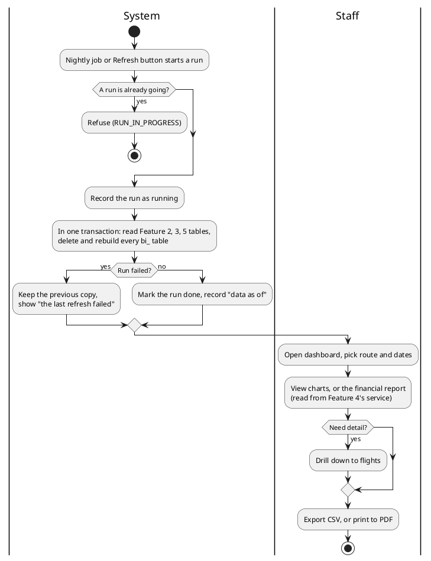
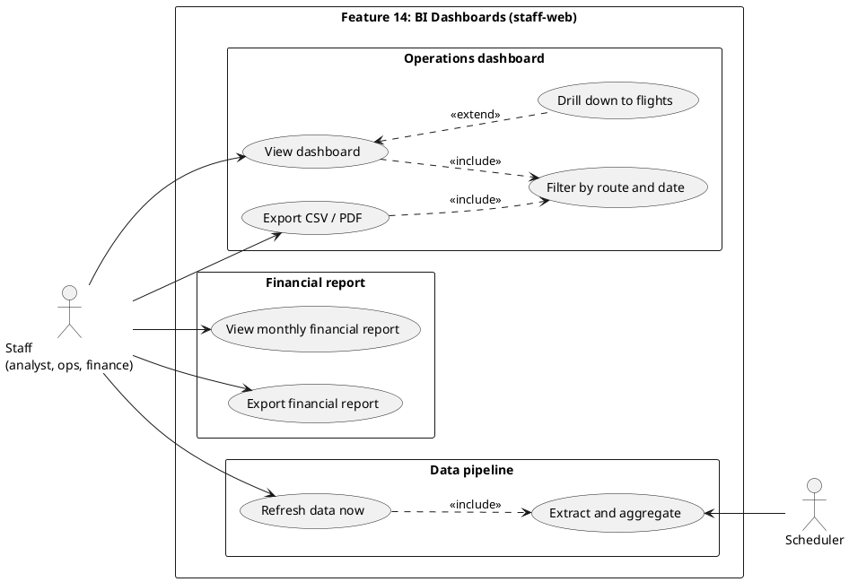

# Feature 14: Business Intelligence Dashboards (Iteration-02)

latest update: Oct 29, 2026

CSC290 Integrated Project · Group 6 · Ehsan, Shikeb

Built from the Iteration-01 spec, the group requirement doc, and Ajarn's feedback. Where they disagree, Ajarn's feedback wins.

Live prototype: [staff-web: Operations dashboard and Finance report](https://claude.ai/artifact/EuCkq3QrbKsvMTjNE9dLL7) (sample data)

Charts: built in staff-web, following the UI team's design. The group decided not to use Power BI.

Note: **What Ajarn said**

Ajarn gave no list for Feature 14 itself. Under Feature 4, he asked for a financial report built together with Feature 14:

- Monthly revenue
- Maintenance cost and payment schedule
- Staff cost
- Meal and catering cost
- Other expenses
- Monthly profit

# Part A: Requirements

## 1. Purpose

Give staff a read-only view of how the airline is doing: 4 operations metrics by route and date, plus a monthly financial report (revenue, costs, profit), all exportable. This feature never creates or edits other features' data.

## 2. Main Users

| User | App | What they do |
| --- | --- | --- |
| Staff (analyst, ops, commercial) | staff-web | Filter dashboards, drill down, export |
| Finance staff | staff-web | View and export the monthly financial report |
| Scheduler | system | Runs the nightly data pull |

Which reports each staff member can open comes from their role (Feature 15 screen access).

## 3. Main Functions

- **On-time performance:** share of departed flights that left on time (within 15 min, a setting), plus delay minutes by cause
- **Load factor:** how full departed flights are, total and per cabin
- **Revenue per seat:** ticket money (without taxes and surcharges) for each seat available on departed flights, after refunds by default
- **Bookings vs cancellations:** per route per day, counted per passenger per flight, with net bookings
- **Filters:** route and date range on every report, group by day, week or month
- **Drill-down:** click a chart point to see the flights behind it
- **Monthly financial report (Ajarn):** Feature 4 builds the numbers (revenue, taxes and surcharges collected for others, refunds, maintenance, staff, catering and other costs, profit, upcoming payments); Feature 14 reads them and adds charts, filters and export
- **Export:** CSV that matches the filters on screen; PDF through the browser's print
- **Data pipeline:** rebuilds a reporting copy (the `bi_` tables) from other features' tables in one go, on a schedule or when Refresh is pressed; shows "data as of"
- **Dashboard tool:** charts built in staff-web, following the UI team's design (no Power BI)
- **Stretch:** route comparison, variance flags, hourly refresh

## 4. Main Flow

&#91;image: Feature 14 data pipeline and viewing flow (PlantUML)\]

## 5. Information Needed

Columns are in the SQL (Part B).

- **Route:** origin, destination, distance
- **Flight (copied):** route, flight number, flight date, status (Feature 2's 7 statuses), scheduled and actual departure, delay minutes, revenue, refunds
- **Seats per cabin:** seats available and sold for each flight and cabin, from Feature 3's seat inventory
- **Delays:** one row per delay, with its minutes, reason code and category
- **Bookings per day:** bookings and cancellations per route, counted per passenger per flight
- **Daily roll-up:** flight totals per route and flight date (flights, cancelled, departed, on time, delay minutes, seats, revenue, refunds); the rates are worked out when read
- **Monthly finance:** not stored here; read from Feature 4's service
- **Data runs:** each refresh: scheduled or manual, who pressed it, data as of, status, rows, error
- **Setting:** the on-time limit (15 min)

## 6. Business Rules

| Area | Rule |
| --- | --- |
| On-time | Flights on time ÷ flights departed (a diversion after departure counts as departed). On time = left within 15 min of schedule, the industry's limit (D15), kept as a setting. Actual departure = time of Feature 2's departed event (Feature 2 has no actual departure column); delay = that minus the scheduled departure, 0 when early. Flights that have not left yet do not count |
| Load factor | Seats sold ÷ seats available, per cabin and total, departed flights only. Seats come from Feature 3's seat inventory (award seats included) |
| Revenue | Ticket money of the flight's coupons in Feature 5's captured payments (fare, award fee and seat fee lines), without taxes and surcharges (Feature 4's pass-through), so it means the same as Feature 4's revenue. Feature 14 counts by flight date and Feature 4 by payment month, so the totals can differ; both pages say so |
| Revenue per seat | (Revenue − refunds) ÷ seats available, departed flights only. After refunds by default; before refunds is a display choice |
| Bookings | Counted per coupon (one passenger on one flight). Booked on the booking's confirmed date, cancelled on the coupon's cancelled date. A coupon changed to another flight is in neither count; a flight cancellation or a partner rebooking counts as a cancellation. Net bookings = booked − cancelled |
| Dates | Flight date = Feature 2's service date (local date at the origin of the original departure; a delay past midnight does not change it). Booking date = local date at the route's origin airport |
| Week or month | Add up the days' totals, then work out the rate. Never average the daily rates (1 of 1 on time, then 0 of 3, is 25 %, not 50 %) |
| Delay causes | One row per delay, grouped by Feature 2's 7 categories: weather, technical, crew, air traffic control, security, airport operations, other. A delay with no reason counts as other. The chart shows announced delay minutes, which can differ from the departure delay when time is made up, and is labelled that way |
| Finance | Profit comes from Feature 4 (revenue − pass-through − refunds − maintenance − staff − catering − other); Feature 14 never recalculates it. Pass-through is its own line: "taxes and surcharges collected for others". Each month shows Feature 4's computed time |
| Read only | Dashboards read the `bi_` copy. The pipeline only reads other features' tables and never writes back. Finance comes from Feature 4's service in the same backend |
| Refresh | One run = one transaction that deletes and rebuilds every `bi_` table (not TRUNCATE, which blocks dashboard reads). All or nothing: a failed run keeps the previous copy. Every run rebuilds everything, so late changes need no tracking. Only one run at a time |
| Export | CSV built from the same query and filters as the screen. PDF through the browser's print |
| Access | Two screens, `f14.operations` and `f14.finance`, given to roles through Feature 15. Finance staff use the finance role |
| Time | "Data as of" uses the Feature 1 simulation clock. For the demo, the seed fills the other features' tables with 30 days of data (reusing their seed data), then runs the pipeline once |

## 7. Data from Other Features

The pipeline reads these tables directly with SQL (read only). This is the one exception to calling other features through their services, because a roll-up cannot make one call per flight. Finance is read through Feature 4's service.

| Feature | We need |
| --- | --- |
| 1 Platform Core | Staff sign-in, simulation clock, staff (who pressed Refresh) |
| 2 Flight Scheduling | Tables `route`, `flight`, `flight_event` (departed and delayed events) and `disruption_reason`; the origin airport's time zone for booking dates |
| 3 Booking & Seats | Tables `seat_inventory` (seats per flight and cabin), `booking` (confirmed time) and `booking_coupon` (status, cancelled time) |
| 4 Pricing & Finance | Its service: the monthly summary for a range of months (every column, pass-through and computed time included), and payment schedules that are scheduled, due from the simulated today. Also the quote's tax and surcharge lines (`fare_quote_line`), to take them out of revenue |
| 5 Payment | Captured payment lines per coupon (fare, award fee, seat fee) and refund lines |
| 15 Admin Console | Screen check and role screens for `f14.operations` and `f14.finance` |

## 8. Data Provided to Other Features

| Feature | We send |
| --- | --- |
| None | Read only; staff get dashboards and exports |
| 15 Admin Console | Nothing needed. A manual refresh is already recorded in `bi_etl_run` with the staff member; if Feature 15 wants it in its log too, it is action `create` with entity type `bi_etl_run`. Exports hold only route and flight totals, no personal data, so they need no audit row |

## 9. Edge Cases

| Case | What happens | Error code |
| --- | --- | --- |
| A refresh fails | The previous copy stays. The page shows the last successful "data as of" and "the last refresh failed" |  |
| The server stops during a run | On startup the backend marks that run failed, so Refresh works again |  |
| No flights in the chosen range | Empty state: "No flights for this route and dates" |  |
| No departed flights or zero seats available | Metric shows a dash instead of dividing by zero |  |
| Refresh pressed while a run is going | Blocked | `RUN_IN_PROGRESS` |
| Flight changes after it was counted | The next run rebuilds everything, so the change is picked up |  |
| Flight has not left yet (today or later) | Not counted in on-time, load factor or revenue per seat until it departs |  |
| More seats sold than available (smaller aircraft swapped in) | Stored as it is; load factor can go over 100 % |  |
| Month not finished yet | Shown as partial |  |
| Feature 4 has no summary for the month yet | Shown as "not computed yet" |  |
| Staff opens a report their role can't see | Blocked | `FORBIDDEN` |

## 10. Open Questions

Labels follow the build order (wave 1: F1 · wave 2: F2, 4, 7, 8, 9, 12, 15 · wave 3: F3a, 3b, 6, 10, 11, 13, 17 · wave 4: F5a, 5b, 14, 16). Feature 14 is in the last wave, so it mostly reads what earlier groups publish.

**We decide**

- [x] Dashboard tool: Power BI, or charts built in staff-web (done: charts in staff-web with the UI team's design; the group decided not to use Power BI, so no `bi_reader` login is needed)
- [ ] Refresh: nightly plus the button (this doc's default)

**Follow an earlier group (read their published API)**

- [ ] Features 2 and 3: tell the owners which of their tables the pipeline reads (section 7)
- [ ] Feature 4: its service shape for us is a range of months with every column, pass-through and computed time; no row means "not computed yet". Ask: is cargo freight (paid through Feature 5) in its revenue? Airport fees stay out
- [ ] Auth owner: the shared staff-only guard and Feature 15's screen check, and seeding the `f14.operations` and `f14.finance` screens

**Same wave, agree together**

- [ ] Feature 5 (5a, 5b): revenue per flight = the coupons' fare, award fee and seat fee lines in captured payments, less taxes and surcharges; refunds from its refund lines

**Changed from the Iteration-01 spec:** added the monthly financial report (Ajarn), read from Feature 4. Route comparison and variance flags from the group doc stay as stretch goals.

**Changed after the DB team's review (29 Oct):** tables moved to the normal schema with a `bi_` prefix; Feature 2's 7 flight statuses; each refresh rebuilds the whole copy in one transaction (the "source does not answer" case is gone); on-time counts departed flights only; new tables for seats per cabin (from Feature 3, so Feature 9 is no longer needed) and one row per delay; revenue without taxes and surcharges, plus a refund column; Feature 4 read through its service; PDF through the browser's print.

# Part B: Technical

Same stack and conventions as the rest of Flython: NestJS, Postgres, the backend's own sign-in tokens, singular table names, PUT for updates, errors as `{ error: { code, message, details? } }`.

## Use Case Diagram

&#91;image: Feature 14 use case diagram (PlantUML)\]

## API Routes

Every route needs a staff sign-in: the global sign-in guard, the shared staff-only guard, and Feature 15's screen check (`f14.operations`, or `f14.finance` for the finance routes).

| Route | Method | Purpose |
| --- | --- | --- |
| `/bi/routes` | GET | Routes for the filter |
| `/bi/metrics` | GET | Rolled-up metrics: route, from, to, group by; rates worked out from the totals |
| `/bi/delay-causes` | GET | Announced delay minutes by category |
| `/bi/flights` | GET | Flights behind a metric (drill-down) |
| `/bi/finance/monthly` | GET | Feature 4's monthly summary for a range of months (from, to), pass-through and computed time included, shaped for charts |
| `/bi/finance/upcoming-payments` | GET | Feature 4's payment schedules that are scheduled, due from the simulated today |
| `/bi/exports/csv` | GET | CSV built from the same query and filters as `/bi/metrics` |
| `/bi/etl-runs/latest` | GET | Latest successful run's "data as of", and whether a run is going or the last one failed |
| `/bi/etl-runs` | POST | Start a manual run now (records who pressed it) |

PDF has no backend route: staff-web prints the page with a print stylesheet, so no PDF library is added. If the group wants a server-side PDF, ask the core team first.

## SQL Schema

Requested tables for the DB team; they write the final schema.

All tables are in the normal (public) schema with a `bi_` prefix. A separate `bi` schema would make Prisma reject every existing model, and Postgres readers never block writers anyway. Only the pipeline writes them.

```sql
-- Feature 14 (Business Intelligence Dashboards) - proposed schema.
-- Contents: the reporting copy the pipeline writes, its run log and its one setting. The extract queries, the roll-up
-- maths, the rates (computed from sums at read time), the exports and the stale-run cleanup are the backend's job.
-- Applies on top of the repo's migrations; uses only staff (feature 1). No foreign keys to other features' tables:
-- each copied row keeps its source id as its key, so nothing in a source can ever be blocked by the copy.
-- The tables are in the public schema with a bi_ prefix, not in a separate bi schema: with a second schema, Prisma
-- refuses every existing model that has no @@schema attribute (84 errors on dev with Prisma 7.10).
-- Only the pipeline writes them. A run rebuilds every bi_ table except bi_etl_run in ONE transaction, with DELETE and
-- INSERT (never TRUNCATE, which locks out readers until commit), so the dashboards keep reading the previous copy until
-- the new one commits, and a failed run leaves it whole.
-- flight_date is feature 2's service_date (local date at the origin). booking_date is the local date at the route's
-- origin airport of the simulation-clock time. Money is NUMERIC in the base currency (feature 4's pricing_setting).
-- Feature 4's monthly finance is not copied: staff-web reads it through feature 4's service.

-- Settings -------------------------------------------------------------------------------------------------

-- Closed list of keys, like crew_setting. 15 minutes is the industry's on-time limit (D15).
CREATE TABLE bi_setting (
  key        TEXT PRIMARY KEY CHECK (key IN ('on_time_minutes')),
  value      TEXT NOT NULL,
  updated_at TIMESTAMPTZ NOT NULL DEFAULT now(),
  updated_by UUID REFERENCES staff (id)
);

INSERT INTO bi_setting (key, value) VALUES ('on_time_minutes', '15');

-- Copy ------------------------------------------------------------------------------------------------------

-- Feature 2's routes, for the route filter.
CREATE TABLE bi_route (
  route_id    UUID PRIMARY KEY,                                -- feature 2's route.id
  origin      TEXT NOT NULL,                                   -- IATA codes
  destination TEXT NOT NULL,
  distance_km INTEGER NOT NULL CHECK (distance_km > 0),
  UNIQUE (origin, destination)
);

-- One row per feature 2 flight, cancelled ones included. actual_departure_at is the occurred_at of the flight's departed
-- event (feature 2 has no actual-departure column); delay_minutes is how late that was against scheduled_dep_at, 0 when
-- early. Revenue is the captured ticket money of the flight's coupons (feature 5's fare, award_fee and seat_fee lines)
-- without the taxes and surcharges (feature 4's pass-through), so it means what feature 4's revenue means; refund_amount
-- is the part of it refunded. Seats are in bi_flight_cabin, delays by cause in bi_flight_delay.
CREATE TABLE bi_flight (
  flight_id              UUID PRIMARY KEY,                     -- feature 2's flight.id
  route_id               UUID NOT NULL REFERENCES bi_route (route_id),
  flight_number          TEXT NOT NULL,
  flight_date            DATE NOT NULL,
  status                 TEXT NOT NULL CHECK (status IN (
                           'scheduled', 'delayed', 'holding', 'diverted', 'cancelled', 'departed', 'arrived')),
  scheduled_departure_at TIMESTAMPTZ NOT NULL,
  actual_departure_at    TIMESTAMPTZ,
  delay_minutes          INTEGER CHECK (delay_minutes >= 0),
  revenue_amount         NUMERIC(12, 2) NOT NULL CHECK (revenue_amount >= 0),
  refund_amount          NUMERIC(12, 2) NOT NULL CHECK (refund_amount >= 0),
  UNIQUE (flight_number, flight_date),
  CHECK ((actual_departure_at IS NULL) = (delay_minutes IS NULL)),
  CHECK (status NOT IN ('departed', 'arrived') OR actual_departure_at IS NOT NULL),
  CHECK (status NOT IN ('scheduled', 'delayed', 'cancelled') OR actual_departure_at IS NULL),
  CHECK (refund_amount <= revenue_amount)
);

CREATE INDEX bi_flight_route_date_idx ON bi_flight (route_id, flight_date);
CREATE INDEX bi_flight_date_idx ON bi_flight (flight_date);

-- Seats per cabin, from feature 3's seat_inventory (capacity and sold_count, award seats included), so feature 9 is not
-- read. Load factor per cabin sums these; the flight's total is their sum.
CREATE TABLE bi_flight_cabin (
  flight_id      UUID NOT NULL REFERENCES bi_flight (flight_id),
  cabin          TEXT NOT NULL CHECK (cabin IN ('economy', 'premium_economy', 'business', 'first')),
  seat_available INTEGER NOT NULL CHECK (seat_available >= 0),
  seat_sold      INTEGER NOT NULL CHECK (seat_sold >= 0),
  PRIMARY KEY (flight_id, cabin)
);

-- One row per feature 2 delayed event: the minutes it added and its reason, with the reason's category copied so the
-- delay-cause chart never reads feature 2's disruption_reason. A delay with no reason counts as 'other'.
CREATE TABLE bi_flight_delay (
  event_id      UUID PRIMARY KEY,                              -- feature 2's flight_event.id
  flight_id     UUID NOT NULL REFERENCES bi_flight (flight_id),
  reason_code   TEXT,
  category      TEXT NOT NULL CHECK (category IN (
                  'weather', 'technical', 'crew', 'air_traffic_control', 'security', 'airport_operations', 'other')),
  delay_minutes INTEGER NOT NULL CHECK (delay_minutes > 0),
  CHECK (reason_code IS NOT NULL OR category = 'other')
);

CREATE INDEX bi_flight_delay_flight_idx ON bi_flight_delay (flight_id);

-- Sales per route and day, counted in coupons (one passenger on one flight), from feature 3. A coupon counts as booked on
-- its booking's confirmed_at (feature 3 has no confirm time per coupon) and as cancelled on its cancelled_at. A coupon
-- cancelled because it was changed is in neither count, so a change is not a cancellation plus a new booking.
CREATE TABLE bi_booking_day (
  route_id           UUID NOT NULL REFERENCES bi_route (route_id),
  booking_date       DATE NOT NULL,
  booking_count      INTEGER NOT NULL CHECK (booking_count >= 0),
  cancellation_count INTEGER NOT NULL CHECK (cancellation_count >= 0),
  PRIMARY KEY (route_id, booking_date)
);

-- Roll-up ---------------------------------------------------------------------------------------------------

-- The flight metrics per route and flight date, summed from bi_flight, bi_flight_cabin and bi_flight_delay in the same
-- transaction. Rates are computed from the sums at read time, and a week or month adds the days' sums (never averages
-- the days' rates):
--   on-time %        on_time_count / departed_count
--   load factor      seat_sold / seat_available
--   revenue per seat (revenue_amount - refund_amount) / seat_available, or before refunds without refund_amount
-- Seats, revenue and on-time count only flights that departed, so today's and future flights do not drag the rates down.
CREATE TABLE bi_metric_day (
  route_id        UUID NOT NULL REFERENCES bi_route (route_id),
  flight_date     DATE NOT NULL,
  flight_count    INTEGER NOT NULL CHECK (flight_count > 0),     -- every flight that day, cancelled included
  cancelled_count INTEGER NOT NULL CHECK (cancelled_count >= 0),
  departed_count  INTEGER NOT NULL CHECK (departed_count >= 0),
  on_time_count   INTEGER NOT NULL CHECK (on_time_count >= 0),   -- delay_minutes <= on_time_minutes
  delay_minutes   INTEGER NOT NULL CHECK (delay_minutes >= 0),
  seat_available  INTEGER NOT NULL CHECK (seat_available >= 0),
  seat_sold       INTEGER NOT NULL CHECK (seat_sold >= 0),
  revenue_amount  NUMERIC(14, 2) NOT NULL CHECK (revenue_amount >= 0),
  refund_amount   NUMERIC(14, 2) NOT NULL CHECK (refund_amount >= 0),
  PRIMARY KEY (route_id, flight_date),
  CHECK (cancelled_count + departed_count <= flight_count),
  CHECK (on_time_count <= departed_count),
  CHECK (departed_count > 0 OR (delay_minutes = 0 AND seat_available = 0 AND seat_sold = 0 AND revenue_amount = 0)),
  CHECK (refund_amount <= revenue_amount)
);

CREATE INDEX bi_metric_day_date_idx ON bi_metric_day (flight_date);

-- Runs ------------------------------------------------------------------------------------------------------

-- One row per pipeline run, written in its own short transaction before the rebuild and finished after it, so the page
-- can show "refreshing". One run at a time: a second Refresh is refused by the unique index (RUN_IN_PROGRESS). On
-- startup the backend fails any row still running (the process died during the run).
-- data_as_of is the simulation-clock time the run read the sources at; the page shows the latest successful run's.
-- started_at and finished_at are real time.
CREATE TABLE bi_etl_run (
  id                    UUID PRIMARY KEY DEFAULT gen_random_uuid(),
  trigger               TEXT NOT NULL CHECK (trigger IN ('scheduled', 'manual')),
  requested_by_staff_id UUID REFERENCES staff (id),
  status                TEXT NOT NULL DEFAULT 'running' CHECK (status IN ('running', 'success', 'failed')),
  data_as_of            TIMESTAMPTZ NOT NULL,
  started_at            TIMESTAMPTZ NOT NULL DEFAULT now(),
  finished_at           TIMESTAMPTZ,
  row_count             INTEGER CHECK (row_count >= 0),
  error_message         TEXT,
  CHECK ((trigger = 'manual') = (requested_by_staff_id IS NOT NULL)),
  CHECK ((status = 'running') = (finished_at IS NULL)),
  CHECK (finished_at >= started_at),
  CHECK ((status = 'success') = (row_count IS NOT NULL)),
  CHECK ((status = 'failed') = (error_message IS NOT NULL))
);

CREATE UNIQUE INDEX bi_etl_run_one_running_uq ON bi_etl_run (status) WHERE status = 'running';
CREATE INDEX bi_etl_run_success_idx ON bi_etl_run (started_at DESC) WHERE status = 'success';
```

## UI Mockups

The mockup is only there to help people picture the pages. It doesn't show every function, and it may show things that aren't part of the feature.

- [staff-web: Operations dashboard and Finance report](https://claude.ai/artifact/EuCkq3QrbKsvMTjNE9dLL7)

## Diagram Sources (PlantUML)




