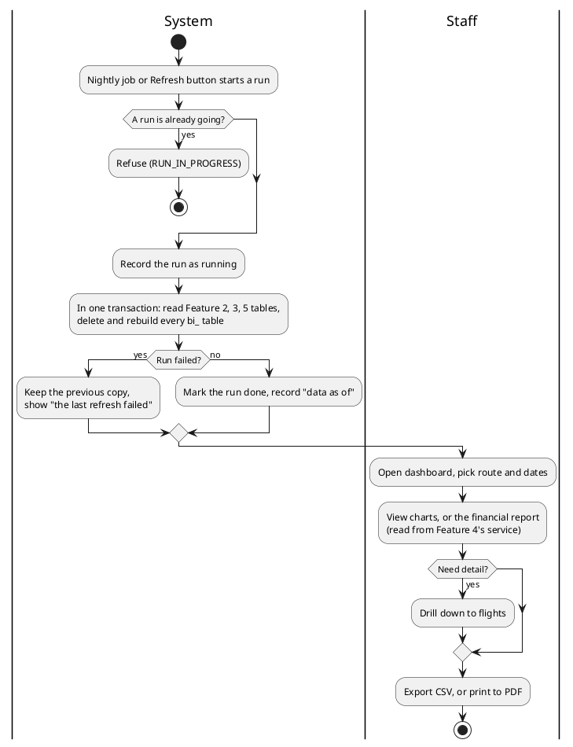
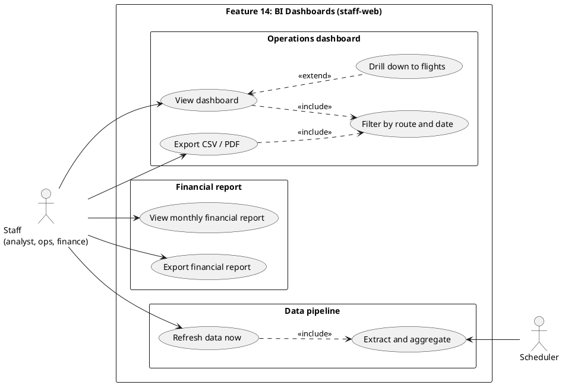

# Feature 14: Business Intelligence Dashboards (Iteration-03)

latest update: Nov 25, 2026

CSC290 Integrated Project · Group 6 · Ehsan, Shikeb

Built from the Iteration-01 spec, the group requirement doc, and Ajarn's feedback. Where they disagree, Ajarn's feedback wins.

**Changed 22 Nov:** three more tabs, **No-shows**, **Extra revenue** and **Aircraft use**, with 3 new `bi_` tables and 10 new columns on `bi_flight` and `bi_metric_day` (migration `20261122120000_feature14_bi_extra_data`). Only F14's own tables change, and the pipeline still only reads the other features.

**Changed 25 Nov:** refresh is nightly (02:00 Bangkok) plus the Refresh button; the 15-second automatic refresh added during development is gone. Each view has its own URL under `/bi`, every view exports CSV, and the Aircraft use page can schedule maintenance through Feature 9's service (admins only). A flight marked departed or arrived without Feature 2's events no longer fails the refresh (see Business Rules).

Live prototypes (sample data): [staff-web: Operations dashboard and Finance report](https://claude.ai/artifact/EuCkq3QrbKsvMTjNE9dLL7) · [BI mockup: No-shows, Extra revenue and Aircraft use](https://claude.ai/artifact/K8VEm6gk3NuzVjQHHYTR5Z)

Charts: built in staff-web, following the UI team's design. The group decided not to use Power BI.

Note: **What Ajarn said**

Ajarn gave no list for Feature 14 itself. Under Feature 4, he asked for a financial report built together with Feature 14:

- Monthly revenue
- Maintenance cost and payment schedule
- Staff cost
- Meal and catering cost
- Other expenses
- Monthly profit

# Part A: Requirements

## 1. Purpose

Give staff a read-only view of how the airline is doing: 4 operations metrics by route and date, no-shows, extra revenue and aircraft use, plus a monthly financial report (revenue, costs, profit), all exportable. The dashboards never edit other features' data. The one write is "Mark for maintenance" on the Aircraft use page, which goes through Feature 9's own service (Feature 9 owns the data and its rules).

## 2. Main Users

| User | App | What they do |
| --- | --- | --- |
| Staff (analyst, ops, commercial) | staff-web | Filter dashboards, drill down, export |
| Finance staff | staff-web | View and export the monthly financial report |
| Fleet admin | staff-web | Marks an aircraft for maintenance from the Aircraft use page (admin role only) |
| Scheduler | system | Runs the nightly data pull (02:00 Bangkok) |

Which reports each staff member can open comes from their role (Feature 15 screen access).

## 3. Main Functions

- **On-time performance:** share of departed flights that left on time (within 15 min, a setting), plus delay minutes by cause
- **Load factor:** how full departed flights are, total and per cabin
- **Revenue per seat:** ticket money (without taxes and surcharges) for each seat available on departed flights, after refunds by default
- **Bookings vs cancellations:** per route per day, counted per passenger per flight, with net bookings
- **Filters:** route and date range on every report, group by day, week or month
- **Drill-down:** click a chart point to see the flights behind it
- **No-shows:** share of booked passengers who did not board, by period, route and flight, counted once the gate has closed
- **Extra revenue:** baggage, upgrades, onboard food and insurance sales by period and type, after refunds, and per boarded passenger
- **Aircraft use:** hours flown per aircraft and per day it could fly, days out of service, low-use aircraft; admins can mark an aircraft for maintenance (through Feature 9)
- **Monthly financial report (Ajarn):** Feature 4 builds the numbers (revenue, taxes and surcharges collected for others, refunds, maintenance, staff, catering and other costs, profit, upcoming payments); Feature 14 reads them and adds charts, filters and export
- **Export:** CSV that matches the filters on screen, on every view; PDF through the browser's print
- **Data pipeline:** rebuilds a reporting copy (the `bi_` tables) from other features' tables in one go, on a schedule or when Refresh is pressed; shows "data as of"
- **Dashboard tool:** charts built in staff-web, following the UI team's design (no Power BI)
- **Stretch:** route comparison, variance flags, hourly refresh, previous-period comparisons on the three new tabs

## 4. Main Flow

&#91;image: Feature 14 data pipeline and viewing flow (PlantUML)\]

## 5. Information Needed

Columns are in the SQL (Part B).

- **Route:** origin, destination, distance
- **Flight (copied):** route, flight number, flight date, status (Feature 2's 7 statuses), scheduled and actual departure, delay minutes, revenue, refunds
- **Seats per cabin:** seats available and sold for each flight and cabin, from Feature 3's seat inventory
- **Delays:** one row per delay, with its minutes, reason code and category
- **Bookings per day:** bookings and cancellations per route, counted per passenger per flight
- **Daily roll-up:** flight totals per route and flight date (flights, cancelled, departed, on time, delay minutes, seats, revenue, refunds); the rates are worked out when read
- **No-shows (on the copied flight):** booked, boarded, denied and no-show counts, a snapshot taken when the gate closed; summed per route and day in the roll-up
- **Aircraft:** tail number, type, in service from, retired on; the aircraft each flight uses; block time (gate to gate)
- **Downtime:** days an aircraft was grounded or in maintenance, cut off at "data as of"
- **Extra revenue per day:** per date and type (baggage, upgrade, onboard order, insurance): how many sold, amount, refunds
- **Monthly finance:** not stored here; read from Feature 4's service
- **Data runs:** each refresh: scheduled or manual, who pressed it, data as of, status, rows, error
- **Setting:** the on-time limit (15 min)

## 6. Business Rules

| Area | Rule |
| --- | --- |
| On-time | Flights on time ÷ flights departed (a diversion after departure counts as departed). On time = left within 15 min of schedule, the industry's limit (D15), kept as a setting. Actual departure = time of Feature 2's departed event (Feature 2 has no actual departure column); delay = that minus the scheduled departure, 0 when early. Flights that have not left yet do not count |
| Load factor | Seats sold ÷ seats available, per cabin and total, departed flights only. Seats come from Feature 3's seat inventory (award seats included) |
| Revenue | Ticket money of the flight's coupons in Feature 5's captured payments (fare, award fee and seat fee lines), without taxes and surcharges (Feature 4's pass-through), so it means the same as Feature 4's revenue. Feature 14 counts by flight date and Feature 4 by payment month, so the totals can differ; both pages say so |
| Revenue per seat | (Revenue − refunds) ÷ seats available, departed flights only. After refunds by default; before refunds is a display choice |
| Bookings | Counted per coupon (one passenger on one flight). Booked on the booking's confirmed date, cancelled on the coupon's cancelled date. A coupon changed to another flight is in neither count; a flight cancellation or a partner rebooking counts as a cancellation. Net bookings = booked − cancelled |
| Dates | Flight date = Feature 2's service date (local date at the origin of the original departure; a delay past midnight does not change it). Booking date = local date at the route's origin airport |
| Week or month | Add up the days' totals, then work out the rate. Never average the daily rates (1 of 1 on time, then 0 of 3, is 25 %, not 50 %) |
| Delay causes | One row per delay, grouped by Feature 2's 7 categories: weather, technical, crew, air traffic control, security, airport operations, other. A delay with no reason counts as other. The chart shows announced delay minutes, which can differ from the departure delay when time is made up, and is labelled that way |
| No-shows | Counted only once Feature 6 has closed the gate (`flight_boarding.closed_at`), and never for a cancelled flight; until then the four counts are empty and the flight is left out. A snapshot of the coupons live at gate close: booked = Feature 3 coupons that are confirmed, or cancelled after the gate closed; boarded and denied = those coupons' Feature 6 check-ins. No-shows = booked − boarded − denied, so it cannot go below 0. Rate = no-shows ÷ booked |
| Extra revenue | Feature 5 payment lines of type baggage, upgrade, onboard order and insurance, on paid payments (captured or reversed, the same rule as flight revenue). Fare, award fee and seat fee stay in the flight's revenue and cargo is left out, so nothing is counted twice. Refunds = succeeded refund lines on those lines. Grouped by the payment's captured date in Asia/Bangkok; a refund stays on the date of the sale. Per passenger = net ÷ boarded passengers in the same period |
| Aircraft use | Block time = from the flight's departed event to its arrived event (gate to gate). Hours per day = hours flown ÷ days the aircraft could fly (in service, not retired, not grounded or in maintenance). Downtime = Feature 9's grounded and in-maintenance periods that have started, with an open or future end cut off at "data as of". Below 6 hours per day the aircraft is flagged as low use. The fleet charts are not split by route |
| Missing flight events | Feature 2's simulation-clock job that writes departed and arrived events does not exist yet, and seeds and dev tools set flights to departed or arrived directly. A flight in that state with no event uses its timetable `dep_at` and `arr_at` (the times the job will write), so one such flight cannot fail the whole refresh |
| Mark for maintenance | Admins only (checked on the server; the form is hidden for other roles). Schedules an A, B, C or D check or unscheduled maintenance for given dates through Feature 9's own service, so its rules (valid dates, no overlap) apply; then refreshes the copy so the page shows it |
| Finance | Profit comes from Feature 4 (revenue − pass-through − refunds − maintenance − staff − catering − other); Feature 14 never recalculates it. Pass-through is its own line: "taxes and surcharges collected for others". Each month shows Feature 4's computed time |
| Read only | Dashboards read the `bi_` copy. The pipeline only reads other features' tables and never writes back. Finance comes from Feature 4's service in the same backend. The only write is Mark for maintenance, through Feature 9's service |
| Refresh | Nightly at 02:00 Bangkok (19:00 UTC) and when Refresh is pressed. A manual Refresh while the nightly run is going waits for it, then runs. One run = one transaction that deletes and rebuilds every `bi_` table (not TRUNCATE, which blocks dashboard reads). All or nothing: a failed run keeps the previous copy. Every run rebuilds everything, so late changes need no tracking. Only one run at a time |
| Export | CSV built from the same query and filters as the screen. PDF through the browser's print |
| Access | Two screens, `f14.operations` and `f14.finance`, given to roles through Feature 15. Finance staff use the finance role. Operations, No-shows and Aircraft use need `f14.operations`; Financial report and Extra revenue (payment money) need `f14.finance` |
| Time | "Data as of" uses the Feature 1 simulation clock. For the demo, the seed fills the other features' tables with 30 days of data (reusing their seed data), then runs the pipeline once |

## 7. Data from Other Features

The pipeline reads these tables directly with SQL (read only). This is the one exception to calling other features through their services, because a roll-up cannot make one call per flight. Finance is read through Feature 4's service.

| Feature | We need |
| --- | --- |
| 1 Platform Core | Staff sign-in, simulation clock, staff (who pressed Refresh) |
| 2 Flight Scheduling | Tables `route`, `flight`, `flight_event` (departed and delayed events) and `disruption_reason`; the origin airport's time zone for booking dates |
| 2 Flight Scheduling (new) | `flight.aircraft_id`, and the `arrived` event in `flight_event` for block time |
| 3 Booking & Seats | Tables `seat_inventory` (seats per flight and cabin), `booking` (confirmed time) and `booking_coupon` (status, cancelled time) |
| 4 Pricing & Finance | Its service: the monthly summary for a range of months (every column, pass-through and computed time included), and payment schedules that are scheduled, due from the simulated today. Also the quote's tax and surcharge lines (`fare_quote_line`), to take them out of revenue |
| 5 Payment | Captured payment lines per coupon (fare, award fee, seat fee) and refund lines; for extra revenue, `payment_line` of type baggage, upgrade, onboard order and insurance, with `payment`, `refund` and `refund_line` |
| 6 Check-in & Boarding | Tables `check_in` (boarded, denied) and `flight_boarding` (gate `closed_at`), for no-shows |
| 9 Aircraft Management | Tables `aircraft`, `aircraft_type`, `aircraft_status_period` and `aircraft_maintenance`, for aircraft use; its service `createMaintenance` for Mark for maintenance |
| 15 Admin Console | Screen check and role screens for `f14.operations` and `f14.finance` |

## 8. Data Provided to Other Features

| Feature | We send |
| --- | --- |
| None | Read only; staff get dashboards and exports |
| 9 Aircraft Management | Maintenance periods created from the Aircraft use page, through its own service (it owns them) |
| 15 Admin Console | Nothing needed. A manual refresh is already recorded in `bi_etl_run` with the staff member; if Feature 15 wants it in its log too, it is action `create` with entity type `bi_etl_run`. Exports hold only route and flight totals, no personal data, so they need no audit row |

## 9. Edge Cases

| Case | What happens | Error code |
| --- | --- | --- |
| A refresh fails | The previous copy stays. The page shows the last successful "data as of" and "the last refresh failed" |  |
| The server stops during a run | On startup the backend marks that run failed, so Refresh works again |  |
| No flights in the chosen range | Empty state: "No flights for this route and dates" |  |
| No departed flights or zero seats available | Metric shows a dash instead of dividing by zero |  |
| Refresh pressed while a run is going | Blocked | `RUN_IN_PROGRESS` |
| Flight changes after it was counted | The next run rebuilds everything, so the change is picked up |  |
| Flight has not left yet (today or later) | Not counted in on-time, load factor or revenue per seat until it departs |  |
| More seats sold than available (smaller aircraft swapped in) | Stored as it is; load factor can go over 100 % |  |
| Month not finished yet | Shown as partial |  |
| Feature 4 has no summary for the month yet | Shown as "not computed yet" |  |
| Staff opens a report their role can't see | Blocked; the tab is hidden and the page shows "no access" | `FORBIDDEN` |
| Gate not closed yet, or flight cancelled | Left out of the no-show figures (counts stay empty, not 0 %) |  |
| Flight marked departed or arrived with no Feature 2 event | Uses the timetable departure and arrival times instead of failing the refresh |  |
| Aircraft with no day it could fly in the range | Hours per day shows a dash |  |
| Mark for maintenance by a non-admin | Blocked | `ADMIN_REQUIRED` |
| Mark for maintenance dates Feature 9 rejects (overlap, end before start) | Feature 9's error is shown on the form |  |

## 10. Open Questions

Labels follow the build order (wave 1: F1 · wave 2: F2, 4, 7, 8, 9, 12, 15 · wave 3: F3a, 3b, 6, 10, 11, 13, 17 · wave 4: F5a, 5b, 14, 16). Feature 14 is in the last wave, so it mostly reads what earlier groups publish.

**We decide**

- [x] Dashboard tool: Power BI, or charts built in staff-web (done: charts in staff-web with the UI team's design; the group decided not to use Power BI, so no `bi_reader` login is needed)
- [x] Refresh: nightly plus the button (done: 02:00 Bangkok plus Refresh; no automatic refresh during the day)

**Follow an earlier group (read their published API)**

- [ ] Features 2 and 3: tell the owners which of their tables the pipeline reads (section 7)
- [ ] Feature 4: its service shape for us is a range of months with every column, pass-through and computed time; no row means "not computed yet". Ask: is cargo freight (paid through Feature 5) in its revenue? Airport fees stay out
- [ ] Auth owner: the shared staff-only guard and Feature 15's screen check, and seeding the `f14.operations` and `f14.finance` screens

**Same wave, agree together**

- [ ] Feature 5 (5a, 5b): revenue per flight = the coupons' fare, award fee and seat fee lines in captured payments, less taxes and surcharges; refunds from its refund lines

**Changed from the Iteration-01 spec:** added the monthly financial report (Ajarn), read from Feature 4. Route comparison and variance flags from the group doc stay as stretch goals.

**Changed 22 Nov (extra data, after the DB team's review):** No-shows use bookings (booked − boarded − denied), counted only after the gate closes, as a snapshot at gate close; no date CHECK on `bi_aircraft` and no `refund_amount <= amount` CHECK on `bi_extra_revenue_day`, because the copy must not reject what its source accepts; `block_minutes` is gate to gate. The migration and F14's refresh change merged together, since the old refresh cannot fill the new NOT NULL columns.

**Changed 25 Nov:** nightly refresh plus the button only; a view per URL; CSV on every view; Mark for maintenance; timetable times when Feature 2's events are missing.

**Changed after the DB team's review (29 Oct):** tables moved to the normal schema with a `bi_` prefix; Feature 2's 7 flight statuses; each refresh rebuilds the whole copy in one transaction (the "source does not answer" case is gone); on-time counts departed flights only; new tables for seats per cabin (from Feature 3, so Feature 9 is no longer needed) and one row per delay; revenue without taxes and surcharges, plus a refund column; Feature 4 read through its service; PDF through the browser's print.

# Part B: Technical

Same stack and conventions as the rest of Flython: NestJS, Postgres, the backend's own sign-in tokens, singular table names, PUT for updates, errors as `{ error: { code, message, details? } }`.

## Use Case Diagram

&#91;image: Feature 14 use case diagram (PlantUML)\]

## API Routes

Every route needs a staff sign-in: the global sign-in guard, the shared staff-only guard, and Feature 15's screen check. The screen is `f14.operations` unless the table says otherwise. All routes are under the backend's `/api` prefix. Filters are query parameters: `route_id`, `from`, `to` (dates), `group` (`day`, `week`, `month`) and `revenue_mode` (`after_refunds`, `before_refunds`). The three new tabs default to the simulation's current month when no dates are given.

As built; the Iteration-02 plan (`/bi/metrics`, `/bi/exports/csv`, `/bi/etl-runs`) was replaced by these.

| Route | Method | Screen | Purpose |
| --- | --- | --- | --- |
| `/bi/status` | GET | either | Latest successful run ("data as of"), the most recent run, whether a run is going, the simulation time |
| `/bi/refresh` | POST | operations | Rebuild the copy now (records who pressed it); waits for a nightly run that is going |
| `/bi/kpis` | GET | operations | Headline figures for the filters, plus the daily rows |
| `/bi/series` | GET | operations | On-time, load factor and revenue per seat per period |
| `/bi/cabins` | GET | operations | Load factor per cabin |
| `/bi/bookings-series` | GET | operations | Bookings and cancellations per period |
| `/bi/bookings` | GET | operations | Bookings and cancellations per route and booking date (drill-down) |
| `/bi/routes` | GET | operations | Routes for the filter, with their figures |
| `/bi/delay-causes` | GET | operations | Announced delay minutes by category |
| `/bi/flights` | GET | operations | Flights behind a figure (drill-down); `cabin` and `cause` narrow it |
| `/bi/no-shows` | GET | operations | No-shows per period, per route and per flight |
| `/bi/extra-revenue` | GET | finance | Extra revenue per period, by type, with refunds and per passenger |
| `/bi/aircraft-use` | GET | operations | Hours and days per aircraft, fleet hours per period, downtime list |
| `/bi/maintenance-access` | GET | operations | Whether the signed-in staff member may mark maintenance (admin) |
| `/bi/aircraft/:id/maintenance` | POST | operations | Mark for maintenance: `maintenance_type`, `planned_start_date`, `planned_end_date`; through Feature 9's service, admins only |
| `/bi/finance` | GET | finance | One month (`month=YYYY-MM`, default the latest), the month before it, and the months Feature 4 has computed |
| `/bi/finance/range` | GET | finance | The finance figures summed over the months that overlap `from`..`to` |
| `/bi/finance/payments` | GET | finance | Feature 4's scheduled payments due from the simulated today |
| `/bi/export/metrics.csv` | GET | operations | Operations figures per period |
| `/bi/export/flights.csv` | GET | operations | The drill-down flights |
| `/bi/export/bookings.csv` | GET | operations | Bookings per route and booking date |
| `/bi/export/no-shows.csv` | GET | operations | No-shows per period |
| `/bi/export/extra-revenue.csv` | GET | finance | Extra revenue per period, one column per type |
| `/bi/export/aircraft-use.csv` | GET | operations | One row per aircraft, lowest hours per day first |
| `/bi/export/finance.csv` | GET | finance | The month's report lines with the change against the month before |

PDF has no backend route: staff-web prints the page with a print stylesheet, so no PDF library is added. If the group wants a server-side PDF, ask the core team first.

## SQL Schema

Requested tables for the DB team; they write the final schema.

All tables are in the normal (public) schema with a `bi_` prefix. A separate `bi` schema would make Prisma reject every existing model, and Postgres readers never block writers anyway. Only the pipeline writes them.

```sql
-- Feature 14 (Business Intelligence Dashboards) - proposed schema.
-- Contents: the reporting copy the pipeline writes, its run log and its one setting. The extract queries, the roll-up
-- maths, the rates (computed from sums at read time), the exports and the stale-run cleanup are the backend's job.
-- Applies on top of the repo's migrations; uses only staff (feature 1). No foreign keys to other features' tables:
-- each copied row keeps its source id as its key, so nothing in a source can ever be blocked by the copy.
-- The tables are in the public schema with a bi_ prefix, not in a separate bi schema: with a second schema, Prisma
-- refuses every existing model that has no @@schema attribute (84 errors on dev with Prisma 7.10).
-- Only the pipeline writes them. A run rebuilds every bi_ table except bi_etl_run in ONE transaction, with DELETE and
-- INSERT (never TRUNCATE, which locks out readers until commit), so the dashboards keep reading the previous copy until
-- the new one commits, and a failed run leaves it whole.
-- flight_date is feature 2's service_date (local date at the origin). booking_date is the local date at the route's
-- origin airport of the simulation-clock time. Money is NUMERIC in the base currency (feature 4's pricing_setting).
-- Feature 4's monthly finance is not copied: staff-web reads it through feature 4's service.

-- Settings -------------------------------------------------------------------------------------------------

-- Closed list of keys, like crew_setting. 15 minutes is the industry's on-time limit (D15).
CREATE TABLE bi_setting (
  key        TEXT PRIMARY KEY CHECK (key IN ('on_time_minutes')),
  value      TEXT NOT NULL,
  updated_at TIMESTAMPTZ NOT NULL DEFAULT now(),
  updated_by UUID REFERENCES staff (id)
);

INSERT INTO bi_setting (key, value) VALUES ('on_time_minutes', '15');

-- Copy ------------------------------------------------------------------------------------------------------

-- Feature 2's routes, for the route filter.
CREATE TABLE bi_route (
  route_id    UUID PRIMARY KEY,                                -- feature 2's route.id
  origin      TEXT NOT NULL,                                   -- IATA codes
  destination TEXT NOT NULL,
  distance_km INTEGER NOT NULL CHECK (distance_km > 0),
  UNIQUE (origin, destination)
);

-- One row per feature 2 flight, cancelled ones included. actual_departure_at is the occurred_at of the flight's departed
-- event (feature 2 has no actual-departure column); delay_minutes is how late that was against scheduled_dep_at, 0 when
-- early. Revenue is the captured ticket money of the flight's coupons (feature 5's fare, award_fee and seat_fee lines)
-- without the taxes and surcharges (feature 4's pass-through), so it means what feature 4's revenue means; refund_amount
-- is the part of it refunded. Seats are in bi_flight_cabin, delays by cause in bi_flight_delay.
CREATE TABLE bi_flight (
  flight_id              UUID PRIMARY KEY,                     -- feature 2's flight.id
  route_id               UUID NOT NULL REFERENCES bi_route (route_id),
  flight_number          TEXT NOT NULL,
  flight_date            DATE NOT NULL,
  status                 TEXT NOT NULL CHECK (status IN (
                           'scheduled', 'delayed', 'holding', 'diverted', 'cancelled', 'departed', 'arrived')),
  scheduled_departure_at TIMESTAMPTZ NOT NULL,
  actual_departure_at    TIMESTAMPTZ,
  delay_minutes          INTEGER CHECK (delay_minutes >= 0),
  revenue_amount         NUMERIC(12, 2) NOT NULL CHECK (revenue_amount >= 0),
  refund_amount          NUMERIC(12, 2) NOT NULL CHECK (refund_amount >= 0),
  UNIQUE (flight_number, flight_date),
  CHECK ((actual_departure_at IS NULL) = (delay_minutes IS NULL)),
  CHECK (status NOT IN ('departed', 'arrived') OR actual_departure_at IS NOT NULL),
  CHECK (status NOT IN ('scheduled', 'delayed', 'cancelled') OR actual_departure_at IS NULL),
  CHECK (refund_amount <= revenue_amount)
);

CREATE INDEX bi_flight_route_date_idx ON bi_flight (route_id, flight_date);
CREATE INDEX bi_flight_date_idx ON bi_flight (flight_date);

-- Seats per cabin, from feature 3's seat_inventory (capacity and sold_count, award seats included), so feature 9 is not
-- read. Load factor per cabin sums these; the flight's total is their sum.
CREATE TABLE bi_flight_cabin (
  flight_id      UUID NOT NULL REFERENCES bi_flight (flight_id),
  cabin          TEXT NOT NULL CHECK (cabin IN ('economy', 'premium_economy', 'business', 'first')),
  seat_available INTEGER NOT NULL CHECK (seat_available >= 0),
  seat_sold      INTEGER NOT NULL CHECK (seat_sold >= 0),
  PRIMARY KEY (flight_id, cabin)
);

-- One row per feature 2 delayed event: the minutes it added and its reason, with the reason's category copied so the
-- delay-cause chart never reads feature 2's disruption_reason. A delay with no reason counts as 'other'.
CREATE TABLE bi_flight_delay (
  event_id      UUID PRIMARY KEY,                              -- feature 2's flight_event.id
  flight_id     UUID NOT NULL REFERENCES bi_flight (flight_id),
  reason_code   TEXT,
  category      TEXT NOT NULL CHECK (category IN (
                  'weather', 'technical', 'crew', 'air_traffic_control', 'security', 'airport_operations', 'other')),
  delay_minutes INTEGER NOT NULL CHECK (delay_minutes > 0),
  CHECK (reason_code IS NOT NULL OR category = 'other')
);

CREATE INDEX bi_flight_delay_flight_idx ON bi_flight_delay (flight_id);

-- Sales per route and day, counted in coupons (one passenger on one flight), from feature 3. A coupon counts as booked on
-- its booking's confirmed_at (feature 3 has no confirm time per coupon) and as cancelled on its cancelled_at. A coupon
-- cancelled because it was changed is in neither count, so a change is not a cancellation plus a new booking.
CREATE TABLE bi_booking_day (
  route_id           UUID NOT NULL REFERENCES bi_route (route_id),
  booking_date       DATE NOT NULL,
  booking_count      INTEGER NOT NULL CHECK (booking_count >= 0),
  cancellation_count INTEGER NOT NULL CHECK (cancellation_count >= 0),
  PRIMARY KEY (route_id, booking_date)
);

-- Roll-up ---------------------------------------------------------------------------------------------------

-- The flight metrics per route and flight date, summed from bi_flight, bi_flight_cabin and bi_flight_delay in the same
-- transaction. Rates are computed from the sums at read time, and a week or month adds the days' sums (never averages
-- the days' rates):
--   on-time %        on_time_count / departed_count
--   load factor      seat_sold / seat_available
--   revenue per seat (revenue_amount - refund_amount) / seat_available, or before refunds without refund_amount
-- Seats, revenue and on-time count only flights that departed, so today's and future flights do not drag the rates down.
CREATE TABLE bi_metric_day (
  route_id        UUID NOT NULL REFERENCES bi_route (route_id),
  flight_date     DATE NOT NULL,
  flight_count    INTEGER NOT NULL CHECK (flight_count > 0),     -- every flight that day, cancelled included
  cancelled_count INTEGER NOT NULL CHECK (cancelled_count >= 0),
  departed_count  INTEGER NOT NULL CHECK (departed_count >= 0),
  on_time_count   INTEGER NOT NULL CHECK (on_time_count >= 0),   -- delay_minutes <= on_time_minutes
  delay_minutes   INTEGER NOT NULL CHECK (delay_minutes >= 0),
  seat_available  INTEGER NOT NULL CHECK (seat_available >= 0),
  seat_sold       INTEGER NOT NULL CHECK (seat_sold >= 0),
  revenue_amount  NUMERIC(14, 2) NOT NULL CHECK (revenue_amount >= 0),
  refund_amount   NUMERIC(14, 2) NOT NULL CHECK (refund_amount >= 0),
  PRIMARY KEY (route_id, flight_date),
  CHECK (cancelled_count + departed_count <= flight_count),
  CHECK (on_time_count <= departed_count),
  CHECK (departed_count > 0 OR (delay_minutes = 0 AND seat_available = 0 AND seat_sold = 0 AND revenue_amount = 0)),
  CHECK (refund_amount <= revenue_amount)
);

CREATE INDEX bi_metric_day_date_idx ON bi_metric_day (flight_date);

-- Runs ------------------------------------------------------------------------------------------------------

-- One row per pipeline run, written in its own short transaction before the rebuild and finished after it, so the page
-- can show "refreshing". One run at a time: a second Refresh is refused by the unique index (RUN_IN_PROGRESS). On
-- startup the backend fails any row still running (the process died during the run).
-- data_as_of is the simulation-clock time the run read the sources at; the page shows the latest successful run's.
-- started_at and finished_at are real time.
CREATE TABLE bi_etl_run (
  id                    UUID PRIMARY KEY DEFAULT gen_random_uuid(),
  trigger               TEXT NOT NULL CHECK (trigger IN ('scheduled', 'manual')),
  requested_by_staff_id UUID REFERENCES staff (id),
  status                TEXT NOT NULL DEFAULT 'running' CHECK (status IN ('running', 'success', 'failed')),
  data_as_of            TIMESTAMPTZ NOT NULL,
  started_at            TIMESTAMPTZ NOT NULL DEFAULT now(),
  finished_at           TIMESTAMPTZ,
  row_count             INTEGER CHECK (row_count >= 0),
  error_message         TEXT,
  CHECK ((trigger = 'manual') = (requested_by_staff_id IS NOT NULL)),
  CHECK ((status = 'running') = (finished_at IS NULL)),
  CHECK (finished_at >= started_at),
  CHECK ((status = 'success') = (row_count IS NOT NULL)),
  CHECK ((status = 'failed') = (error_message IS NOT NULL))
);

CREATE UNIQUE INDEX bi_etl_run_one_running_uq ON bi_etl_run (status) WHERE status = 'running';
CREATE INDEX bi_etl_run_success_idx ON bi_etl_run (started_at DESC) WHERE status = 'success';
```

### Extra data (22 Nov)

Migration `20261122120000_feature14_bi_extra_data`, applied after `20261113120000_feature16_interaction_sessions`. It empties the copy first (every refresh rebuilds it anyway), so the new columns can be NOT NULL without a backfill; `bi_etl_run` and `bi_setting` are kept. No CHECK compares values from other features, so a row a source feature accepts can never make the refresh fail.

```sql
-- Feature 14 Business Intelligence Dashboards: extra data (3 new tabs).
--   No-shows      from feature 3 booking_coupon, feature 6 check_in and flight_boarding
--   Extra revenue from feature 5 payment_line, payment, refund, refund_line
--   Aircraft use  from feature 9 aircraft, aircraft_type, aircraft_status_period, aircraft_maintenance
--                 and feature 2 flight (aircraft_id) and flight_event (departed, arrived)
--
-- Only F14's own bi_ tables change. No other feature's table is touched.
--
-- Every bi_ table is a copy that each refresh deletes and rebuilds. So this migration empties the copy first:
-- the new columns can then be NOT NULL without a backfill. Run one refresh after migrating to fill it again.
-- bi_etl_run (run history) and bi_setting are kept.

DELETE FROM bi_metric_day;
DELETE FROM bi_booking_day;
DELETE FROM bi_flight_delay;
DELETE FROM bi_flight_cabin;
DELETE FROM bi_flight;
DELETE FROM bi_route;


-- ===== Aircraft use =====

-- One row per aircraft in feature 9. A soft-deleted aircraft is copied only if a flight still points to it.
-- No date CHECK here: feature 9 does not enforce retired_on >= entry_into_service_date, and a copy must never reject
-- what its source accepts (one bad row would fail every refresh).
CREATE TABLE bi_aircraft (
  aircraft_id     UUID PRIMARY KEY,                             -- feature 9's aircraft.id
  tail_number     TEXT NOT NULL,
  type_code       TEXT NOT NULL,                                -- feature 9's aircraft_type.code
  in_service_from DATE NOT NULL,                                -- aircraft.entry_into_service_date
  retired_on      DATE                                          -- last day in the fleet; NULL = still flying
);

-- Days an aircraft could not fly: feature 9's live 'grounded' and 'in_maintenance' periods ('in_service' is left out).
-- Only periods that started by "data as of". An open-ended or future end is cut off at the "data as of" date,
-- so a day is never counted as "out" before it has happened.
CREATE TABLE bi_aircraft_downtime (
  period_id   UUID PRIMARY KEY,                                 -- feature 9's aircraft_status_period.id
  aircraft_id UUID NOT NULL REFERENCES bi_aircraft (aircraft_id),
  status      TEXT NOT NULL CHECK (status IN ('grounded', 'in_maintenance')),
  reason      TEXT,                                             -- maintenance_type (a_check, ...) or the period's reason
  start_date  DATE NOT NULL,
  end_date    DATE NOT NULL,                                    -- inclusive, same as feature 9
  CHECK (end_date >= start_date)                                -- the refresh makes end_date, so this cannot fail on source data
);

CREATE INDEX bi_aircraft_downtime_aircraft_idx ON bi_aircraft_downtime (aircraft_id, start_date);


-- ===== New columns on bi_flight =====

ALTER TABLE bi_flight
  -- Aircraft use: the aircraft that flies it now.
  ADD COLUMN aircraft_id    UUID NOT NULL REFERENCES bi_aircraft (aircraft_id),
  -- Block time, gate to gate: from the flight's 'departed' event to its 'arrived' event. Feature 2's simulation-clock
  -- job writes these at the flight's dep_at and arr_at, which are timetable (gate) times. NULL until it has arrived.
  ADD COLUMN block_minutes  INTEGER CHECK (block_minutes > 0),
  -- No-shows, counted only once the gate has closed (feature 6 flight_boarding.closed_at is set). All four are NULL
  -- before that, and for a cancelled flight, so the flight is left out of the no-show rate instead of counting as 0%.
  -- A flight that leaves without a gate close stays NULL.
  -- The counts are a snapshot of the coupons live when the gate closed, so a later cancel or refund does not change them:
  --   booked_count  = feature 3 booking_coupon rows on the flight that are 'confirmed', or 'cancelled' after closed_at
  --   boarded_count = those coupons whose feature 6 check_in is 'boarded'
  --   denied_count  = those coupons whose feature 6 check_in is 'denied' (refused by feature 7 screening)
  --   no_show_count = booked - boarded - denied (set by the refresh; boarded and denied are subsets of booked, so it
  --                   cannot go below 0)
  ADD COLUMN booked_count   INTEGER CHECK (booked_count >= 0),
  ADD COLUMN boarded_count  INTEGER CHECK (boarded_count >= 0),
  ADD COLUMN denied_count   INTEGER CHECK (denied_count >= 0),
  ADD COLUMN no_show_count  INTEGER CHECK (no_show_count >= 0),
  -- These three CHECKs compare only columns the refresh fills from the same feature 2 flight row (block_minutes and
  -- actual_departure_at both need its departed event; the counts are NULL whenever status is 'cancelled'), so they
  -- cannot reject source data.
  ADD CONSTRAINT bi_flight_block_after_departure_ck CHECK (block_minutes IS NULL OR actual_departure_at IS NOT NULL),
  ADD CONSTRAINT bi_flight_boarding_counts_ck CHECK (
    (booked_count IS NULL) = (boarded_count IS NULL)
    AND (boarded_count IS NULL) = (denied_count IS NULL)
    AND (denied_count IS NULL) = (no_show_count IS NULL)),
  ADD CONSTRAINT bi_flight_boarding_not_cancelled_ck CHECK (status <> 'cancelled' OR booked_count IS NULL);

CREATE INDEX bi_flight_aircraft_date_idx ON bi_flight (aircraft_id, flight_date);


-- ===== New columns on bi_metric_day =====

-- No-shows per route and day: sums of the bi_flight counts over flights whose gate has closed (NULL counts add 0).
ALTER TABLE bi_metric_day
  ADD COLUMN booked_count  INTEGER NOT NULL CHECK (booked_count >= 0),
  ADD COLUMN boarded_count INTEGER NOT NULL CHECK (boarded_count >= 0),
  ADD COLUMN denied_count  INTEGER NOT NULL CHECK (denied_count >= 0),
  ADD COLUMN no_show_count INTEGER NOT NULL CHECK (no_show_count >= 0);


-- ===== Extra revenue =====

-- Baggage, upgrade, onboard food and insurance on paid payments ('captured' or 'reversed', the same rule as the
-- revenue on bi_flight). fare, award_fee and seat_fee stay in bi_flight's revenue, and cargo is left out, so nothing
-- is counted twice. Refunds are the 'succeeded' refund_line amounts on those lines, the same rule as bi_flight.
-- Grouped by the payment's captured date in Asia/Bangkok (the airline's home time zone); a refund stays on the date of
-- the sale it refunds. No route: bags and insurance are not tied to one flight.
CREATE TABLE bi_extra_revenue_day (
  revenue_date  DATE NOT NULL,
  line_type     TEXT NOT NULL CHECK (line_type IN ('baggage', 'upgrade', 'onboard_order', 'insurance')),
  line_count    INTEGER NOT NULL CHECK (line_count > 0),          -- how many were sold
  amount        NUMERIC(14, 2) NOT NULL CHECK (amount >= 0),
  refund_amount NUMERIC(14, 2) NOT NULL CHECK (refund_amount >= 0),
  PRIMARY KEY (revenue_date, line_type)
  -- No refund_amount <= amount CHECK: feature 5 does not tie refund_line sums to the line's amount, and the copy must
  -- not reject what its source accepts.
);
```

The refresh (`BiEtlService.rebuild`) deletes children first (`bi_metric_day`, `bi_booking_day`, `bi_flight_delay`, `bi_flight_cabin`, `bi_flight`, `bi_aircraft_downtime`, `bi_aircraft`, `bi_route`, `bi_extra_revenue_day`) and fills `bi_aircraft` and `bi_aircraft_downtime` before `bi_flight`, since `bi_flight.aircraft_id` points to `bi_aircraft`.

## Frontend Pages

Staff-web (`src/features/bi-dashboards/`, routes under `/_authenticated/bi/`), inside the main staff sidebar ("Reports" → "Business intelligence"). The sidebar link opens `/bi`, which goes to the first view the role can open; old `/bi#finance` links still work. Tabs under the title link between the views, and a role only sees the tabs it can open.

Every view has the same layout: title, "Data as of" and Refresh, the tabs, the filter card (Apply, Export: CSV or Print PDF), alerts ("Last refresh failed", "Refreshing data"), then the content. Loading shows card-sized placeholders, a failed section shows Retry, and an empty range shows an empty state. Missing values show `—`. The Financial report has no Refresh: Feature 4 computes its figures (Recompute on Feature 4's Monthly report page) and BI only reads them, so its badge shows when Feature 4 computed the month and its empty state links to that page.

| Tab | Route | Screen | What it shows |
| --- | --- | --- | --- |
| Operations | `/bi/operations` | `f14.operations` | 4 headline figures with the change against the previous period; on-time, load factor by cabin, revenue per seat (after or before refunds), bookings vs cancellations; top delay causes; click any figure for the flights behind it |
| Financial report | `/bi/finance` | `f14.finance` | Month picker; revenue, costs, profit and margin; revenue-to-profit waterfall; report lines; upcoming payments |
| No-shows | `/bi/no-shows` | `f14.operations` | No-show rate, no-shows, boarded, highest route; rate per period; passengers by boarding result; rate by route |
| Extra revenue | `/bi/extra-revenue` | `f14.finance` | Net extra revenue, per passenger; per period by type; by type with refunds and share. Fleet-wide (no route filter) |
| Aircraft use | `/bi/aircraft-use` | `f14.operations` | Hours per aircraft per day, fleet size, days out of service, low-use aircraft; ranked hours per day; fleet hours per period; days out of service; Mark for maintenance (admins). Fleet-wide |

**Demo data (local only):** `apps/backend/scripts/bi-demo-data.ts` writes sample figures into the `bi_` copy for 1 Oct to 5 Nov 2026 (`npx tsx scripts/bi-demo-data.ts` from `apps/backend`). A Refresh or the nightly run replaces them with the real data. Never run it against a shared database.

## UI Mockups

The mockup is only there to help people picture the pages. It doesn't show every function, and it may show things that aren't part of the feature.

- [staff-web: Operations dashboard and Finance report](https://claude.ai/artifact/EuCkq3QrbKsvMTjNE9dLL7)
- [BI mockup: No-shows, Extra revenue and Aircraft use](https://claude.ai/artifact/K8VEm6gk3NuzVjQHHYTR5Z). In the No-shows chart the middle group is "Denied", not "Checked in, not boarded"

## Diagram Sources (PlantUML)




