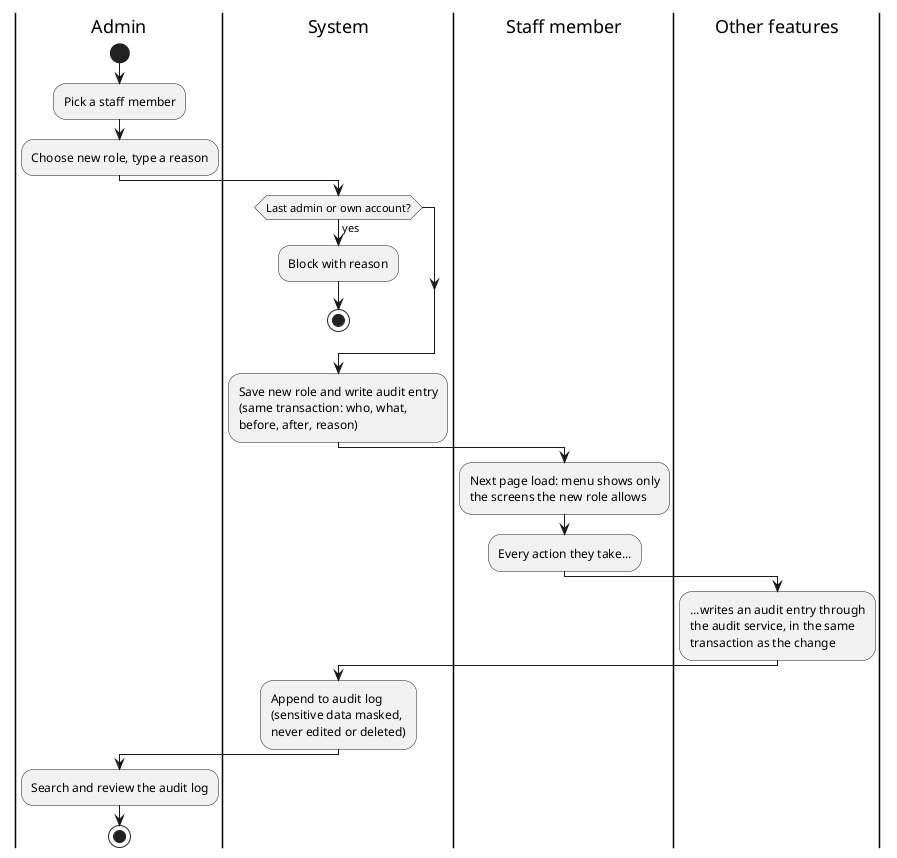
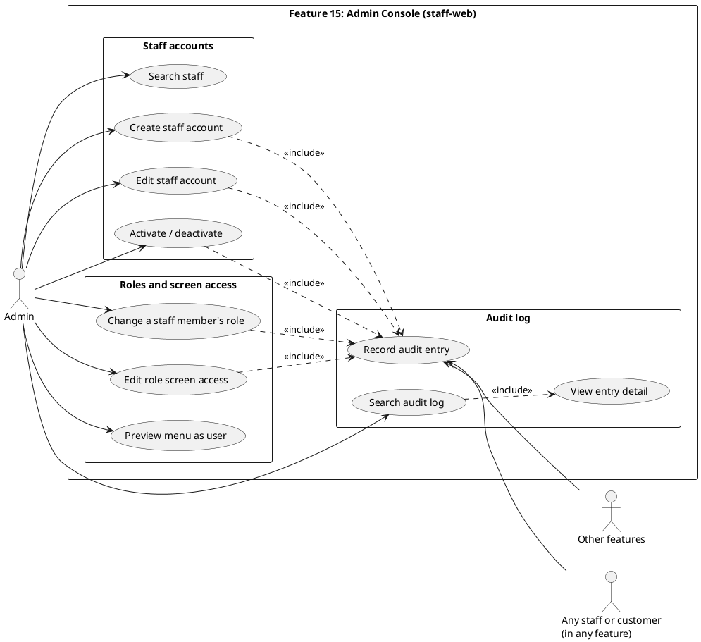

# Feature 15: Admin Console (Iteration-02)

latest update: Oct 12, 2026

CSC290 Integrated Project · Group 11 · Chin, Kaow

Built from the Iteration-01 spec, the group requirement doc, and Ajarn's feedback. Where they disagree, Ajarn's feedback wins.

Live prototype: [staff-web: Staff and roles, Role access, Audit log](https://claude.ai/artifact/FoEEXqHCvieii7wkL1tWF1) (sample data)

Note: **What Ajarn said**

- Don't build price-change rules. Overriding pricing could break the feature that owns pricing.
- Each feature owns its own business logic. The admin console must not override other modules.
- Keep the admin console to two things: user role management and audit logging.
- When an admin changes a user's role, their screen access changes with it (for example, Finance to Customer Service Agent). This controls screens only, not business rules.
- Audit every user group and every feature: who used the system and what they did. No module left out.

# Part A: Requirements

## 1. Purpose

Give admins one place to manage staff accounts and roles, where a staff member's role decides which screens they can see, and keep an audit log of every action by everyone in every feature.

## 2. Main Users

| User | App | What they do |
| --- | --- | --- |
| Admin | staff-web | Manages staff accounts, roles and screen access; reads the audit log |
| All staff | staff-web | See only the screens their role allows; every action they take is logged |
| Other features | system | Write an audit entry for every action done in their screens, through the shared audit service |

## 3. Main Functions

Ajarn limited this feature to two things: **user role management** and **audit logging**.

- **Staff accounts:** create (staff ID made by the system), edit, activate or deactivate, search and filter
- **Change role (Ajarn):** pick a new role and the person's screens change with it, for example Finance to Customer Service Agent swaps the Finance pages for the Complaint pages
- **Role screen access:** choose which screens each role can open. Core screens (everyone) and admin screens (admins only) are locked; only assignable screens can be changed
- **Preview as user:** see the menu a staff member will get
- **Audit log (Ajarn):** every feature and every user group, every action: who signed in, what they did, what changed (before and after), and who opened sensitive data
- **Search the log:** filter by feature, person, action and date; open a row to see before and after. Sensitive entries only show masked data, and opening one is logged too
- **Not in this feature (Ajarn):** pricing rules, the currency table and override approvals. Each feature keeps its own business rules

## 4. Main Flow

&#91;image: Feature 15 role change and audit flow (PlantUML)\]

## 5. Information Needed

Columns are in the SQL (Part B).

- **Staff account:** name, login email, staff ID, role, active or not, created date, last sign-in
- **Role:** name (the role list itself comes from Feature 1)
- **Screen:** which feature it belongs to, code, name, kind (core, admin or assignable), active or not
- **Role screen access:** which screens each role can open
- **Audit entry:** when it happened (simulation time), when it was saved (real time), order number, who (staff, customer or system), their role, feature, action, what it touched, short summary, before and after (masked if sensitive), reason, sensitive or not

## 6. Business Rules

| Area | Rule |
| --- | --- |
| Scope | Only role management and audit logging; no pricing rules, currency table or overrides (Ajarn) |
| Roles | One role per staff member; a role controls which screens they see, never business rules (Ajarn) |
| Roles | A role change applies on the person's next page load; editing a role's screens affects everyone with that role |
| Roles | Screens have three kinds: core (every staff member), admin (admins only) and assignable (set per role). Only assignable screens can be given to or taken from a role, so an admin can't lock everyone out of the admin console. New roles can't be created yet |
| Access | Screens only build the menu. Every API route checks the role code itself, so hiding a screen is never the only protection |
| Accounts | Login email must be unique; staff ID is made by the system and can't be edited |
| Accounts | Admins create staff accounts first; the first Clerk sign-in finds the account by email (lower case) and claims it. The first admin is added when the database is set up. A staff email can only be edited before the account is claimed |
| Guards | An admin can't deactivate or change the role of their own account. The last active admin can't be deactivated, moved to another role or deleted; this check takes a lock, so two admins can't remove each other at the same moment |
| Deactivate | Deactivating sets `disabled_at`, revokes refresh tokens and writes the audit entry together. Sign-in and refresh both check `disabled_at` and refuse if it's set |
| Reason | Every admin change needs a reason |
| Audit coverage | Every feature sends an entry for every sign-in, sign-out, create, update and delete, and every time someone opens sensitive data (passport, payment or personal details); normal page views are not logged. No feature is left out (Ajarn) |
| Audit writing | Each feature writes its entry through the shared audit service, in the same transaction as the change: both are saved, or neither is. The writer picks the entry id, so a retry can never make a duplicate. Actions come from a fixed list of 11 (see the SQL) |
| Audit privacy | The writer masks sensitive data before saving: passport last 3 characters, year of birth only, phone last 3 digits, watchlist as changed field names only, never card data. These entries are marked sensitive; the list hides their before and after, and opening one writes its own view\_sensitive entry |
| Audit storage | Append-only: entries can't be edited or deleted, even by admins |
| Time | Business times use the simulation clock. The audit log also saves real time and an order number (`seq`) and is sorted by `seq`, so rewinding the clock can't reorder history |

## 7. Data from Other Features

| Feature | We need |
| --- | --- |
| 1 Platform Core | Role list, sign-in and session exchange, revoke refresh tokens, simulation clock |
| 7 Profiles | Nothing for roles (user, staff and role are Feature 1's) |
| All features | An audit entry for every action (through the audit service), and their list of screens in code |

## 8. Data Provided to Other Features

| Feature | We send |
| --- | --- |
| All features | Which screens the signed-in staff member can open (builds the menu) |
| All features | The audit service they call to write entries |

## 9. Edge Cases

| Case | What happens | Error code |
| --- | --- | --- |
| Create an account with an email that exists | Blocked | `EMAIL_TAKEN` |
| Admin tries to deactivate themselves | Blocked | `SELF_DISABLE` |
| Deactivate or move the last admin | Blocked | `LAST_ADMIN` |
| Admin change sent with no reason | Blocked | `REASON_REQUIRED` |
| Deactivate someone who is signed in | Refresh tokens revoked and refresh refuses; they are signed out when the short access token runs out (up to 15 min) |  |
| Role changed while the person is signed in | New menu on their next page load |  |
| Staff opens a screen their role doesn't allow | Blocked and logged | `FORBIDDEN` |
| First sign-in with an email no admin set up | Blocked | `STAFF_NOT_PROVISIONED` |
| An audit entry fails to save | The whole change is cancelled, so a change is never saved without its entry |  |
| Someone tries to edit or delete an audit entry | Refused by the database |  |
| The same audit entry is sent twice (a retry) | Saved once, because it has the same id |  |
| Admin tries to change their own role | Blocked | `SELF_ROLE_CHANGE` |
| Two admins try to remove each other at the same moment | Only one succeeds; the other is blocked | `LAST_ADMIN` |
| Sign-in to a deactivated account | Blocked and logged | `STAFF_DISABLED` |
| Give a role a core or admin screen | Blocked | `SCREEN_NOT_ASSIGNABLE` |
| Role or staff member doesn't exist | Blocked | `ROLE_NOT_FOUND`, `STAFF_NOT_FOUND` |
| Admin saves a change that changes nothing | Blocked, no audit entry | `NO_CHANGE` |

## 10. Open Questions

Labels follow the build order (wave 1: F1 · wave 2: F2, 4, 7, 8, 9, 12, 15 · wave 3: F3a, 3b, 6, 10, 11, 13, 17 · wave 4: F5a, 5b, 14, 16). Feature 15 is wave 2, so the audit log becomes the standard every later feature uses.

**Follow an earlier group**

- [x] Feature 1: role table, how a role name maps to screens, and the revoke-tokens endpoint (done: Feature 1 doc has the role table and SessionService.revokeAll; the role-to-screen mapping is our role\_screen)

**Same wave, agree together**

- [x] Feature 7: shared table changes (done: Feature 1 now owns `staff.role_id`, `staff.disabled_at`, nullable `clerk_user_id`)

**Unsure**

- [ ] Feature 2's doc puts disruption reasons, the airline code and the max holding time in Feature 15 as editable rules, but Ajarn removed rule settings from Feature 15. Who keeps these? Asked F2: suggested F2 keeps disruption reasons and max holding time, and the core team adds the airline code to the shared app config. Waiting for their reply.

**Decided (later groups follow us):** every feature logs sign-ins, sign-outs, every create, update and delete, and every view of sensitive data (passport, payment, personal details), but not normal page views; audit actions are the fixed list of 11 in the SQL; entries are written through the audit service in the same transaction as the change; each feature lists its screens in code and the backend adds or updates them at startup (removed ones are turned off), with codes like `f6.gate_screen`; a new staff member's first Clerk sign-in with the email an admin set up claims the account; roles are a table (`role_id`), not a fixed list; access token 15 min, refresh token 30 days; audit entries are kept forever; admins only see masked data in sensitive entries; every blocked sign-in is logged.

**Changed from the Iteration-01 spec:** pricing rules, currency table and override approvals removed (Ajarn); the audit log now covers every feature, not only Features 11 and 13 (Ajarn); role screen access added from the group doc.

# Part B: Technical

Same stack and conventions as the rest of Flython: NestJS, Postgres, Clerk for sign-in, singular table names, PUT for updates, errors as `{ error: { code, message, details? } }`.

## Use Case Diagram

&#91;image: Feature 15 use case diagram (PlantUML)\]

## API Routes

Guards: A = admin, S = any signed-in staff. Guards check the role code on the API itself; screens only build the menu. Every A write needs a non-empty reason and writes its own audit entry.

| Route | Method | Guard | Purpose |
| --- | --- | --- | --- |
| `/admin/staff` | GET | A | List and search staff with role and status |
| `/admin/staff` | POST | A | Create a staff account |
| `/admin/staff/:id` | PUT | A | Edit name or email |
| `/admin/staff/:id/role` | PUT | A | Change role |
| `/admin/staff/:id/status` | PUT | A | Activate or deactivate |
| `/admin/roles` | GET | A | Roles from Feature 1 |
| `/admin/roles/:id/screens` | GET | A | Screens a role can open |
| `/admin/roles/:id/screens` | PUT | A | Replace a role's screen access |
| `/me/screens` | GET | S | Screens the signed-in staff member can open (builds the menu) |
| `/admin/staff/:id/screens` | GET | A | Preview the menu a staff member will get |
| `/admin/audit-log` | GET | A | Search by feature, actor, action, date |
| `/admin/audit-log/:id` | GET | A | One entry with before and after |

Other features don't call an HTTP route to write audit entries. They call the shared `AuditService.write(entry)` inside their own transaction, so the change and its entry are saved together. The writer sets the entry `id` from the request, so a retry is ignored (`ON CONFLICT (id) DO NOTHING`).

## SQL Schema

Requested tables for the DB team; they write the final schema.

`"user"`, `staff` and `role` belong to Feature 1; Feature 15 adds two columns to `staff` and adds three tables.

```sql
-- user, staff and role belong to Feature 1 (role_id, disabled_at and nullable
-- clerk_user_id are in its doc). Feature 15 adds two columns to staff:
CREATE SEQUENCE staff_code_seq;
ALTER TABLE staff ADD COLUMN staff_code TEXT NOT NULL UNIQUE
  DEFAULT 'ST-' || lpad(nextval('staff_code_seq')::text, 4, '0');   -- ST-0001, made by the system
ALTER TABLE staff ADD COLUMN last_sign_in_at TIMESTAMPTZ;

-- Screens ---------------------------------------------------------------------
-- kind decides how a screen is given out, so an admin can't lock everyone out:
--   core        every signed-in staff member (home, own profile). Never in role_screen.
--   admin       only roles with is_admin (Feature 15's own screens). Never in role_screen.
--   assignable  given per role through role_screen. The only kind an admin can edit.
-- Each feature lists its screens in code; the backend upserts them by code at startup
-- and sets is_active = false for removed ones.
CREATE TABLE screen (
  id UUID PRIMARY KEY DEFAULT gen_random_uuid(),
  feature_no TEXT NOT NULL,                  -- '6', '13', '3b'
  code TEXT NOT NULL UNIQUE,                 -- e.g. 'f6.gate_screen'
  name TEXT NOT NULL,
  kind TEXT NOT NULL DEFAULT 'assignable' CHECK (kind IN ('core', 'admin', 'assignable')),
  is_active BOOLEAN NOT NULL DEFAULT true,
  created_at TIMESTAMPTZ NOT NULL DEFAULT now(),
  updated_at TIMESTAMPTZ NOT NULL DEFAULT now(),
  UNIQUE (id, kind)
);

-- screen_kind is pinned to 'assignable' and part of the FK,
-- so core and admin screens can't be put in a role.
CREATE TABLE role_screen (
  role_id UUID NOT NULL REFERENCES role (id),
  screen_id UUID NOT NULL,
  screen_kind TEXT NOT NULL DEFAULT 'assignable' CHECK (screen_kind = 'assignable'),
  PRIMARY KEY (role_id, screen_id),
  FOREIGN KEY (screen_id, screen_kind) REFERENCES screen (id, kind)
);
CREATE INDEX role_screen_screen_idx ON role_screen (screen_id);

-- Audit log -------------------------------------------------------------------
-- Written by the in-process audit service inside the same transaction as the change.
-- id is chosen by the writer, so a retry is INSERT ... ON CONFLICT (id) DO NOTHING.
-- occurred_at = simulation clock; recorded_at = real time; seq = insertion order.
-- List and page by seq, so rewinding the simulation clock can't reorder history.
-- The backend takes the actor from the token, needs a reason on admin changes,
-- and the writer masks sensitive fields before saving.
CREATE TABLE audit_log (
  id UUID PRIMARY KEY DEFAULT gen_random_uuid(),
  seq BIGINT GENERATED ALWAYS AS IDENTITY UNIQUE,
  occurred_at TIMESTAMPTZ NOT NULL,
  recorded_at TIMESTAMPTZ NOT NULL DEFAULT now(),
  actor_type TEXT NOT NULL CHECK (actor_type IN ('staff', 'customer', 'system')),
  actor_id UUID,                             -- user id; null for system
  actor_role TEXT,                           -- role code at the time of the action
  source_feature TEXT NOT NULL,              -- '2', '3b', '15'
  action TEXT NOT NULL CHECK (action IN (
    'sign_in', 'sign_out', 'sign_in_blocked', 'access_denied',
    'create', 'update', 'delete', 'view_sensitive',
    'role_change', 'status_change', 'screen_access_change')),
  entity_type TEXT,
  entity_id TEXT,                            -- TEXT because ids differ across features
  summary TEXT,
  reason TEXT,
  before JSONB,
  after JSONB,
  is_sensitive BOOLEAN NOT NULL DEFAULT false  -- before/after masked; list views hide them
);
CREATE INDEX audit_log_occurred_idx ON audit_log (occurred_at DESC);
CREATE INDEX audit_log_feature_idx ON audit_log (source_feature, occurred_at DESC);
CREATE INDEX audit_log_actor_idx ON audit_log (actor_type, actor_id, occurred_at DESC);
CREATE INDEX audit_log_entity_idx ON audit_log (entity_type, entity_id, occurred_at DESC);

-- Append-only: no update, delete or truncate
CREATE FUNCTION audit_log_block_change() RETURNS trigger AS $$
BEGIN
  RAISE EXCEPTION 'audit_log is append-only';
END;
$$ LANGUAGE plpgsql;

CREATE TRIGGER audit_log_no_change BEFORE UPDATE OR DELETE ON audit_log
  FOR EACH ROW EXECUTE FUNCTION audit_log_block_change();
CREATE TRIGGER audit_log_no_truncate BEFORE TRUNCATE ON audit_log
  FOR EACH STATEMENT EXECUTE FUNCTION audit_log_block_change();

-- Last-admin rule (backend, not a constraint): every path that can remove an admin
-- (role change, deactivate, delete) first runs
--   SELECT pg_advisory_xact_lock(hashtextextended('active_admin_guard', 0));
-- then counts the other active admins and refuses with LAST_ADMIN if there are none.
```

## Frontend Pages

| Page | Route | Who | What it shows |
| --- | --- | --- | --- |
| Staff and roles | `/admin/staff` | Admin | Staff list with search and filters; create staff |
| Staff detail | `/admin/staff/:id` | Admin | Edit name or email, change role, activate or deactivate, preview menu |
| Role access | `/admin/roles` | Admin | Pick a role and tick its assignable screens |
| Audit log | `/admin/audit-log` | Admin | Search entries by feature, person, action and date |
| Audit entry | `/admin/audit-log/:id` | Admin | One entry with before and after (masked if sensitive) |

## UI Mockups

The mockup is only there to help people picture the pages. It doesn't show every function, and it may show things that aren't part of the feature.

- [staff-web: Staff and roles, Role access, Audit log](https://claude.ai/artifact/FoEEXqHCvieii7wkL1tWF1)

## Diagram Sources (PlantUML)




