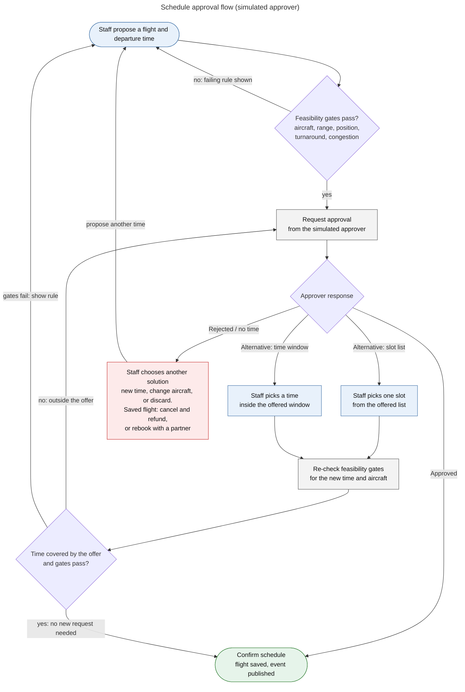

# Feature 2 — Flight Scheduling & Network Ops (Iteration-03)

Sep 30, 2026 · @Zayar

**Prototype:** [Flight scheduling console](https://claude.ai/artifact/VFjajn3UTQbPww7GhVi71Z), an interactive mock-up of the pages in this document.

## Overview

Feature 2 is the staff-only source of truth for what flies, when, and on which aircraft, and it publishes the flight status event stream every other module reacts to. Passengers never touch it directly; they see its output through search (3a) and notifications (13).

What this feature owns:

- Airport, route and timetable master data
- Flight generation from a route plus a repeat pattern (e.g. daily, Mon/Wed/Fri)
- Aircraft assignment per flight, with a turnaround-time check
- Delay, diversion and cancellation records, each with a structured disruption reason
- The status event stream: created, delayed, diverted, cancelled
- *(stretch level 2)* Gate/slot allocation and seasonal schedule versions

Added on 4 Oct 2026:

- Availability checks before a flight is confirmed: aircraft, position, turnaround and congestion
- Schedule conflict records with four resolutions: change aircraft, reschedule, cancel and refund, rebook with a partner airline
- Delays that cascade to the next flight, and holding
- Batch actions that validate each flight on its own

**Scope levels.** Core: everything above except congestion. Stretch level 1: congestion windows recorded by staff, the congestion check on confirm, and congestion conflicts with a proposed delay. Stretch level 2: gate and slot allocation, and seasonal schedule versions.

**One staff role.** Every signed-in staff member can read and change everything in Feature 2. There are no read-only or admin roles.

**Revision of 12 Oct 2026.** Two reviews are folded in. (1) A schedule approval step: no flight is confirmed until a simulated airport approver answers, and the answer can be an approval, an offer of other times, or a rejection (section "Schedule approval"). (2) A schema review: service date and timetable times kept apart from current times, an outbox for event delivery, a database guard against double-booking an aircraft, UUID ids, PUT instead of PATCH, and a list of rules that belong to the backend. Where the review and the Feature 9 contract disagreed, this document follows the Feature 9 contract (see the open questions).

**Revision of 15 Nov 2026 (staff-web layout).** The pages are grouped so the sidebar stays short: Airports (with fees and approval policy), Routes (with patterns) and Schedule flight (with approvals, conflicts, the disruption log, the settings and, in manual mode, the Approver console) are one entry each, with tabs chosen by a `?tab=` query. Generate flights and Flight detail stay sub-pages of the Schedule flight. Nothing in the data model, routes or events changed; only the section "Frontend pages" below was rewritten.

Cross-module contracts to lock by week 3–4:

- **Feature 9 (Aircraft):** we query availability/status before confirming an assignment, and again before we act on an aircraft (a re-check, no push). To learn that an aircraft was grounded, we read `GET /aircraft/status-changes?since=` on a sweep. Feature 9 starts each turnaround itself from a simulation-clock job, so we do not start one.
- **Features 3a, 3b, 6, 13, 14:** they subscribe to our event stream. Disruption reasons are a fixed list, never free text, so 13 and 14 can categorise without parsing strings.
- **Feature 1:** every request carries a JSON Web Token (JWT) verified locally against the JSON Web Key Set (JWKS) endpoint; every timestamp we store or compare comes from the simulation clock client, never the system clock.

Added in this revision:

- **Feature 4 (Pricing):** expected revenue for the loss warning, and permission for Feature 2's internal costing to use the currency table (display-only for passengers). Feature 4's document needs the matching route.
- **Feature 9 (Aircraft):** per-aircraft availability route that returns the exact failing rule, `max_range_km` and `max_takeoff_weight_kg` on the aircraft type. A landed flight is signalled by our `flight.arrived` event.
- **Feature 15 (Audit):** we send an audit entry for each privileged action (dismissed conflict, forced change). The holding limit, airline code and approval settings are not Feature 15 rules; they live in our own `flight_setting` table.

*Everything below is a proposed design for Iteration-01; names and columns are for the team to challenge.*

## Data model

Sixteen tables. Conventions for all of them: singular names, UUID primary keys (the airport uses its IATA code), `TEXT` instead of fixed-length character columns, `created_at` and `updated_at` on every table, all instants as `TIMESTAMPTZ` from the simulation clock. PK = primary key, FK = foreign key.

| Table | Key columns | Notes |
| --- | --- | --- |
| `airport` | `iata_code` (PK), `icao_code`, `name`, `city`, `country`, `timezone`, `min_turnaround_min`, `is_active` | Master data, staff-edited |
| `airport_fee` | `id` (PK), `airport` (FK), `fee_type`, `applies_on` (departure or arrival), `amount`, `unit`, `currency`, `effective_from`, `effective_to` (nullable) | Charges an airport makes the airline; the fee in force on the flight's local date applies |
| `route` | `id` (PK), `origin` (FK), `destination` (FK), `distance_km`, `block_time_min`, `is_active` | Unique on `(origin, destination)`; distance feeds loyalty (11) and the range gate |
| `flight_pattern` | `id` (PK), `route_id` (FK), `flight_number`, `dep_time_local`, `days_of_week`, `valid_from`, `valid_to` | The repeat rule flights are generated from; `flight_number` is unique |
| `flight` | `id` (PK), `pattern_id` (FK, nullable: one-off flight), `flight_number`, `service_date`, `route_id` (FK), `scheduled_dep_at`, `scheduled_arr_at`, `dep_at`, `arr_at`, `actual_destination` (FK, nullable), `aircraft_id` (not null, feature 9), `status` | Unique on `(flight_number, service_date)`; the timetable cannot double-book an aircraft (exclusion constraint) |
| `flight_event` | `id` (PK, also the `event_id`), `seq`, `flight_id` (FK), `type`, `disruption_reason_code`, `delay_minutes`, `old_dep_at`, `new_dep_at`, `old_arr_at`, `new_arr_at`, `new_destination`, `old_aircraft_id`, `new_aircraft_id`, `hold_minutes`, `resolution`, `partner_airline`, `note`, `actor_id`, `occurred_at` | Append-only (a trigger refuses UPDATE and DELETE); `actor_id` is null for system actions |
| `flight_event_outbox` | `event_id` (PK, FK), `published_at`, `attempts`, `last_error` | Delivery state, kept apart so the event stays immutable |
| `disruption_reason` | `code` (PK), `category`, `description`, `is_active` | Category is a fixed list; reasons are disabled, never deleted |
| `flight_setting` | `key` (PK), `value`, `updated_by` | `holding_limit_minutes`, `airline_code`, `approval_mode`, `approval_response_delay_minutes` |
| `partner_airline` | `code` (PK), `name`, `is_active` | Mocked list |
| `partner_airline_route` | `partner_airline` (FK), `route_id` (FK) | Which partner flies which route; rebooking is offered only where a row exists |
| `airport_congestion` | `id` (PK), `airport` (FK), `starts_at`, `ends_at`, `max_movement_per_hour`, `disruption_reason_code` (FK), `created_by` | Stretch level 1 |
| `schedule_conflict` | `id` (PK), `flight_id` (FK), `kind`, `detail`, `facts`, `status`, `detected_at`, `caused_by_event_id` (FK), `resolution`, `partner_airline` (FK), `resolution_event_id` (FK), `resolved_by`, `resolved_at` | One open conflict per flight and kind |
| `airport_approval_policy` | `airport` (PK, FK), `curfew_start_local`, `curfew_end_local`, `max_departure_per_hour`, `offer_style` | The rules the simulated approver follows in automatic mode; staff-edited |
| `schedule_approval` | `id` (PK), `purpose`, `flight_id` (FK, reschedule only), `pattern_id` (FK), `route_id` (FK), `flight_number`, `service_date`, `aircraft_id`, `proposed_dep_at`, `proposed_arr_at`, `approver_type`, `approver_airport` (FK), `approver_partner_airline` (FK), `status`, `reject_reason`, `previous_approval_id` (FK), `covered_by_approval_id` (FK), `revision`, `requested_by`, `responded_by`, `respond_by`, `resulting_flight_id` (FK) | A snapshot of one proposed flight and the approver's answer; not a flight, so search never sees it |
| `schedule_approval_offer` | `id` (PK), `approval_id` (FK), `kind` (window or slot), `starts_at`, `ends_at` (window only) | The times an approver offers instead; times are departure times at the origin |

**Deliberate choices.**

- **Two pairs of times.** `scheduled_dep_at` and `scheduled_arr_at` are the published timetable and change only by a reschedule. `dep_at` and `arr_at` are the current expected times and also move with delays and holding. Total delay is `dep_at - scheduled_dep_at`. `service_date` is the local origin date of the original departure and never changes, so a delay across midnight does not change which flight it is.
- **Status is a cache of the latest event**, with a fixed mapping (next table), so the event table stays the source of truth.
- **Events are append-only.** Delivery state lives in `flight_event_outbox`, inserted in the same transaction as the event. Events are ordered by `seq`, never by `occurred_at` (ties, and the simulation clock can be rewound).
- **A diverted flight** keeps its route and sets `actual_destination`; queries that need where a flight ends use `COALESCE(actual_destination, route.destination)`.
- **No draft flights.** Generated flights and approval requests are not flights. A flight row exists only after confirm, with an aircraft, so `aircraft_id` is not null.
- **The seat map belongs to the aircraft type (feature 9)**, so a flight stores no seat map reference.

| Event type | `flight.status` afterwards |
| --- | --- |
| `created`, `rescheduled` | `scheduled` |
| `delayed` | `delayed` |
| `holding` | `holding` |
| `hold_ended` | `departed` |
| `diverted` | `diverted` |
| `cancelled` | `cancelled` |
| `aircraft_changed` | unchanged |
| `departed`, `arrived` | `departed`, `arrived` (written by a simulation-clock job as system events) |

## API routes

Every path below sits under the module prefix `/api/flight-scheduling`, which namespaces Feature 2 in the shared application. Besides the routes in the tables, `GET /patterns` and `GET /patterns/{id}` read patterns, and `PUT /flight-settings` saves several settings in one request (the Settings tab sends all four).

Errors share one shape across the project: `{ error: { code, message, details? } }`. `details` carries the failing rule (for example the gate name and the minutes short). Writes use `POST` to create and `PUT` to edit; there is no `PATCH`. Ids in paths are UUIDs. Field names are proposals until the week 3–4 lock.

| Method & path | Purpose | Main errors |
| --- | --- | --- |
| `GET /airports`, `POST /airports`, `PUT /airports/{iata}` | Airport master data | `409` duplicate code, `422` bad format |
| `GET /airports/{iata}/fees`, `POST /airports/{iata}/fees`, `PUT /airport-fees/{id}` | Airport fee master data | `409` overlapping dates for the same fee type and movement, `422` negative amount |
| `GET /airports/{iata}/approval-policy`, `PUT /airports/{iata}/approval-policy` | Rules of the simulated approver for one airport | `422` bad curfew or limit |
| `GET /routes`, `POST /routes`, `PUT /routes/{id}` | Route master data | `409` duplicate pair, `422` same origin and destination |
| `POST /patterns`, `PUT /patterns/{id}` | Create or edit a repeat pattern; an edit applies only to flights generated afterwards | `422` bad digits, days or date range, `409` duplicate flight number |
| `POST /flights/generate` | Preview flights for a date range from patterns, or one one-off flight (`route_id`, `flight_number`, `dep_at`); nothing is saved | `409` a flight already exists for that number and date |
| `GET /flights?route=&from=&to=&status=` | List and filter flights | none |
| `GET /flights/{id}` | One flight with its event history | `404` |
| `GET /flights/{id}/events` | Event history for one flight | `404` |
| `GET /flights/{id}/cost-estimate` | Operating cost plus airport fees, and a loss warning when expected revenue is lower | `502` feature 9 or 4 unreachable |
| `PUT /flights/{id}/aircraft` | Change the aircraft of a saved flight; runs the gates | `409` gate failed (rule in `details`) |
| `POST /flights/{id}/delay`, `/divert`, `/cancel` | Record a delay, a diversion or a cancellation with a disruption reason | `422` unknown reason or airport, `409` already departed |
| `GET /disruption-reasons` | List disruption reasons | none |
| `GET /events?category=&disruptions_only=&limit=&cursor=` | Every flight's events, newest first, for the Disruption log; the cursor is the last `seq` seen | `400` unknown category or bad cursor |
| `GET /flight-settings`, `PUT /flight-settings/{key}` | Our own settings (holding limit, airline code, approval mode) | `422` bad value |
| `GET /partner-airlines` | Mocked partner list | none |

Checks, approval and confirm:

| Method & path | Purpose | Main errors |
| --- | --- | --- |
| `POST /flights/check` | Run the gates for proposed flights that are not saved yet (flight, aircraft, departure time) and return every gate that fails | none; failures are in the body |
| `GET /flights/{id}/availability?dep_at=` | The same gates for a saved flight at another time | none; returns the gates that fail |
| `POST /approvals` | Request approval for a proposed flight; runs the gates first | `409` a gate failed, `409` a live request already exists |
| `GET /approvals?status=&flight_number=`, `GET /approvals/{id}` | List requests; one request with its offered times | `404` |
| `POST /approvals/{id}/respond` | The approver's answer: `approved`, `alternative_window`, `alternative_slots` or `rejected` with a reason | `409` not pending, `422` offer missing or times outside the service day |
| `POST /approvals/{id}/revise` | Staff pick a time (or change the aircraft) after an offer or a rejection; re-runs the gates; creates the next revision | `409` a gate failed, `422` no change |
| `POST /flights/confirm` | Takes proposed flights, each with an `approved` `approval_id`; re-runs the gates, checks the approval still matches, saves the flights as `scheduled` | `409` approval missing or no longer matching; failing flights come back in the `207` body |
| `POST /flights/{id}/reschedule` | Move a saved flight to times covered by an `approved` approval (purpose `reschedule`) | `409` approval missing or not matching |
| `GET /conflicts?status=open` | Open schedule conflicts | none |
| `GET /conflicts/{id}/options` | Feasible resolutions with their impact | `404` |
| `POST /conflicts/{id}/resolve` | Apply one resolution | `409` option no longer feasible, `422` missing partner or approval |
| `POST /conflicts/{id}/dismiss` | Close a conflict without a resolution; needs a reason and writes an audit entry (15) | `409` not open |
| `GET /flights/{id}/impact` | Counts of bookings, crew, bags, cargo affected | `502` another feature unreachable |
| `POST /airports/{iata}/congestion` | Stretch level 1: record a congestion window | `409` overlaps another window, `422` bad window or limit |
| `POST /flights/{id}/hold` and `/hold/end` | Start or end holding | `409` flight not in the air |
| `POST /flights/batch/aircraft`, `/batch/delay` | Batch actions, each flight validated on its own | `207` mixed results |

## Flight status event stream

Every change to a flight writes one `flight_event` row and publishes one event with the same content. This is the contract features 3a, 3b, 6, 13, 14 (and 9, for landed flights) code against, so it is the first thing to freeze. One typed factory builds every event and fills the right columns for its type (a `delayed` event needs a reason, the old and new times and minutes; `diverted` needs a destination; `cancelled` needs a resolution, and a partner only for `rebook_partner`), with one unit test per type. Events are append-only, so a wrong row can never be corrected.

```json
{
  "event_id": "0b6c…",
  "type": "flight.delayed",
  "flight_id": "7f3a…",
  "flight_number": "XX214",
  "service_date": "2026-10-03",
  "disruption_reason_code": "WX",
  "disruption_category": "weather",
  "delay_minutes": 45,
  "old_dep_at": "2026-10-03T14:00:00Z",
  "new_dep_at": "2026-10-03T14:45:00Z",
  "old_arr_at": "2026-10-03T15:20:00Z",
  "new_arr_at": "2026-10-03T16:05:00Z",
  "occurred_at": "2026-10-03T12:10:00Z"
}
```

`delay_minutes` is this event's increment; the total delay is `dep_at - scheduled_dep_at`.

| Event type | Extra fields | Who reacts |
| --- | --- | --- |
| `flight.created` | route, `dep_at`, `arr_at` | 3a refreshes search results |
| `flight.delayed` | `delay_minutes`, old and new times | 13 sends notifications; 6 shifts the check-in window |
| `flight.rescheduled` | old and new times, reason | 13 notifies; 6 moves the check-in window; 8 re-checks duty |
| `flight.aircraft_changed` | `old_aircraft_id`, `new_aircraft_id` | 9 and 3b handle the seat map and re-seating; 8 re-checks type ratings |
| `flight.holding` | `hold_minutes`, `new_arr_at` | 13 notifies; 10 and 6 prepare for the later arrival |
| `flight.hold_ended` | `arr_at` | 13 clears the notice |
| `flight.diverted` | `new_destination` | 13 notifies; 10 reroutes bag tracking |
| `flight.cancelled` | `resolution` (refund or rebook\_partner), `partner_airline` | 5b refunds; 3b rebooks; 13 notifies |
| `flight.departed`, `flight.arrived` | `occurred_at` | 6 and 10 close their steps; 9 starts the turnaround of a landed flight from its own simulation-clock job |

A simulation-clock job writes `departed` and `arrived` when the clock passes `dep_at` and `arr_at`. Disruption reasons are reference data with a fixed category (`weather`, `technical`, `crew`, `air_traffic_control`, `security`, `airport_operations`, `other`), so consumers group by `disruption_category` and never parse `note`.

*Decided:* events travel on an in-process bus inside the one application. Each event is saved with its outbox row in one transaction and published after commit. Subscribers that missed events replay through the outbox, not by reading `seq` greater than the last one seen (identity values are not commit order). Each event carries a unique `event_id` so a repeat can be ignored.

## Availability checks

Generating flights saves nothing. The generated list is a preview. A flight is saved as `scheduled`, and `flight.created` is published, only when staff confirm it, it passes the gates, and it holds an approval (next section). Search (3a) therefore never shows a flight whose aircraft or time is unconfirmed. *This changes when `flight.created` fires; it needs agreement from 3a and 3b.*

1. **Pick the date and time.** Staff propose a departure time, or accept the one from the pattern. Local times are built with a time zone library that knows daylight saving: a time inside a skipped hour moves forward, a repeated hour takes its first occurrence.
2. **Aircraft availability (feature 9).** Feature 9's per-aircraft availability route returns whether the aircraft is in service for the whole flight window and, if not, the exact rule that failed. That rule is shown on the flight page.
3. **Range.** The route's `distance_km` must not exceed the aircraft type's `max_range_km` (feature 9).
4. **Position and turnaround, both neighbours.** The previous flight must end where this one starts, the next flight must start where this one ends, and each gap must be at least the larger of the airport's minimum turnaround and the aircraft type's minimum turnaround (feature 9). "Where a flight ends" is `actual_destination` when it was diverted.
5. **Congestion.** Stretch level 1: skipped until congestion windows are built. Movements are counted per hour inside a recorded window.
6. **Request approval.** All gates pass, so staff request approval from the simulated approver.
7. **Receive the response.** Approved, other times offered, or rejected.
8. **Confirm.** Staff confirm an approved flight. The gates run again, because the world may have changed since the request, and the approval must still match the aircraft and times being saved. Then the flight is saved as `scheduled`, the approval becomes `consumed`, and `flight.created` is published. A flight that fails a gate is not saved, and the failing rules are shown beside it.

**Concurrency.** A database exclusion constraint on the aircraft and the *timetable* range of non-cancelled flights makes double-booking impossible, even for concurrent confirms or a batch. Current times are deliberately not constrained: a delay that runs into the next flight must be storable so it raises a `cascade` conflict. The turnaround buffer is not expressible in the constraint, so the backend takes `pg_advisory_xact_lock` on the aircraft before checking and saving.

**No slot booking.** Feature 2 does not reserve airport slots. The approval step simulates the airport's answer; it does not hold capacity.

*Movement rule (proposal):* a movement is one scheduled departure or arrival at one airport. Congestion counts movements by their start time, in hourly buckets, and prorates the last bucket when the window does not end on the hour.

## Schedule approval (simulated approver)

Before a schedule is final, the proposed flight is sent for approval. In the real world this would be the airport's slot coordinator and, for partner-operated flying, the other airline. In this project it is a simulation inside the system; nothing connects to a real airport or airline.



**Who approves (proposal, to confirm).** A *simulated slot coordinator* of the origin airport. Each request is addressed to one approver, stored as `approver_type` `airport` with the airport, or `partner_airline` with the partner (stretch, for flights a partner operates). One approval covers the departure time at the origin and the arrival that follows from the block time. A second approval from the destination airport is stretch.

**Fully simulated, in two modes** (`flight_setting` key `approval_mode`):

- `auto` (default): the system answers by the airport's `airport_approval_policy`, after `approval_response_delay_minutes` of simulation time (0 answers at once). The policy has a night curfew in local time, a maximum departures per hour, and whether alternatives are offered as a window or as a list of slots. Inside the curfew or above the cap, the system offers the next valid times that same service day; with none left, it rejects with `no_slot_available`.
- `manual`: the request waits on the Approver console tab of the Schedule flight page, where a team member plays the approver and picks any response. This is for demos, so every case can be shown on demand.

Both modes answer through the same route, `POST /approvals/{id}/respond`; the automatic one writes it as a system action (`responded_by` null).

**Responses the approver supports.**

| Response | What is stored | What staff do next |
| --- | --- | --- |
| Approved | status `approved` | Confirm the schedule |
| Alternative time window (for example 11:00–13:00) | status `alternative_offered`; one `window` offer with the earliest and latest departure | Pick a departure time inside the window |
| Alternative slot list (for example 11:30, 12:00, 13:30) | status `alternative_offered`; one `slot` offer per time | Pick one slot |
| Rejected, no available time | status `rejected` with `reject_reason` (`curfew`, `no_slot_available`, `capacity_full`, `other`) and a note | Another solution: propose a different time, change the aircraft, or discard the flight |
| No answer in time (stretch) | status `expired` after `respond_by` on the simulation clock | Request again |

**After an offer.** Staff call `POST /approvals/{id}/revise` with the chosen time. The system re-checks aircraft availability and every other gate for the new time, and the old request becomes `superseded`. If the chosen time is one of the offered slots, or inside the offered window, and the aircraft is unchanged, the offer already covers it: the new revision is created as `approved` with `covered_by_approval_id` pointing to the earlier one, and no new request is sent. Otherwise (a time outside the offer, or a different aircraft) a new request goes out and the cycle repeats. If a gate fails for the new time, staff see the failing rule and nothing is created.

**After a rejection.** The same `revise` route starts a new revision for another time or aircraft. For a flight that is already saved, a conflict can instead be closed by cancel and refund, or rebook with a partner (offered only where `partner_airline_route` has a row for the route).

**What needs approval.** A new flight (generated or one-off) before confirm, and a reschedule of a saved flight. It does not apply to delays, holding, diversions or cancellations: those are operational events that happen to a flight, not requests for a time.

**Rules.** One live request (`pending`, `approved` or `alternative_offered`) per flight number and service date. An approval is used once (`consumed`). The approver cannot be overridden; a forced time would need Feature 15's override log.

## Cost estimate and profitability

Feature 2 owns airport fees because they are charges of an airport, kept beside the airport master data. Each fee has an amount, a unit (per flight, per hour or per tonne), a currency, an effective date range, and `applies_on`: a landing fee is incurred on arrival, a handling or navigation fee on departure, as staff record it. The fee used is the one in force on the flight's local date at that airport.

The estimate for a flight is its block time in hours times the aircraft type's operating cost per hour, plus the fees at the origin (departure fees) and destination (arrival fees). A per-flight fee is its amount; a per-tonne fee uses `max_takeoff_weight_kg` of the aircraft type; a per-hour fee uses the planned ground time at that airport, which is the larger of the airport's and the aircraft type's minimum turnaround (proposal). Operating cost and weight come from feature 9 (`GET /aircraft-types`). Currency conversion uses feature 4's currency table; this is internal costing, not passenger display. The base currency is **THB** (feature 4's `base_currency` setting, with THB as the fallback). Every line keeps its own currency and is also shown in THB, and the total is in THB; while a currency has no rate in the table the line says so and the total is left out.

Staff see the estimate on Flight detail. When expected revenue is lower, the page shows a loss warning so staff can change the aircraft or reschedule before confirming. Expected revenue comes from the fare quote (feature 4) and seats sold (feature 3b); the exact route is for the team to agree with those features. The estimate is calculated when asked and not stored.

## Conflict detection and resolution

A conflict is a stored record, not an error message, so it stays open on the Conflicts tab of the Schedule flight page until staff resolve it. Conflicts are raised when a delay or reschedule moves a flight, when a re-check against feature 9 finds the aircraft grounded or in maintenance, and when a congestion window is recorded. A re-check updates the open conflict of the same flight and kind instead of adding another (one open conflict per flight and kind). If a re-check finds the cause gone, the system closes it as `superseded`. Staff can close one without a resolution with `dismiss`, which needs a reason and writes an audit entry (15).

| Conflict kind | Raised when |
| --- | --- |
| `aircraft_unavailable` | Feature 9 reports the aircraft grounded or in maintenance during the flight |
| `aircraft_position` | The previous flight ends at a different airport, the next starts elsewhere, or the flights overlap |
| `turnaround_short` | The gap at an airport is below the larger of the airport's and the aircraft type's minimum turnaround |
| `congestion` | Stretch level 1. A congestion window has more movements in an hour than its limit |
| `cascade` | A delay on one flight breaks a later flight on the same aircraft |

The cascade check does not look only at the next flight. It walks the aircraft's flights in timetable order from the delayed flight down the day, comparing each flight's current departure with the previous one's current arrival, so a delay longer than one gap still reaches the flights behind it. Each conflict stores the exact failing rule in `detail` for people and as numbers in `facts` for the options logic.

Staff see the conflict with the exact rule that failed, then choose one resolution. The options offered depend on what is actually feasible.

| Resolution | Offered when | Feature 2 does | Handled by other features |
| --- | --- | --- | --- |
| Change aircraft | Another aircraft passes the availability gates for the same window | Assigns the new aircraft; publishes `flight.aircraft_changed` | 9 supplies the seat map; 3b re-seats passengers if the type differs; 8 re-checks type ratings |
| Reschedule | A later or earlier time passes the gates and the approver approves it | Requests approval for the new time, then sets it; publishes `flight.rescheduled` | 13 notifies; 6 moves the check-in window; 8 re-checks crew duty |
| Cancel and refund | No feasible aircraft or time exists | Cancels with a disruption reason; publishes `flight.cancelled` with resolution `refund` | 5b refunds and compensates; 13 notifies |
| Rebook with partner airline | Cancelling, and a partner flies the route (`partner_airline_route`) | Cancels; records the partner; publishes `flight.cancelled` with resolution `rebook_partner` | 3b creates the new itinerary segment; 5b settles any fare difference |

Feature 2 only records the decision and publishes the event. It never moves money or edits a booking. Partner airlines, and which route each flies, are a mocked list in Iteration-01.

Before committing a resolution, staff can open an impact preview for the flight: how many bookings (3b), crew pairings (8), bags (10) and cargo bookings (17) the change touches, read from those features' APIs.

## Delays, congestion and holding

Three situations, one rule: Feature 2 changes the schedule and publishes an event. Feature 13 turns that event into messages. Feature 2 never sends a notification itself.

| Situation | What staff record | What Feature 2 does | Who is told, through feature 13 |
| --- | --- | --- | --- |
| Delay before departure | Minutes and disruption reason | Moves departure and arrival; walks the aircraft's later flights and raises or updates `cascade` conflicts | Booked passengers (via 3b); crew (8); check-in window moves (6) |
| Airport congestion | Airport, time window, maximum movements per hour, disruption reason | Stretch level 1. Counts movements per hour inside the window; raises a `congestion` conflict on the flights over the limit, each with a proposed delay that moves it past the window | Passengers on any flight that is then delayed or rescheduled |
| Holding (aircraft waits in the air) | Flight, minutes held, disruption reason | Sets status `holding`, extends the arrival time, publishes `flight.holding`; ends with `flight.hold_ended` | Passengers waiting at the destination; ground handling (6, 10) |

A flight can only be put into holding after it has departed and before it arrives, judged on the simulation clock. If the hold passes the limit in `flight_setting` (`holding_limit_minutes`, proposed starting value 30, staff-editable, to be agreed), the system proposes a diversion instead. Delays, holding and diversions need no approval: they happen to a flight. The event for a delay, reschedule or hold always carries the disruption reason and category, the old and new times, and the flight number. Subscribers look up the affected passengers and crew themselves, because Feature 2 does not own bookings or rosters.

## Multiple flights

Batch routes accept a list of flights and check each one on its own, with its own aircraft, approval, congestion and turnaround. One failing flight never blocks or rolls back the others, so the response reports every flight separately with HTTP (Hypertext Transfer Protocol) status `207 Multi-Status`.

- **Order:** flights are processed by departure time. When two flights in one batch use the same aircraft, the second sees the first, so the batch cannot double-book an aircraft (the exclusion constraint is the final guard).
- **Unit of work:** one database transaction per flight, not per batch.
- **Batch actions:** confirm approved flights, assign aircraft, and delay (for example, delay every BKK departure between 14:00 and 16:00 by 30 minutes). A batch confirm takes one `approval_id` per flight; a flight without an approved approval comes back as failed in the result.
- **Delay batches** also run the cascade check for each flight, so a failed later flight appears as its own conflict in the result.

```json
{
  "results": [
    { "flight_id": "7f3a…", "ok": true },
    { "flight_id": "91c2…", "ok": false,
      "conflicts": [
        { "kind": "turnaround_short", "detail": "Short by 12 min at BKK" }
      ] }
  ],
  "summary": { "ok": 1, "failed": 1 }
}
```

The example is JSON (JavaScript Object Notation). Field names are proposals until the week 3–4 lock.

## Use case diagram

&#91;embedded content: use case diagram · 1 staff actor, 10 use cases, 3 external systems\]

Staff change the schedule. Resolving a schedule conflict is the highlighted use case because its outcome decides what other features must react to.

*The diagram needs a refresh for this revision:* add the use cases Request approval, Choose another time after an offer, and Respond as approver (console), and a fourth external system, the simulated approver.

## Frontend pages

All pages are staff-only web pages. Pages that belong together are one entry in the main staff sidebar (group "Flight Scheduling") and share a tab strip. The tab is a `?tab=` query on the page's URL, so a link or a refresh lands on the same tab; the first tab has no query. Each database-backed action counts toward the roughly 30 demo actions per group.

| Sidebar entry | Tabs | Actions (all write to the database unless marked read) |
| --- | --- | --- |
| Airports | **Airports**; **Airport fees** (`?tab=fees`); **Approval policy** (`?tab=policy`) | Create, edit, disable an airport; set minimum turnaround. Add and edit the airport's fees. Edit the airport's approval policy (curfew, hourly cap, offer style) |
| Routes | **Routes**; **Patterns** (`?tab=patterns`) | Create, edit a route; set distance and block time. Create or edit a repeat pattern; read: preview the dates it would generate. Each pattern has an Edit button and a Generate button that opens Generate flights with that pattern ticked |
| Schedule flight | **Flights**; **Approvals** (`?tab=approvals`); **Conflicts** (`?tab=conflicts`); **Disruption log** (`?tab=disruptions`); **Settings** (`?tab=settings`); **Approver console** (`?tab=console`, only when `approval_mode` is `manual`) | A **Generate flights** button sits in the header of every tab. *Flights:* read: filter by route, date and status; open a flight; select several flights for batch change aircraft or delay. *Approvals:* read: requests by status with their offered times; revise a request (pick a slot, pick a time inside a window, change the aircraft); request approval for a reschedule. *Conflicts:* read: open conflicts with the failing rule (the tab shows the number of open conflicts); read: options with impact; resolve by change aircraft, reschedule, cancel and refund, or rebook with partner; dismiss with a reason. *Disruption log:* read: all events, filterable by disruption category. *Settings:* edit holding limit, airline code, approval mode and response delay. *Approver console:* read: pending requests; respond approved, offer a window, offer slots, or reject with a reason |
| Schedule flight, sub-page: Generate flights | none | Pick patterns and a date range, or add a one-off flight; preview. An action bar above the preview is always visible: **Assign aircraft**, **Check gates**, **Request approval** and **Confirm approved**, with a four-step guide that marks the next step. The actions apply to the ticked flights, or to every flight when none is ticked, and each button shows how many flights it will touch. Read: approval status per flight; pick a time from an offer; discard flights. Unconfirmed flights are lost when staff go back, but approval requests stay on the Approvals tab of the Schedule flight |
| Schedule flight, sub-page: Flight detail | none | Assign or change aircraft; record delay, diversion, cancellation; read: event history; read: cost estimate and loss warning; read: availability check for a proposed time; start or end holding; reschedule (through an approval). The Schedule flight stays highlighted in the sidebar |
| Congestion | none | Stretch level 1. Record a congestion window; read: flights over the limit |

Adding an airport or a route opens a dialog from a button above the list; the other create and edit forms sit under their lists. Dates are chosen with a date picker and stored as `YYYY-MM-DD`; times stay as time inputs.

The flight detail page and the Generate flights page must show the exact rule that blocked an aircraft assignment or a time (grounded, or turnaround short by N minutes), not a generic error, so staff can fix it instead of guessing.

## Rules the backend enforces (not database constraints)

- **Formats:** IATA code 3 letters, ICAO code 4, currency 3 letters, flight number = airline code plus 1 to 4 digits, `timezone` a valid IANA name, `days_of_week` values 1 to 7.
- **Overlaps:** fee dates must not overlap for one airport, fee type and movement; congestion windows must not overlap for one airport. For both, lock the airport row (`SELECT ... FOR UPDATE`), run the overlap query, then insert.
- **Event shape:** the typed event factory fills the right columns per event type (event stream section); one unit test per type.
- **Diversion:** a diverted flight must have `actual_destination`; a resolved conflict records who resolved it and when.
- **Approval:** an offer set matches its response (one window, or at least one slot); offered times fall on the service day; a status change follows the allowed transitions (pending to approved, alternative\_offered, rejected or expired; any live status to superseded; approved to consumed).
- **Settings:** values are validated per key (a whole number of minutes, a two-letter airline code, `auto` or `manual`).
- **Daylight saving:** local times are built with a time zone library that knows IANA rules.
- **Audit:** privileged actions (dismiss a conflict, forced changes) send an entry to Feature 15 with a reason.

## SQL (Structured Query Language)

PostgreSQL. Table names are singular. Cross-module foreign keys (`aircraft_id`, and `staff` ids from feature 1) belong in the shared cross-module file and are shown here as comments where they matter. Verify against the team's actual database before use.

### Schema (Data Definition Language, DDL)

Create order matters: reference data and `airport` first, then `route`, `flight_pattern`, `flight`, `flight_event`, and the approval and conflict tables last.

```sql
-- Reference data ---------------------------------------------------------------------------------
CREATE TABLE disruption_reason (
  code        TEXT PRIMARY KEY,
  category    TEXT NOT NULL CHECK (category IN (
                'weather', 'technical', 'crew', 'air_traffic_control',
                'security', 'airport_operations', 'other')),
  description TEXT NOT NULL,
  is_active   BOOLEAN NOT NULL DEFAULT true,
  created_at  TIMESTAMPTZ NOT NULL DEFAULT now(),
  updated_at  TIMESTAMPTZ NOT NULL DEFAULT now()
);

CREATE TABLE partner_airline (
  code       TEXT PRIMARY KEY,
  name       TEXT NOT NULL,
  is_active  BOOLEAN NOT NULL DEFAULT true,
  created_at TIMESTAMPTZ NOT NULL DEFAULT now(),
  updated_at TIMESTAMPTZ NOT NULL DEFAULT now()
);

-- Network master data ----------------------------------------------------------------------------
CREATE TABLE airport (
  iata_code          TEXT PRIMARY KEY,
  icao_code          TEXT NOT NULL UNIQUE,
  name               TEXT NOT NULL,
  city               TEXT NOT NULL,
  country            TEXT NOT NULL,
  timezone           TEXT NOT NULL,
  min_turnaround_min INTEGER NOT NULL CHECK (min_turnaround_min > 0),
  is_active          BOOLEAN NOT NULL DEFAULT true,
  created_at         TIMESTAMPTZ NOT NULL DEFAULT now(),
  updated_at         TIMESTAMPTZ NOT NULL DEFAULT now()
);

-- applies_on says which movement at this airport incurs the fee (a landing fee is an arrival).
CREATE TABLE airport_fee (
  id             UUID PRIMARY KEY DEFAULT gen_random_uuid(),
  airport        TEXT NOT NULL REFERENCES airport (iata_code),
  fee_type       TEXT NOT NULL CHECK (fee_type IN ('landing', 'parking', 'handling', 'navigation')),
  applies_on     TEXT NOT NULL CHECK (applies_on IN ('departure', 'arrival')),
  amount         NUMERIC(12, 2) NOT NULL CHECK (amount >= 0),
  unit           TEXT NOT NULL CHECK (unit IN ('per_flight', 'per_hour', 'per_tonne')),
  currency       TEXT NOT NULL,
  effective_from DATE NOT NULL,
  effective_to   DATE,
  created_at     TIMESTAMPTZ NOT NULL DEFAULT now(),
  updated_at     TIMESTAMPTZ NOT NULL DEFAULT now()
);
CREATE INDEX airport_fee_lookup_idx ON airport_fee (airport, fee_type, applies_on, effective_from);

CREATE TABLE route (
  id             UUID PRIMARY KEY DEFAULT gen_random_uuid(),
  origin         TEXT NOT NULL REFERENCES airport (iata_code),
  destination    TEXT NOT NULL REFERENCES airport (iata_code),
  distance_km    INTEGER NOT NULL CHECK (distance_km > 0),
  block_time_min INTEGER NOT NULL CHECK (block_time_min > 0), -- gate-to-gate minutes
  is_active      BOOLEAN NOT NULL DEFAULT true,
  created_at     TIMESTAMPTZ NOT NULL DEFAULT now(),
  updated_at     TIMESTAMPTZ NOT NULL DEFAULT now(),
  UNIQUE (origin, destination),
  CHECK (origin <> destination)
);
CREATE INDEX route_destination_idx ON route (destination);

CREATE TABLE partner_airline_route (
  partner_airline TEXT NOT NULL REFERENCES partner_airline (code),
  route_id        UUID NOT NULL REFERENCES route (id),
  PRIMARY KEY (partner_airline, route_id)
);
CREATE INDEX partner_airline_route_route_idx ON partner_airline_route (route_id);

CREATE TABLE flight_pattern (
  id             UUID PRIMARY KEY DEFAULT gen_random_uuid(),
  route_id       UUID NOT NULL REFERENCES route (id),
  flight_number  TEXT NOT NULL UNIQUE,   -- airline code (flight_setting) plus 1 to 4 digits
  dep_time_local TIME NOT NULL,          -- local time at the origin airport
  days_of_week   SMALLINT[] NOT NULL,    -- 1 = Monday ... 7 = Sunday, in origin local time
  valid_from     DATE NOT NULL,
  valid_to       DATE NOT NULL,
  created_at     TIMESTAMPTZ NOT NULL DEFAULT now(),
  updated_at     TIMESTAMPTZ NOT NULL DEFAULT now(),
  CHECK (valid_to >= valid_from)
);
CREATE INDEX flight_pattern_route_idx ON flight_pattern (route_id);

-- Flights ----------------------------------------------------------------------------------------
-- scheduled_dep_at/arr_at: the published timetable, changed only by a reschedule.
-- dep_at/arr_at: current expected times, also moved by delays and holding.
-- service_date: local origin date of the original departure; never changes.
CREATE TABLE flight (
  id                 UUID PRIMARY KEY DEFAULT gen_random_uuid(),
  pattern_id         UUID REFERENCES flight_pattern (id),   -- NULL for a one-off flight
  flight_number      TEXT NOT NULL,
  service_date       DATE NOT NULL,
  route_id           UUID NOT NULL REFERENCES route (id),
  scheduled_dep_at   TIMESTAMPTZ NOT NULL,
  scheduled_arr_at   TIMESTAMPTZ NOT NULL,
  dep_at             TIMESTAMPTZ NOT NULL,
  arr_at             TIMESTAMPTZ NOT NULL,
  actual_destination TEXT REFERENCES airport (iata_code),   -- set by a diversion
  aircraft_id        UUID NOT NULL,                         -- feature 9 (cross-module FK)
  status             TEXT NOT NULL DEFAULT 'scheduled' CHECK (status IN (
                       'scheduled', 'delayed', 'holding', 'diverted', 'cancelled', 'departed', 'arrived')),
  created_at         TIMESTAMPTZ NOT NULL DEFAULT now(),
  updated_at         TIMESTAMPTZ NOT NULL DEFAULT now(),
  UNIQUE (flight_number, service_date),
  CHECK (scheduled_arr_at > scheduled_dep_at),
  CHECK (arr_at > dep_at),
  -- The timetable can never double-book an aircraft, even under concurrent confirms.
  -- Current times are deliberately not constrained (a delay may overlap the next flight and must
  -- surface as a cascade conflict). The turnaround buffer needs pg_advisory_xact_lock per aircraft.
  CONSTRAINT flight_timetable_no_aircraft_overlap EXCLUDE USING gist (
    aircraft_id WITH =,
    tstzrange(scheduled_dep_at, scheduled_arr_at) WITH &&
  ) WHERE (status <> 'cancelled')
);
-- The exclusion constraint needs: CREATE EXTENSION IF NOT EXISTS btree_gist;
CREATE INDEX flight_route_dep_idx ON flight (route_id, dep_at);
CREATE INDEX flight_dep_at_idx ON flight (dep_at);
CREATE INDEX flight_arr_at_idx ON flight (arr_at);
CREATE INDEX flight_aircraft_dep_idx ON flight (aircraft_id, dep_at);
CREATE INDEX flight_status_dep_idx ON flight (status, dep_at);
CREATE INDEX flight_pattern_idx ON flight (pattern_id) WHERE pattern_id IS NOT NULL;

-- Event history ----------------------------------------------------------------------------------
-- id is the event_id on the stream. seq orders events. old_*/new_* are the values before/after.
-- delay_minutes is this event's increment. The typed event factory in the backend fills the
-- right columns per type. departed/arrived are written by the simulation-clock job (actor_id NULL).
CREATE TABLE flight_event (
  id                     UUID PRIMARY KEY DEFAULT gen_random_uuid(),
  seq                    BIGINT GENERATED ALWAYS AS IDENTITY UNIQUE,
  flight_id              UUID NOT NULL REFERENCES flight (id),
  type                   TEXT NOT NULL CHECK (type IN (
                           'created', 'delayed', 'rescheduled', 'aircraft_changed',
                           'holding', 'hold_ended', 'diverted', 'cancelled',
                           'departed', 'arrived')),
  disruption_reason_code TEXT REFERENCES disruption_reason (code),
  delay_minutes          INTEGER CHECK (delay_minutes > 0),
  old_dep_at             TIMESTAMPTZ,
  new_dep_at             TIMESTAMPTZ,
  old_arr_at             TIMESTAMPTZ,
  new_arr_at             TIMESTAMPTZ,
  new_destination        TEXT REFERENCES airport (iata_code),
  old_aircraft_id        UUID,
  new_aircraft_id        UUID,
  hold_minutes           INTEGER CHECK (hold_minutes > 0),
  resolution             TEXT CHECK (resolution IN ('refund', 'rebook_partner')),
  partner_airline        TEXT REFERENCES partner_airline (code),
  note                   TEXT,
  actor_id               UUID,   -- staff (feature 1); NULL = system action
  occurred_at            TIMESTAMPTZ NOT NULL
);
CREATE INDEX flight_event_flight_idx ON flight_event (flight_id, seq);
CREATE INDEX flight_event_occurred_idx ON flight_event (occurred_at);
CREATE INDEX flight_event_reason_idx ON flight_event (disruption_reason_code, occurred_at);

-- Append-only through the shared forbid_mutation() trigger (baseline file).
CREATE TRIGGER flight_event_append_only
  BEFORE UPDATE OR DELETE ON flight_event
  FOR EACH ROW EXECUTE FUNCTION forbid_mutation();

-- Delivery state, inserted in the same transaction as the event; the publisher sets published_at.
CREATE TABLE flight_event_outbox (
  event_id     UUID PRIMARY KEY REFERENCES flight_event (id),
  published_at TIMESTAMPTZ,
  attempts     INTEGER NOT NULL DEFAULT 0,
  last_error   TEXT
);
CREATE INDEX flight_event_outbox_pending_idx ON flight_event_outbox (event_id) WHERE published_at IS NULL;

-- Congestion and conflicts -----------------------------------------------------------------------
-- Stretch level 1. The backend refuses overlapping windows for one airport.
CREATE TABLE airport_congestion (
  id                     UUID PRIMARY KEY DEFAULT gen_random_uuid(),
  airport                TEXT NOT NULL REFERENCES airport (iata_code),
  starts_at              TIMESTAMPTZ NOT NULL,
  ends_at                TIMESTAMPTZ NOT NULL,
  max_movement_per_hour  INTEGER NOT NULL CHECK (max_movement_per_hour > 0),
  disruption_reason_code TEXT NOT NULL REFERENCES disruption_reason (code),
  created_by             UUID,   -- staff (feature 1)
  created_at             TIMESTAMPTZ NOT NULL DEFAULT now(),
  updated_at             TIMESTAMPTZ NOT NULL DEFAULT now(),
  CHECK (ends_at > starts_at)
);
CREATE INDEX airport_congestion_airport_idx ON airport_congestion (airport, starts_at);

-- superseded: closed by the system because a re-check found the cause gone (resolved_by stays NULL).
-- dismissed: closed by staff without a resolution (reason in the audit entry, feature 15).
CREATE TABLE schedule_conflict (
  id                  UUID PRIMARY KEY DEFAULT gen_random_uuid(),
  flight_id           UUID NOT NULL REFERENCES flight (id),
  kind                TEXT NOT NULL CHECK (kind IN (
                        'aircraft_unavailable', 'aircraft_position', 'turnaround_short',
                        'congestion', 'cascade')),
  detail              TEXT NOT NULL,                       -- the exact rule that failed, for people
  facts               JSONB NOT NULL DEFAULT '{}'::jsonb,  -- the same rule as numbers
  status              TEXT NOT NULL DEFAULT 'open' CHECK (status IN (
                        'open', 'resolved', 'dismissed', 'superseded')),
  detected_at         TIMESTAMPTZ NOT NULL,
  caused_by_event_id  UUID REFERENCES flight_event (id),
  resolution          TEXT CHECK (resolution IN (
                        'change_aircraft', 'reschedule', 'cancel_refund', 'rebook_partner')),
  partner_airline     TEXT REFERENCES partner_airline (code),
  resolution_event_id UUID REFERENCES flight_event (id),
  resolved_by         UUID,   -- staff (feature 1)
  resolved_at         TIMESTAMPTZ,
  created_at          TIMESTAMPTZ NOT NULL DEFAULT now(),
  updated_at          TIMESTAMPTZ NOT NULL DEFAULT now(),
  CHECK ((status = 'resolved') = (resolution IS NOT NULL)),
  CHECK (resolution IS DISTINCT FROM 'rebook_partner' OR partner_airline IS NOT NULL)
);
CREATE UNIQUE INDEX schedule_conflict_open_uq ON schedule_conflict (flight_id, kind) WHERE status = 'open';
CREATE INDEX schedule_conflict_open_idx ON schedule_conflict (detected_at) WHERE status = 'open';
CREATE INDEX schedule_conflict_flight_idx ON schedule_conflict (flight_id);

-- Schedule approval (simulated approver) ---------------------------------------------------------
-- Rules the simulated approver follows in auto mode. Staff edit them without a code change.
CREATE TABLE airport_approval_policy (
  airport                TEXT PRIMARY KEY REFERENCES airport (iata_code),
  curfew_start_local     TIME,   -- local time at the airport; both NULL = no curfew
  curfew_end_local       TIME,
  max_departure_per_hour INTEGER CHECK (max_departure_per_hour > 0),
  offer_style            TEXT NOT NULL DEFAULT 'slots' CHECK (offer_style IN ('window', 'slots')),
  created_at             TIMESTAMPTZ NOT NULL DEFAULT now(),
  updated_at             TIMESTAMPTZ NOT NULL DEFAULT now(),
  CHECK ((curfew_start_local IS NULL) = (curfew_end_local IS NULL))
);

-- A snapshot of one proposed flight (or reschedule) and the approver's answer. It is not a flight,
-- so unconfirmed proposals never reach search. Each revision after an offer or a rejection is a new row.
CREATE TABLE schedule_approval (
  id                       UUID PRIMARY KEY DEFAULT gen_random_uuid(),
  purpose                  TEXT NOT NULL CHECK (purpose IN ('new_flight', 'reschedule')),
  flight_id                UUID REFERENCES flight (id),            -- reschedule only
  pattern_id               UUID REFERENCES flight_pattern (id),
  route_id                 UUID NOT NULL REFERENCES route (id),
  flight_number            TEXT NOT NULL,
  service_date             DATE NOT NULL,
  aircraft_id              UUID NOT NULL,                          -- feature 9 (cross-module FK)
  proposed_dep_at          TIMESTAMPTZ NOT NULL,
  proposed_arr_at          TIMESTAMPTZ NOT NULL,
  approver_type            TEXT NOT NULL CHECK (approver_type IN ('airport', 'partner_airline')),
  approver_airport         TEXT REFERENCES airport (iata_code),
  approver_partner_airline TEXT REFERENCES partner_airline (code),
  status                   TEXT NOT NULL DEFAULT 'pending' CHECK (status IN (
                             'pending', 'approved', 'alternative_offered', 'rejected',
                             'superseded', 'consumed', 'expired')),
  reject_reason            TEXT CHECK (reject_reason IN ('curfew', 'no_slot_available', 'capacity_full', 'other')),
  response_note            TEXT,
  previous_approval_id     UUID REFERENCES schedule_approval (id), -- the request this one revises
  covered_by_approval_id   UUID REFERENCES schedule_approval (id), -- the earlier offer that already covers this time
  revision                 INTEGER NOT NULL DEFAULT 1 CHECK (revision > 0),
  requested_by             UUID,                                   -- staff (feature 1)
  requested_at             TIMESTAMPTZ NOT NULL,                   -- simulation clock
  respond_by               TIMESTAMPTZ,                            -- simulation clock; used by expiry (stretch)
  responded_by             UUID,                                   -- NULL = the automatic simulator
  responded_at             TIMESTAMPTZ,
  resulting_flight_id      UUID REFERENCES flight (id),            -- set when consumed
  created_at               TIMESTAMPTZ NOT NULL DEFAULT now(),
  updated_at               TIMESTAMPTZ NOT NULL DEFAULT now(),
  CHECK (proposed_arr_at > proposed_dep_at),
  CHECK ((approver_type = 'airport') = (approver_airport IS NOT NULL)),
  CHECK ((approver_type = 'partner_airline') = (approver_partner_airline IS NOT NULL)),
  CHECK ((purpose = 'reschedule') = (flight_id IS NOT NULL)),
  CHECK ((status = 'rejected') = (reject_reason IS NOT NULL)),
  CHECK ((status = 'consumed') = (resulting_flight_id IS NOT NULL))
);
-- One live request per flight number and service date.
CREATE UNIQUE INDEX schedule_approval_live_uq ON schedule_approval (flight_number, service_date)
  WHERE status IN ('pending', 'approved', 'alternative_offered');
CREATE INDEX schedule_approval_pending_idx ON schedule_approval (requested_at) WHERE status = 'pending';
CREATE INDEX schedule_approval_flight_idx ON schedule_approval (flight_id) WHERE flight_id IS NOT NULL;
CREATE INDEX schedule_approval_route_idx ON schedule_approval (route_id);
CREATE INDEX schedule_approval_previous_idx ON schedule_approval (previous_approval_id) WHERE previous_approval_id IS NOT NULL;

-- The times an approver offers instead. kind = 'slot': starts_at is the departure time.
-- kind = 'window': departures from starts_at to ends_at inclusive.
CREATE TABLE schedule_approval_offer (
  id          UUID PRIMARY KEY DEFAULT gen_random_uuid(),
  approval_id UUID NOT NULL REFERENCES schedule_approval (id),
  kind        TEXT NOT NULL CHECK (kind IN ('window', 'slot')),
  starts_at   TIMESTAMPTZ NOT NULL,
  ends_at     TIMESTAMPTZ,
  created_at  TIMESTAMPTZ NOT NULL DEFAULT now(),
  CHECK ((kind = 'window') = (ends_at IS NOT NULL)),
  CHECK (ends_at IS NULL OR ends_at > starts_at)
);
CREATE INDEX schedule_approval_offer_approval_idx ON schedule_approval_offer (approval_id);

-- Settings ---------------------------------------------------------------------------------------
-- Feature 2 keeps its own settings. Values are validated by the backend.
CREATE TABLE flight_setting (
  key        TEXT PRIMARY KEY CHECK (key IN (
               'holding_limit_minutes', 'airline_code', 'approval_mode', 'approval_response_delay_minutes')),
  value      TEXT NOT NULL,
  updated_at TIMESTAMPTZ NOT NULL DEFAULT now(),
  updated_by UUID   -- staff (feature 1)
);
INSERT INTO flight_setting (key, value) VALUES
  ('holding_limit_minutes', '30'),
  ('approval_mode', 'auto'),
  ('approval_response_delay_minutes', '0');
-- airline_code is seeded per airline, for example ('airline_code', 'XX').
```

The foreign keys on `aircraft_id` (feature 9) and the staff columns (feature 1) are added by the shared cross-module file once those tables exist.

### Queries

```sql
-- Position and turnaround, both neighbours, for a proposed or saved flight.
-- :flight_id is NULL for a proposal, so the comparison uses IS DISTINCT FROM.
-- The application compares gap_min with the larger of the airport's and the aircraft type's minimum.
WITH prev_flight AS (
  SELECT f.id, COALESCE(f.actual_destination, r.destination) AS ends_at_airport, f.arr_at AS ended_at
  FROM flight f JOIN route r ON r.id = f.route_id
  WHERE f.aircraft_id = :aircraft_id AND f.id IS DISTINCT FROM :flight_id
    AND f.status <> 'cancelled' AND f.scheduled_dep_at < :dep_at
  ORDER BY f.scheduled_dep_at DESC LIMIT 1),
next_flight AS (
  SELECT f.id, r.origin AS starts_at_airport, f.dep_at AS starts_at
  FROM flight f JOIN route r ON r.id = f.route_id
  WHERE f.aircraft_id = :aircraft_id AND f.id IS DISTINCT FROM :flight_id
    AND f.status <> 'cancelled' AND f.scheduled_dep_at > :dep_at
  ORDER BY f.scheduled_dep_at LIMIT 1)
SELECT 'previous' AS side, p.id, p.ends_at_airport = :origin AS airport_ok,
       EXTRACT(EPOCH FROM (:dep_at - p.ended_at)) / 60 AS gap_min, a.min_turnaround_min
FROM prev_flight p JOIN airport a ON a.iata_code = :origin
UNION ALL
SELECT 'next', n.id, n.starts_at_airport = :destination,
       EXTRACT(EPOCH FROM (n.starts_at - :arr_at)) / 60, a.min_turnaround_min
FROM next_flight n JOIN airport a ON a.iata_code = :destination;

-- Cascade: walk the aircraft's flights in timetable order from a delayed flight down the day.
-- A delay longer than one gap still reaches the flights behind it. The application raises or
-- updates one open cascade conflict per flight where gap_min is too small or position_broken.
WITH day AS (
  SELECT f.id, f.flight_number, f.scheduled_dep_at, f.dep_at, f.arr_at, r.origin,
         COALESCE(f.actual_destination, r.destination) AS ends_at
  FROM flight f JOIN route r ON r.id = f.route_id
  WHERE f.aircraft_id = :aircraft_id AND f.status <> 'cancelled'
    AND f.scheduled_dep_at >= :from_scheduled_dep_at
    AND f.scheduled_dep_at <  :day_end_at)
SELECT id, flight_number, dep_at,
       origin <> LAG(ends_at) OVER w AS position_broken,
       EXTRACT(EPOCH FROM (dep_at - LAG(arr_at) OVER w)) / 60 AS gap_min
FROM day
WINDOW w AS (ORDER BY scheduled_dep_at)
ORDER BY scheduled_dep_at;

-- Congestion: movements per hour bucket inside a window (departures and arrivals), last bucket prorated.
WITH movement AS (
  SELECT f.dep_at AS moved_at FROM flight f JOIN route r ON r.id = f.route_id
  WHERE r.origin = :airport AND f.status <> 'cancelled'
    AND f.dep_at >= :starts_at AND f.dep_at < :ends_at
  UNION ALL
  SELECT f.arr_at FROM flight f JOIN route r ON r.id = f.route_id
  WHERE COALESCE(f.actual_destination, r.destination) = :airport AND f.status <> 'cancelled'
    AND f.arr_at >= :starts_at AND f.arr_at < :ends_at),
bucket AS (
  SELECT :starts_at + floor(EXTRACT(EPOCH FROM (moved_at - :starts_at)) / 3600) * interval '1 hour' AS bucket_start
  FROM movement)
SELECT bucket_start, count(*) AS movements,
       :max_movement_per_hour * LEAST(1.0, EXTRACT(EPOCH FROM (:ends_at - bucket_start)) / 3600) AS allowed
FROM bucket
GROUP BY bucket_start
HAVING count(*) > :max_movement_per_hour * LEAST(1.0, EXTRACT(EPOCH FROM (:ends_at - bucket_start)) / 3600);

-- Does an earlier offer already cover the time staff picked? (a hit means no new request is needed)
SELECT o.id
FROM schedule_approval_offer o
WHERE o.approval_id = :previous_approval_id
  AND ((o.kind = 'slot' AND o.starts_at = :dep_at)
    OR (o.kind = 'window' AND :dep_at BETWEEN o.starts_at AND o.ends_at));

-- Requests waiting for an answer (the Approver console)
SELECT id, flight_number, service_date, proposed_dep_at, approver_airport, requested_at
FROM schedule_approval
WHERE status = 'pending'
ORDER BY requested_at;

-- Latest status per flight, derived from the append-only event table (ordered by seq, not time)
SELECT DISTINCT ON (flight_id) flight_id, type, disruption_reason_code, occurred_at
FROM flight_event
ORDER BY flight_id, seq DESC;
```

`:sim_now` and every other instant come from the simulation clock, never the system clock.

## Open questions

**Schedule approval (from review feedback 1). Proposals to confirm:**

- [ ] **Who is the simulated approver?** Proposal: a simulated slot coordinator of the origin airport. The destination airport and a partner airline are stretch.
- [ ] **Is the approval fully simulated?** Proposal: yes, nothing outside the system, in two modes: `auto` by an editable airport policy, and `manual` on an Approver console for demos.
- [ ] **Which responses does the approver support?** Proposal: approved; alternative time window; alternative slot list; rejected with a reason; and, as stretch, no answer (expired).
- [ ] **"Request approval again if needed":** proposal: not needed when the chosen time lies in an offered slot or window and the aircraft is unchanged; needed otherwise. Confirm this reading.
- [ ] **What needs approval?** Proposal: new flights before confirm and reschedules of saved flights; not delays, holding, diversions or cancellations.
- [ ] **Rejected:** proposal: staff propose another time or aircraft, or discard; a saved flight can also be cancelled and refunded or rebooked with a partner. Is that enough, or is another recovery option wanted?

**From the schema review. Proposals to confirm:**

- [ ] **Turnaround trigger.** The review asked Feature 2 to start the Feature 9 turnaround, but the Feature 9 contract says Feature 9 starts it from its own simulation-clock job. This document keeps the contract and adds `flight.arrived` for Feature 9's job to read. Confirm with Feature 9.
- [ ] **One-off flights** go through `POST /flights/generate` with a one-off entry, then the same check, approval and confirm path as pattern flights.
- [ ] **Holding limit, airline code and approval settings** live in our own `flight_setting` table, not in Feature 15.
- [ ] **Feature 4:** add an expected-revenue route to its document, and agree internal costing may use its currency table.
- [ ] **Feature 9:** per-aircraft availability route with the failing rule, `max_range_km`, `max_takeoff_weight_kg`, and its reading of `flight.arrived`.
- [ ] **Feature 15:** audit entries for dismissed conflicts and other privileged actions.
- [ ] **Partner mock:** `partner_airline_route` says which partner serves which route. Who seeds it?

**Decided earlier:**

- [x] **Event transport:** in-process bus plus saved `flight_event` rows, now with an outbox. All subscribing groups use the same bus.
- [x] **Feature 9:** Feature 2 calls a REST endpoint for a tail number and time window, which returns `available` and a reason. Feature 2 never reads Feature 9's tables.
- [x] **Turnaround time:** an airport minimum and an aircraft type minimum; the larger applies.
- [x] **Stretch scope:** gate allocation and seasonal schedule versions (stretch level 2) are later. Congestion (stretch level 1) stays optional. Airport slots were dropped on 4 Oct.
- [x] **Auth:** the JWT is checked by middleware; the staff user id is stored as `actor_id`.

**Still open from 4 Oct:**

- [ ] `flight.created` now fires on confirm, not on generation. Does 3a agree that unconfirmed flights never exist for search?
- [ ] Aircraft change to a different type: 3b owns re-seating. Confirm the event is enough for them.
- [ ] Impact preview needs read routes from 3b (bookings), 8 (crew), 10 (bags) and 17 (cargo). Who owns each route?
- [ ] Disruption reasons: agree the starting set with features 13 and 14 before week 3.
- [ ] Refund and compensation after a cancellation: confirm that 5b starts from the `flight.cancelled` event alone.

## Glossary

Acronyms used in this document, in alphabetical order.

| Acronym | Meaning | Where it appears |
| --- | --- | --- |
| API | Application Programming Interface | The routes other features and the frontend call |
| BKK, CNX, HKT | IATA airport codes: Bangkok Suvarnabhumi, Chiang Mai, Phuket | Example data and the airport table |
| DDL | Data Definition Language: the SQL that creates and changes tables | Schema section |
| DST | Daylight saving time | Pattern generation |
| FK | Foreign key: a column that points at the primary key of another table | Data model tables |
| HTTP | Hypertext Transfer Protocol; `207 Multi-Status` is the status batch routes return | Batch routes |
| IANA | Internet Assigned Numbers Authority; its list of time zone names, such as Asia/Bangkok | `airport.timezone` |
| IATA | International Air Transport Association: assigns 3-letter airport codes and 2-letter airline codes | `airport.iata_code`, `partner_airline.code`, flight number prefix |
| ICAO | International Civil Aviation Organization: assigns 4-letter airport codes such as VTBS | `airport.icao_code` |
| JSON | JavaScript Object Notation: the text format of events and batch responses | Event stream, batch response |
| JWKS | JSON Web Key Set: the public keys used to check a JWT | Feature 1 integration |
| JWT | JSON Web Token: the signed sign-in token sent with each request | Auth |
| PK | Primary key: the column that uniquely identifies a row | Data model tables |
| REST | Representational State Transfer: calling another feature over HTTP routes | Feature 9 availability |
| SQL | Structured Query Language | Schema and queries |
| UUID | Universally unique identifier, used as the id of every table except `airport` | Data model |
| WX | Weather: the reason code in the event example | Event stream |
