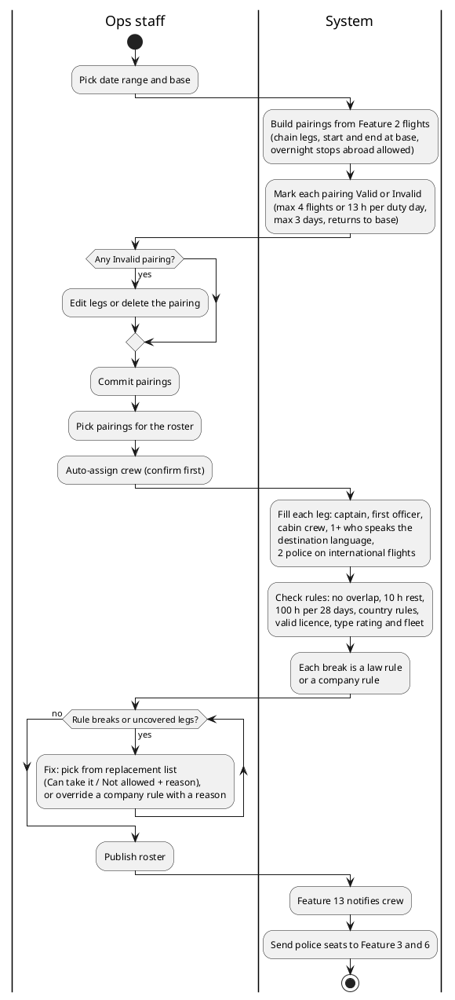
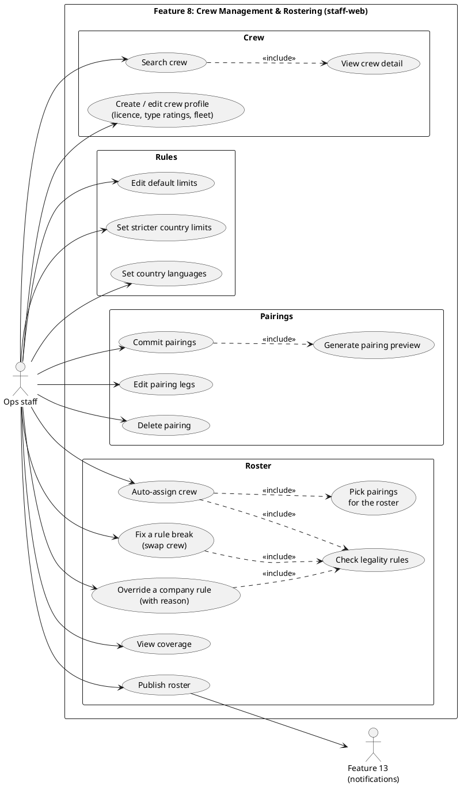

# Feature 8: Crew Management & Rostering (Iteration-02)

latest update: Nov 14, 2026

CSC290 Integrated Project · Group 1 · Choto, Xiang Xiang

Built from the Iteration-01 spec and Ajarn's feedback, and checked against the code on `feat-08-crew-rostering`. Where the spec and the code disagree, this doc says which one is current.

Live prototype: staff-web: Home, Crew, Pairings, Roster, Fix rule breaks (sample data)

Note: **What Ajarn said**

- Assign crew automatically instead of picking by hand.
- The same crew member can't be on two flights that overlap.
- Each flight needs at least 1 local crew member from the destination country.
- Check crew rules for each country, like rest hours, max duty and flight hours, and minimum rest before the next duty.
- Add police as crew. They fly like a normal passenger.
- Be careful with flight rules and laws.
- From Feature 5's feedback: crew overtime (OT) pay goes through Feature 5, working with Feature 8.

# Part A: Requirements

## 1. Purpose

Help Ops staff turn scheduled flights into crew pairings, assign crew to them automatically, and keep every roster legal: no overlapping flights, enough rest, local crew on every flight, and police on international flights.

## 2. Main Users

| User | App | What they do |
| --- | --- | --- |
| Ops staff | staff-web | Manage crew and rules, build pairings, run auto-assign, fix rule breaks, publish the roster |
| Crew | none this iteration | Get their roster through Feature 13 notifications; no crew login yet |
| Police officers | none | Stored as crew with role Police; they fly as normal passengers on the flight |

## 3. Main Functions

- **Crew profiles:** search, view, create and edit crew (captain, first officer, cabin crew, police), with personal and contact details, home base, fleet, the languages they speak, licence (number and expiry) and type ratings or certifications
- **Rules:** edit the default limits, add stricter limits per destination country, and set which languages count as local in each country
- **Pairing builder:** pick a date range and base; the system chains Feature 2 flights into pairings that start and end at base (overnight stops abroad allowed, up to 3 days), shows a preview, then saves it on commit
- **Edit or delete pairings:** add, remove or reorder legs; the pairing is checked again right away. A pairing can be deleted only if no published roster uses it
- **Auto-assign crew (Ajarn):** Ops picks which pairings to use and confirms, then the system fills every leg with the crew it needs
- **Legality check:** every assignment is checked against the rules in section 6; each break names the rule
- **Fix and swap:** on Fix & publish, Ops swaps in another crew member to fix a break or cover a sick call (the swap is checked too), or overrides a company rule with a reason. Each candidate shows Can take it or Not allowed, with the reason
- **Coverage:** see which legs are not fully crewed
- **Publish roster:** only when there are no open breaks (overridden ones count as closed); Feature 13 tells each crew member their duties
- **Audit:** staff actions are sent to the Feature 15 audit log

## 4. Main Flow

&#91;image: Feature 8 main flow (PlantUML)\]

A sick call starts at Fix & publish: Ops removes the crew member from the leg and the system suggests legal replacements.

## 5. Information Needed

Columns are in the SQL (Part B).

- **Crew:** name, employee number, role (captain / first officer / cabin crew / police), date of birth, email, phone, home base, fleet (aircraft type), languages they speak, licence number and expiry, type ratings or certifications with their expiry
- **Pairing:** code (such as P-101), base, legs. Leg order, duty days, duty hours and Valid / Invalid are worked out from the flights' current times, so a Feature 2 delay changes them; none of them is stored
- **Leg assignment:** which crew member is in which seat on which leg, assigned by auto or by Ops, when removed and why
- **Legality rules:** default limits, stricter rest and duty limits per destination country, each country's own local-crew number, and the languages spoken in each country
- **Roster run:** date range, base, the pairings chosen, draft or published
- **Rule breaks:** leg, crew member or empty seat, rule broken, detail, when fixed or overridden, who overrode it and why

## 6. Business Rules

Every number below is a default in `crew_setting`, editable on the Rules page.

| Area | Rule |
| --- | --- |
| Pairing | Starts and ends at the crew's home base; can stay overnight abroad, up to 3 days |
| Pairing | Max 4 flights and 13 h per duty period; otherwise Invalid with the reason shown. A duty starts 60 min before its first departure and ends at its last arrival |
| Crew per leg | 1 captain, 1 first officer, and 1 cabin crew per 50 seats in the aircraft layout, rounded up (until Feature 9 publishes the count per type) |
| Local crew | At least 1 cabin crew member who speaks a language of the destination country (Ajarn). A country can ask for more |
| Police | International flights need 2 police officers (air marshals). They fly as normal passengers in an aisle seat near the front of Economy with no extra fee (Business only if Economy is full) and board first (Ajarn) |
| Licence and fleet | A crew member with an expired licence can't be assigned. Pilots need a valid type rating for the flight's aircraft type. Crew are assigned only to flights on their fleet's aircraft type. A licence or rating shows as Expiring soon from 30 days before it expires |
| Rest and hours | Min 10 h rest between duty periods, including overnight stops abroad; max 100 flight hours per 28 days |
| Overlap | A crew member can never be on two flights that overlap in time (Ajarn) |
| Country rules | A destination country can set stricter rest or duty limits; the strictest rule wins, and a looser value is refused on save (Ajarn) |
| Breaks | Every break names the rule that failed. Law rules (overlap, rest, duty limits, 28-day hours, legal crew per leg, licence, type rating, fleet) can never be overridden. Company rules (local crew, police) can be overridden by Ops with a reason, sent to the Feature 15 audit log |
| Publish | Roster can be published only with at least one pairing and no open breaks; changes after publishing are re-checked and re-sent |
| Time | All times use the Feature 1 simulation clock |
| Out of scope | Crew login, standby pool, leave and swap requests |

## 7. Data from Other Features

| Feature | We need |
| --- | --- |
| 1 Platform Core | Login, roles, simulation clock |
| 2 Flight Scheduling | Flights: number, route, times, aircraft, date; delay, reschedule, aircraft change and cancel events (shared event bus) |
| 3 Booking & Seats | A seat for each police officer (aisle, near the front, no extra fee) |
| 9 Aircraft | Aircraft type and how many cabin crew it needs; the list of aircraft types (for fleet and type ratings) |
| 15 Admin Console | Audit service, screen registration for Role access |

## 8. Data Provided to Other Features

| Feature | We send |
| --- | --- |
| 2 Flight Scheduling | Crew assigned to each flight, coverage status, how many pairings a flight change affects (for their impact preview) |
| 5 Payment | Duty hours, so overtime pay can be worked out (Ajarn) |
| 6 Check-in & Boarding | Police officers on each flight, so they board first, before other passengers |
| 13 Notifications | Roster published or changed (to crew) |
| 14 BI | Crew assignments and coverage |
| 15 Admin Console | Audit entry for staff actions; Feature 8's three screens |

## 9. Edge Cases

Pairing codes show on the pairing card as its Invalid reason. Rule codes are stored on `rule_break.rule`. Request errors come back as `{ error: { code, message, details? } }`, such as `{ "error": { "code": "ROSTER_HAS_BREAKS", "message": "close 2 open breaks to publish" } }`. Errors without a code above get one from the status: `VALIDATION_ERROR` (400), `UNAUTHORIZED`, `FORBIDDEN`, `NOT_FOUND`, `CONFLICT`.

| Case | What happens | Error code |
| --- | --- | --- |
| Pairing does not return to base | Marked Invalid, cannot be committed | `PAIRING_NOT_CLOSED` |
| A leg leaves from somewhere the last one didn't land | Marked Invalid | `SEQUENCE_BROKEN` |
| Duty day over 13 h, or over 4 flights | Marked Invalid, reason shown | `DUTY_DAY_EXCEEDED`, `FLIGHTS_PER_DAY_EXCEEDED` |
| Pairing over 3 days | Marked Invalid | `PAIRING_TOO_LONG` |
| Pairing with no legs left | Marked Invalid | `PAIRING_EMPTY` |
| Commit with no valid pairing chosen | Blocked | `NO_PAIRINGS` |
| No legal crew left for a seat | Leg stays uncovered, shows as an open item | `NO_LEGAL_CREW` |
| No cabin crew who speaks the destination language | Rule break; Ops fixes it or overrides with a reason | `NO_LOCAL_CREW` |
| Fewer than 2 police on an international flight | Rule break; Ops fixes it or overrides with a reason | `POLICE_MIN` |
| No seat left for police | Rule break until Feature 3 gives a seat | `POLICE_NO_SEAT` |
| Same crew on overlapping flights | Rule break | `OVERLAP` |
| Less than 10 h rest, or over 100 h in 28 days | Rule break | `REST_SHORT`, `HOURS_28D` |
| Duty over the limit after a delay | Rule break | `DUTY_LIMIT` |
| Licence expired, or pilot has no valid type rating for the aircraft | Can't be assigned; shows as Not allowed in the replacement list | `LICENCE_EXPIRED`, `NO_TYPE_RATING` |
| Crew member's fleet is not the flight's aircraft type (such as after an aircraft change) | Rule break | `WRONG_FLEET` |
| Sick call after publishing | Removed from the leg; the seat shows as an open item with legal replacements | |
| Flight delayed or cancelled (Feature 2 event) | Affected legs re-checked; new breaks show on Fix & publish | |
| Publish with open breaks | Blocked | `ROSTER_HAS_BREAKS` |
| Publish a run with no pairings | Blocked | `ROSTER_EMPTY` |
| Ops tries to override a law rule | Blocked (400, "is a law rule and cannot be overridden") | `LAW_RULE_NOT_OVERRIDABLE` |
| Override or sick call sent with no reason | Blocked (400, "reason is required") | |
| Delete a pairing used by a published roster | Blocked | `PAIRING_IN_USE` |

## 10. Open Questions

Labels follow the build order (wave 1: F1 · wave 2: F2, 4, 7, 8, 9, 12, 15 · wave 3: F3a, 3b, 6, 10, 11, 13, 17 · wave 4: F5a, 5b, 14, 16). Feature 8 is wave 2, so most of these are ours to decide.

**We decide (later groups follow us)**

- [ ] Overtime: we provide duty hours; Feature 5 (wave 4) works out the pay from them
- [ ] Real values for country rules (we start with the defaults for every country)

**Same wave, agree together**

- [ ] Feature 9: cabin crew count per aircraft type (we use 1 per 50 seats until then), and the aircraft type list for fleet and type ratings

**Not built yet (follow-up branches)**

- [ ] A country's own local-crew number can't be saved: the code stores it as a `crew_setting` row named `min_local_crew.<country>`, but `crew_setting.key` only allows the fixed key list. Needs a Database Team change (a `min_local_crew` column on `country_legality_rule` fits best)
- [ ] Audit: swaps, overrides, sick calls and publish write audit entries through `AuditService`. Crew edits, rule edits and pairing commits, edits and deletes write none yet
- [ ] The roster's own times (`assigned_at`, `resolved_at`, `published_at`) use the server clock, not the simulation clock
- [ ] Feature 13 notifications, police seats from Feature 3 and the Feature 2 flight-change events are not wired yet

**Decided:** overnight stops abroad allowed (up to 3 days); local crew = cabin crew who speak a language of the destination country; company rules (local crew, police) can be overridden with a reason, law rules can't; police (air marshals) fly only on international flights, 2 per flight, in an aisle seat near the front with no extra fee; licences, type ratings and fleet are in scope (from the Figma); Expiring soon starts 30 days before expiry; a pilot's fleet must match the aircraft (`WRONG_FLEET`).

**Cut from the Iteration-01 spec and still cut (Ajarn did not ask for them):** crew self-service login, standby pool, leave and swap requests.

# Part B: Technical

Same stack and conventions as the rest of Flython: NestJS, Postgres, Clerk for sign-in, singular table names, PUT for updates, errors as `{ error: { code, message, details? } }`.

## Use Case Diagram

&#91;image: Feature 8 use case diagram (PlantUML)\]

## API Routes

All routes are under `/api/crew-rostering`, grouped by the staff-web page that calls them. Every route needs a staff sign-in (`StaffOnlyGuard`), so there is no guard column.

| Route | Method | Purpose |
| --- | --- | --- |
| `/setup-crew/bases` | GET | Base airports for the crew form |
| `/setup-crew/fleets` | GET | Aircraft types for fleet and type ratings |
| `/setup-crew/languages` | GET | Language list |
| `/setup-crew/crew` | GET | List and search crew |
| `/setup-crew/crew/suggest-employee-no` | GET | Next free employee number |
| `/setup-crew/crew/:crewId` | GET | Crew detail with licence and certifications |
| `/setup-crew/crew` | POST | Create a crew profile |
| `/setup-crew/crew/:crewId` | PUT | Edit a crew profile |
| `/setup-crew/crew/:crewId/certifications` | POST | Add a type rating or certification |
| `/setup-crew/crew/:crewId/certifications/:certificationId` | PUT, DELETE | Edit or remove a certification |
| `/setup-rule` | GET | The whole rule set for the page |
| `/setup-rule/defaults` | GET, PUT | Default limits |
| `/setup-rule/company-rules` | GET | Company rules (local crew, police) |
| `/setup-rule/countries`, `/setup-rule/languages` | GET | Country and language lists |
| `/setup-rule/country-limits` | GET, POST | List and add stricter country limits |
| `/setup-rule/country-limits/:countryCode` | PUT, DELETE | Edit or remove a country limit |
| `/setup-rule/country-languages` | GET | Languages spoken in each country |
| `/setup-rule/country-languages/:countryCode` | PUT, DELETE | Set or remove a country's languages |
| `/build-pairing/bases` | GET | Bases with flights |
| `/build-pairing/pairings` | GET | Pairings for a date range and base, with Valid / Invalid |
| `/build-pairing/pairings/generate` | POST | Build a preview over a date range and base; nothing is saved |
| `/build-pairing/pairings/commit` | POST | Save the chosen pairings into the run for that base and dates |
| `/build-pairing/pairings/:pairingId/legs` | PUT | Add, remove or reorder legs (re-checked) |
| `/build-pairing/pairings/:pairingId` | DELETE | Delete a pairing (`PAIRING_IN_USE` if a published roster uses it) |
| `/build-pairing/flights/:flightId/impact` | GET | Pairings and crew a flight change affects (for Feature 2's impact preview) |
| `/assign-crew/bases` | GET | Bases with committed pairings |
| `/assign-crew/pairings` | GET | Committed pairings for a run |
| `/assign-crew/runs/:rosterRunId` | GET | Assignments, coverage and rule breaks |
| `/assign-crew/runs/:rosterRunId/auto-assign` | POST | Auto-assign crew to the chosen pairings |
| `/fix-publish/state` | GET | Breaks, candidates and roster for a run |
| `/fix-publish/runs/:rosterRunId/check` | POST | Re-check the run |
| `/fix-publish/breaks/:breakId/swap` | POST | Swap in a crew member (checked first) |
| `/fix-publish/breaks/:breakId/override` | POST | Override a company-rule break with a reason (law rules refused) |
| `/fix-publish/runs/:rosterRunId/sick-calls` | POST | Take a crew member off a leg with a reason |
| `/fix-publish/runs/:rosterRunId/publish` | POST | Publish; blocked if any break is open |

Feature 8 registers three screens with the admin console at startup (`f08.roster_runs`, `f08.crew`, `f08.rules`), so Role access can grant them. Audit entries are written with Feature 15's `AuditService` inside the same transaction as the change.

## SQL Schema

The current schema, from Part 8 of `apps/backend/src/db/schema.sql`. The Database Team owns it. `airport` and `flight` belong to Feature 2, `staff` to Feature 1.

```sql
-- Settings and rules ------------------------------------------------------------------------------------

-- Default limits for every country. Feature 8 keeps its own settings, like features 2, 4, 9 and 12.
-- Values are validated by the backend. Cabin crew per leg = ceil(seats in the aircraft layout / seats_per_cabin_crew),
-- a duty starts report_minutes before its first departure and ends release_minutes after its last arrival, and a
-- licence or certification shows as expiring soon from expiry_warning_days before it expires.
CREATE TABLE crew_setting (
  key        TEXT PRIMARY KEY CHECK (key IN (
               'min_rest_hours', 'max_duty_hours', 'max_flights_per_duty', 'max_pairing_days', 'max_flight_hours_28d',
               'min_local_crew', 'min_police_international', 'seats_per_cabin_crew', 'report_minutes', 'release_minutes',
               'expiry_warning_days')),
  value      TEXT NOT NULL,
  updated_at TIMESTAMPTZ NOT NULL DEFAULT now(),
  updated_by UUID REFERENCES staff (id)
);

INSERT INTO crew_setting (key, value) VALUES
  ('min_rest_hours', '10'),
  ('max_duty_hours', '13'),
  ('max_flights_per_duty', '4'),
  ('max_pairing_days', '3'),
  ('max_flight_hours_28d', '100'),
  ('min_local_crew', '1'),
  ('min_police_international', '2'),
  ('seats_per_cabin_crew', '50'),
  ('report_minutes', '60'),
  ('release_minutes', '0'),
  ('expiry_warning_days', '30');

-- A destination with stricter rest or duty limits. The backend refuses a looser value on save and, when checking,
-- applies the stricter of this row and the default (more rest, less duty), so a row can never loosen a limit,
-- even after the default changes.
CREATE TABLE country_legality_rule (
  country_code   TEXT PRIMARY KEY CHECK (country_code ~ '^[a-z]{2}$'),
  min_rest_hours NUMERIC(4, 1) NOT NULL CHECK (min_rest_hours > 0),
  max_duty_hours NUMERIC(4, 1) NOT NULL CHECK (max_duty_hours > 0),
  updated_at     TIMESTAMPTZ NOT NULL DEFAULT now(),
  updated_by     UUID REFERENCES staff (id)
);

-- Languages that count as local in each destination country (edited by Ops; example rows belong in the seed).
CREATE TABLE country_language (
  country_code  TEXT NOT NULL CHECK (country_code ~ '^[a-z]{2}$'),
  language_code TEXT NOT NULL CHECK (language_code ~ '^[a-z]{2}$'),
  PRIMARY KEY (country_code, language_code)
);

-- Crew --------------------------------------------------------------------------------------------------

-- Operational crew. staff_id links a crew member to a staff sign-in only when one is needed; there is no crew login in
-- Iteration-02, so it starts empty. Soft delete only.
-- languages stays an array: the local-crew rule and the "crew who speak it" count query it with languages && '{ja,en}'
-- (Prisma hasSome), which the GIN index serves.
-- fleet_aircraft_type and crew_certification.aircraft_type hold feature 9's aircraft_type.model (A320), which every layout
-- version of the type shares, not aircraft_type.code (A320-V2). The backend validates them against active types.
-- A crew member's current location is derived: the arrival airport of their last flown leg, else base_airport.
CREATE TABLE crew (
  id                  UUID PRIMARY KEY DEFAULT gen_random_uuid(),
  staff_id            UUID UNIQUE REFERENCES staff (id),   -- one crew row per sign-in, also after a soft delete
  first_name          TEXT NOT NULL,
  last_name           TEXT NOT NULL,
  employee_number     TEXT NOT NULL,
  role                TEXT NOT NULL CHECK (role IN ('captain', 'first_officer', 'cabin_crew', 'police')),
  date_of_birth       DATE,
  email               TEXT,
  phone               TEXT,
  base_airport        TEXT NOT NULL,                      -- feature 2's airport (cross-module FK)
  fleet_aircraft_type TEXT NOT NULL,
  languages           TEXT[] NOT NULL DEFAULT '{}'        -- ISO 639-1, such as {th,en,ja}
                        CHECK (array_to_string(languages, ',', '?') ~ '^([a-z]{2}(,[a-z]{2})*)?$'),
  licence_number      TEXT NOT NULL,
  licence_expires_on  DATE NOT NULL,
  created_at          TIMESTAMPTZ NOT NULL DEFAULT now(),
  updated_at          TIMESTAMPTZ NOT NULL DEFAULT now(),
  deleted_at          TIMESTAMPTZ
);

CREATE UNIQUE INDEX crew_employee_number_uq ON crew (employee_number) WHERE deleted_at IS NULL;
CREATE UNIQUE INDEX crew_licence_number_uq ON crew (licence_number) WHERE deleted_at IS NULL;
CREATE INDEX crew_base_role_idx ON crew (base_airport, role) WHERE deleted_at IS NULL;
CREATE INDEX crew_languages_idx ON crew USING gin (languages) WHERE deleted_at IS NULL;

-- Type ratings (aircraft_type set) and other certifications such as CRM (aircraft_type NULL). Renewing one updates
-- expires_on; the audit log keeps the old value.
CREATE TABLE crew_certification (
  id            UUID PRIMARY KEY DEFAULT gen_random_uuid(),
  crew_id       UUID NOT NULL REFERENCES crew (id),
  name          TEXT NOT NULL,
  aircraft_type TEXT,
  expires_on    DATE NOT NULL
);

CREATE UNIQUE INDEX crew_certification_uq ON crew_certification (crew_id, name, aircraft_type) NULLS NOT DISTINCT;

-- Pairings ----------------------------------------------------------------------------------------------

CREATE SEQUENCE pairing_code_seq;

-- A chain of feature 2 flights that starts and ends at base_airport. Leg order, duty days, duty hours, day count and
-- validity are derived from the flights' current times (a delay changes them), so none of them is stored.
-- A pairing that is not in a roster run is a draft: it may be invalid while Ops edits it, and deleting it is a hard
-- delete (its legs go with it). roster_run_pairing refuses to delete a pairing that is in a run (23503). In a draft run
-- the backend first takes the pairing out (its rule breaks, assignments and run link); in a published run the crew
-- history keeps it in, and the backend answers PAIRING_IN_USE.
CREATE TABLE pairing (
  id           UUID PRIMARY KEY DEFAULT gen_random_uuid(),
  code         TEXT NOT NULL UNIQUE DEFAULT 'P-' || nextval('pairing_code_seq'), -- what Ops sees, such as P-101
  base_airport TEXT NOT NULL,                                                      -- feature 2's airport (cross-module FK)
  created_at   TIMESTAMPTZ NOT NULL DEFAULT now(),
  updated_at   TIMESTAMPTZ NOT NULL DEFAULT now()
);

CREATE INDEX pairing_base_idx ON pairing (base_airport);

-- A flight is in one pairing at most. added_by 'ops' marks a leg added by hand, which a regenerate keeps.
CREATE TABLE pairing_leg (
  id         UUID PRIMARY KEY DEFAULT gen_random_uuid(),
  pairing_id UUID NOT NULL REFERENCES pairing (id) ON DELETE CASCADE,
  flight_id  UUID NOT NULL UNIQUE,                         -- feature 2's flight (cross-module FK)
  added_by   TEXT NOT NULL DEFAULT 'auto' CHECK (added_by IN ('auto', 'ops')),
  created_at TIMESTAMPTZ NOT NULL DEFAULT now(),
  UNIQUE (id, pairing_id)
);

CREATE INDEX pairing_leg_pairing_idx ON pairing_leg (pairing_id);

-- Roster runs -------------------------------------------------------------------------------------------

-- One run per base and date range, drafted then published once. After publishing, changes (swaps, sick calls,
-- feature 2 flight changes) are made in place and each one notifies the crew it affects (feature 13).
-- A draft run may be discarded: the backend deletes its rule breaks, assignments and roster_run_pairing rows, then the
-- run, in one transaction (there are no cascades). A published run is never deleted.
CREATE TABLE roster_run (
  id           UUID PRIMARY KEY DEFAULT gen_random_uuid(),
  base_airport TEXT NOT NULL,                              -- feature 2's airport (cross-module FK)
  date_from    DATE NOT NULL,
  date_to      DATE NOT NULL,
  status       TEXT NOT NULL DEFAULT 'draft' CHECK (status IN ('draft', 'published')),
  published_at TIMESTAMPTZ,                                -- simulation clock
  created_at   TIMESTAMPTZ NOT NULL DEFAULT now(),
  updated_at   TIMESTAMPTZ NOT NULL DEFAULT now(),
  CHECK (date_to >= date_from),
  CHECK ((status = 'published') = (published_at IS NOT NULL))
);

CREATE INDEX roster_run_base_idx ON roster_run (base_airport, date_from DESC);

-- The pairings Ops committed to a run. A pairing joins one run at most, so its crew and its rule breaks belong to that
-- run. The backend adds only valid pairings with the run's base and dates.
CREATE TABLE roster_run_pairing (
  roster_run_id UUID NOT NULL REFERENCES roster_run (id),
  pairing_id    UUID NOT NULL UNIQUE REFERENCES pairing (id),
  PRIMARY KEY (roster_run_id, pairing_id)
);

-- One row per person on a leg; active = unassigned_at IS NULL. The pairing_id foreign key means crew can only be put on
-- a pairing that is in a run, and only on that pairing's legs. On a published run rows are never deleted: a swap or a
-- sick call sets unassigned_at and reason, and the replacement is a new row. A draft run's rows may be deleted.
-- role is the seat, copied from crew.role when assigned (the backend checks they match), so a later promotion does not
-- rewrite history. Overlap with the person's other flights, rest and the 28-day hours are checked by the backend while
-- holding a lock on the crew row (SELECT ... FOR UPDATE), so two concurrent assignments cannot both pass.
CREATE TABLE pairing_leg_assignment (
  id             UUID PRIMARY KEY DEFAULT gen_random_uuid(),
  pairing_id     UUID NOT NULL REFERENCES roster_run_pairing (pairing_id),
  pairing_leg_id UUID NOT NULL,
  crew_id        UUID NOT NULL REFERENCES crew (id),
  role           TEXT NOT NULL CHECK (role IN ('captain', 'first_officer', 'cabin_crew', 'police')),
  assigned_by    TEXT NOT NULL CHECK (assigned_by IN ('auto', 'ops')),
  assigned_at    TIMESTAMPTZ NOT NULL,                     -- simulation clock
  unassigned_at  TIMESTAMPTZ,                              -- simulation clock
  reason         TEXT,                                     -- why the person came off, such as 'sick call'
  created_at     TIMESTAMPTZ NOT NULL DEFAULT now(),
  FOREIGN KEY (pairing_leg_id, pairing_id) REFERENCES pairing_leg (id, pairing_id),
  CHECK (unassigned_at IS NULL OR reason IS NOT NULL)
);

CREATE UNIQUE INDEX pairing_leg_assignment_active_uq ON pairing_leg_assignment (pairing_leg_id, crew_id) WHERE unassigned_at IS NULL;
CREATE UNIQUE INDEX pairing_leg_assignment_pilot_uq ON pairing_leg_assignment (pairing_leg_id, role)
  WHERE unassigned_at IS NULL AND role IN ('captain', 'first_officer');
CREATE INDEX pairing_leg_assignment_leg_idx ON pairing_leg_assignment (pairing_leg_id);
CREATE INDEX pairing_leg_assignment_pairing_idx ON pairing_leg_assignment (pairing_id);
CREATE INDEX pairing_leg_assignment_crew_idx ON pairing_leg_assignment (crew_id) WHERE unassigned_at IS NULL;

-- Rule breaks -------------------------------------------------------------------------------------------

-- Law rules, never overridden: OVERLAP, REST_SHORT, HOURS_28D, DUTY_LIMIT, NO_LEGAL_CREW, LICENCE_EXPIRED,
-- NO_TYPE_RATING, WRONG_FLEET. Company rules, closed in writing with a reason: NO_LOCAL_CREW, POLICE_MIN, POLICE_NO_SEAT.
-- DUTY_LIMIT covers the flight and hour limits of a duty (detail says which). WRONG_FLEET is a person whose fleet type
-- is not the flight's aircraft type, such as after a feature 2 aircraft change.
-- crew_id names the person for person rules; role names the empty seat for NO_LEGAL_CREW (also after a sick call).
-- A re-check inserts with ON CONFLICT DO NOTHING (rule_break_open_uq) and closes the open breaks it no longer finds as
-- 'fixed'. On a published run a break is never deleted. The override actor and reason also go to the audit log.
CREATE TABLE rule_break (
  id              UUID PRIMARY KEY DEFAULT gen_random_uuid(),
  roster_run_id   UUID NOT NULL,
  pairing_id      UUID NOT NULL,
  pairing_leg_id  UUID NOT NULL,
  crew_id         UUID REFERENCES crew (id),
  role            TEXT CHECK (role IN ('captain', 'first_officer', 'cabin_crew', 'police')),
  rule            TEXT NOT NULL CHECK (rule IN (
                    'OVERLAP', 'REST_SHORT', 'HOURS_28D', 'DUTY_LIMIT', 'NO_LEGAL_CREW', 'LICENCE_EXPIRED',
                    'NO_TYPE_RATING', 'WRONG_FLEET', 'NO_LOCAL_CREW', 'POLICE_MIN', 'POLICE_NO_SEAT')),
  detail          TEXT NOT NULL,
  created_at      TIMESTAMPTZ NOT NULL DEFAULT now(),
  resolved_at     TIMESTAMPTZ,                             -- simulation clock
  resolution      TEXT CHECK (resolution IN ('fixed', 'overridden')),
  overridden_by   UUID REFERENCES staff (id),
  override_reason TEXT,
  FOREIGN KEY (roster_run_id, pairing_id) REFERENCES roster_run_pairing (roster_run_id, pairing_id),
  FOREIGN KEY (pairing_leg_id, pairing_id) REFERENCES pairing_leg (id, pairing_id),
  CHECK ((rule = 'NO_LEGAL_CREW') = (role IS NOT NULL)),
  CHECK ((resolution IS NULL) = (resolved_at IS NULL)),
  -- NULL-safe: an open break can carry neither a reason nor an actor.
  CHECK ((resolution IS NOT DISTINCT FROM 'overridden') = (override_reason IS NOT NULL)),
  CHECK ((resolution IS NOT DISTINCT FROM 'overridden') = (overridden_by IS NOT NULL)),
  CHECK (resolution IS DISTINCT FROM 'overridden' OR rule IN ('NO_LOCAL_CREW', 'POLICE_MIN', 'POLICE_NO_SEAT'))
);

CREATE UNIQUE INDEX rule_break_open_uq ON rule_break (pairing_leg_id, rule, crew_id, role) NULLS NOT DISTINCT
  WHERE resolved_at IS NULL;
CREATE INDEX rule_break_run_idx ON rule_break (roster_run_id, pairing_id);
CREATE INDEX rule_break_run_open_idx ON rule_break (roster_run_id) WHERE resolved_at IS NULL;
```

## Frontend Pages

All pages are in staff-web, inside the shared staff sidebar under **Crew & Rostering**.

| Page | Route | Who | What it shows |
| --- | --- | --- | --- |
| Crew | `/setup-crew` | Ops staff | Crew list with search, filters and summary cards; create crew |
| Crew profile | `/setup-crew/:crewId` | Ops staff | Profile, licence and certifications; edit |
| Rules | `/setup-rule` | Ops staff | Legality limits (defaults, company rules, stricter country limits) and country languages |
| Build pairings | `/build-pairings` | Ops staff | Step 1: generate, check, edit and commit pairings |
| Assign crew | `/assign-crew` | Ops staff | Step 2: pick pairings and auto-assign; results and rule breaks |
| Fix & publish | `/fix-publish` | Ops staff | Step 3: fix breaks, sick calls, overrides, publish |

The three wizard pages carry the date range and base in the URL (`?dateFrom=&dateTo=&base=`), so moving between steps keeps the same run.

## UI Mockups

The mockup is only there to help people picture the pages. It doesn't show every function, and it may show things that aren't part of the feature.

- staff-web: Home, Crew, Pairings, Roster, Fix rule breaks

## Diagram Sources (PlantUML)




